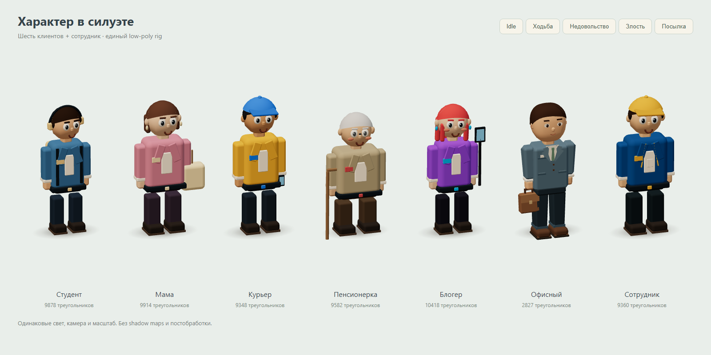
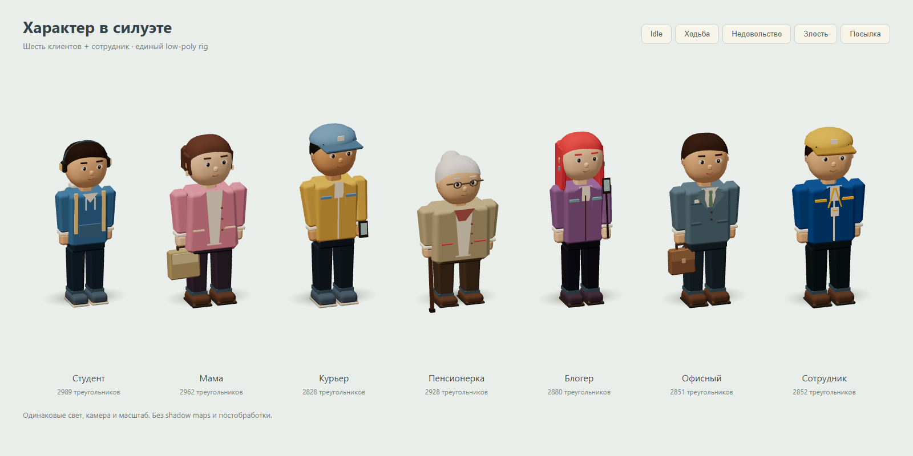
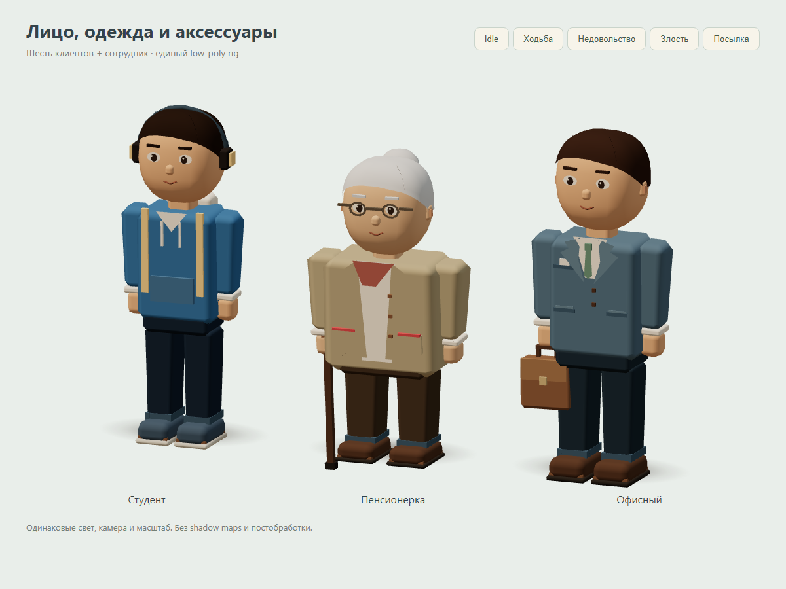
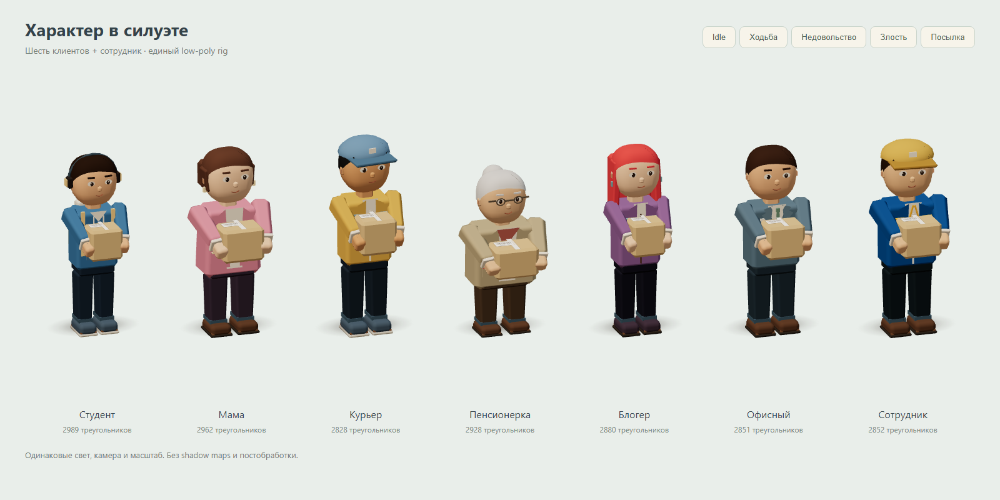
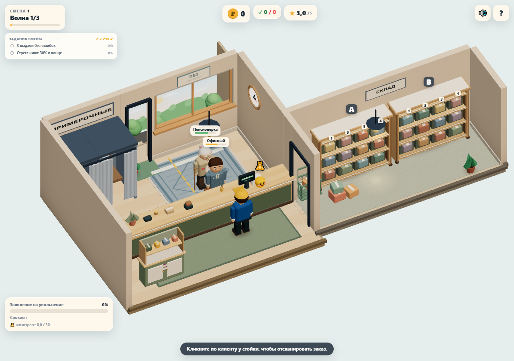
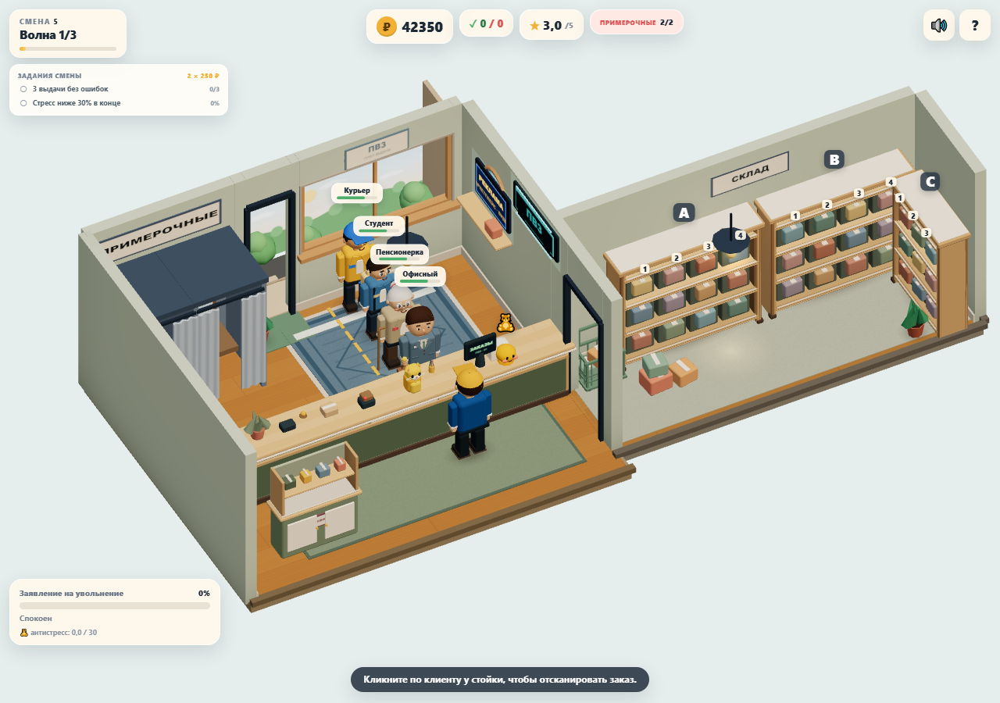
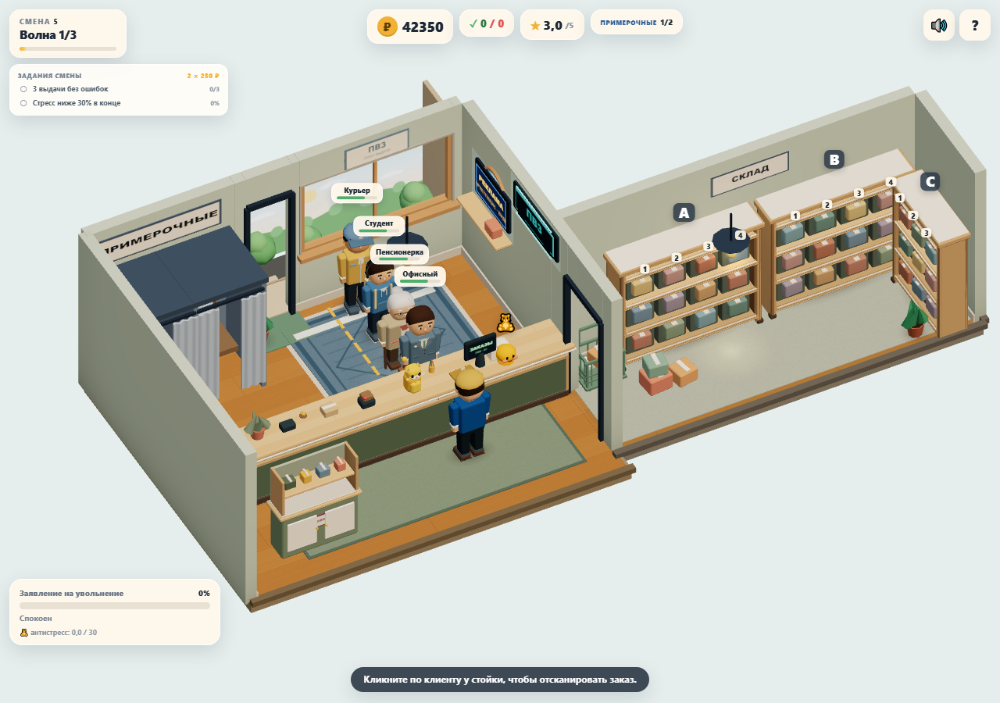

# Visual pass персонажей

Задание владельца: распространить одобренный office prototype на шесть обычных архетипов и игрока. Ветка `sol/character-visual-pass` создана от `sol/office-character-prototype` (`de74cbe`). PR — stacked, base `sol/cozy-visual-reference`; после merge PR #5 Lead меняет base на `main`. Самостоятельного merge нет. Отдельный issue для этого художественного задания не назначен.

## Образы

Общие улучшения: мягкая низкополигональная голова, выразительные глаза с бликом, кисти с большими пальцами, суженные рукава, фаски одежды/обуви, более спокойная мимика. Детали объединены в vertex-color batches по подвижным частям.

| Архетип | Изменения | Все треугольники, включая скрытые меши |
|---|---|---:|
| student | Узкий силуэт, худи с карманом и шнурками, наушники, охристый рюкзак с лямками, светлая подошва | 2 989 |
| mom | Более широкий длинный кардиган, боб, серьги, кремовый топ, тканевый шоппер | 2 962 |
| courier | Подтянутые пропорции, куртка с молнией/карманами, округлая голубая кепка, телефон, рабочие кроссовки | 2 828 |
| elderly | Низкий округлый силуэт, кардиган и платок у горла, седой пучок, очки без прозрачных линз, трость | 2 928 |
| blogger | Узкий сливовый жакет, длинные красные волосы, серьги, селфи-палка, тёмная обувь | 2 880 |
| office | Сохранён согласованный костюм, пробор, галстук и портфель; добавлены большие пальцы, общая мимика и более точный хват | 2 851 |
| player | Синяя форма, округлая жёлтая кепка, нагрудные карманы и бейдж на шнурке; общие лицо, кисти и движения | 2 852 |

Ходьба различается частотой и амплитудой: у пенсионерки более короткий шаг и лёгкий наклон. Idle включает дыхание, взгляд и небольшой жест свободной рукой. Моргание плавно закрывает глаза; недовольство меняет брови/рот и добавляет постукивание ногой. При переносе кисти охватывают боковины посылки, ручные аксессуары скрываются и затем возвращаются. Рюкзак остаётся на спине.

### Одинаковая линейка до / после

[Ходьба](screenshots/characters/walking.png) · [Недовольство](screenshots/characters/impatient.png)

## Границы и ресурсы

- `PersonRig` и его контракт сохранены. `characterRig.ts` содержит общий view-rig и профили; `officeCharacter.ts` — совместимая фабрика office. `characters.ts` направляет в него только сотрудника по существующему набору `cap + lanyard`. В `client.ts` изменён только выбор фабрики по id обычного архетипа.
- Специальные персонажи остаются в прежней фабрике: Галя, баба Зина, Саня, королева примерок и Валера. Их геометрия, силуэты и анимации не переписаны. [Контрольный кадр](screenshots/characters/bosses.png).
- Новых текстур/ассетов, shadow maps, SSAO, bloom и постобработки нет. Используются прежние общие decal/contact-shadow и материалы `mat()` / `VERTEX_COLOR_MATERIAL`.
- Статическая геометрия и три пары бровей для эмоций кэшируются. В `update` геометрия не создаётся: меняется ссылка на готовую пару бровей.
- Выходы instance-batching и единственный индивидуальный материал цвета посылки перечислены в `body.userData.personResources = { geometries, materials }`. Общие кэши туда не включены; временные исходники деформации/панелей освобождаются после объединения. Реальный `PersonRig.dispose()` и жизненный цикл удаления клиентов остаются задачей #4. Реестр находится на body, поскольку Client заменяет root.userData.
- Механика, экономика, заказы, камеры, управление, UI и расположение объектов не менялись. Разные boss-миниигры полностью не проходились; выполнен view-smoke их существующих rig в idle/walk/impatient/carry.

## Производительность

Та же методика PR #5: Chromium 158.0.8127.18, 1280×900 / DPR 1, seed 73129, 2 секунды прогрева и 5 секунд RAF-интервалов. Два клиента: office/elderly; четыре со всем оформлением: office/elderly/student/courier. Обслуживание приостановлено, анимации мира работают. Браузерные тесты и perf не запускались одновременно.

`npm run perf -- --label characters-after --check-budget`

До: отдельный worktree на `de74cbe`; после: рабочее дерево этой ветки перед коммитом (поле revision в raw JSON указывает её исходный HEAD). [Raw до](perf/characters/before.json), [raw после](perf/characters/after.json).

| Сцена | Вариант | avg / p95 / max frame time, мс | Draw calls | Triangles | Textures | Programs |
|---|---|---:|---:|---:|---:|---:|
| 2 клиента | До | 143.05 / 183.30 / 183.40 | 125 | 72 665 | 16 | 10 |
| 2 клиента | После | 138.28 / 150.10 / 150.10 | 122 | 60 615 | 16 | 9 |
| 4 + оформление | До | 164.51 / 183.30 / 250.00 | 177 | 107 801 | 19 | 10 |
| 4 + оформление | После | 154.04 / 166.70 / 200.00 | 173 | 83 430 | 19 | 9 |

Два клиента ниже метрик PR #5 (124 calls / ~78 908 triangles). Пик четырёх клиентов ниже 180 calls / 150k triangles. Стоимость refresh shadow map — 0 мс: карты отключены до и после. Это контрольные сцены, а не измерение всех возможных комбинаций боссов.

Измеритель работает через **SwiftShader**, программный GPU. Разница RAF-интервалов шумная и не подтверждает FPS на мобильном устройстве; выигрыш по треугольникам не равен пропорциональному выигрышу FPS. Физический мобильный GPU ещё нужно проверить.

### Одинаковые игровые кадры

## Проверки и повторение

- `npm run build` — успешно. Прежнее предупреждение о размере bundle остаётся.
- `npm test` — 41/41.
- `npm run test:e2e` — 3/3: основной игровой цикл, office geometry и все семь новых образов.
- `npm run perf -- --label characters-after --check-budget` — успешно.
- Все семь rig проверены в idle, walking, impatient, angry, carry и возврате к idle; полный интервал моргания, допустимые трансформации, лимит 3000 треугольников, ≤14 вызовов на отдельную модель во всех проверенных позах, реестр уникальных ресурсов и повторное использование двух дополнительных состояний бровей.
- `console.error` / `pageerror` отсутствуют в e2e, perf и отдельном smoke специальных персонажей. Прежнее предупреждение `THREE.Clock` остаётся.
- Линейка доступна на `/tests/visual/character-lineup.html` после запуска Vite; кнопки переключают позы. Это отдельный тестовый стенд, игровой UI не меняется.

Вне задачи: исправление утечек/лагов (#4), game over (#3), архитектурные срезы, переделка уникальных боссов, новые эффекты и полное мобильное профилирование. К этим задачам не переходили. Для отката — revert коммита visual pass, база PR #5 и office prototype сохраняются. Готово к ревью OpenCode Lead, merge не выполнялся.
