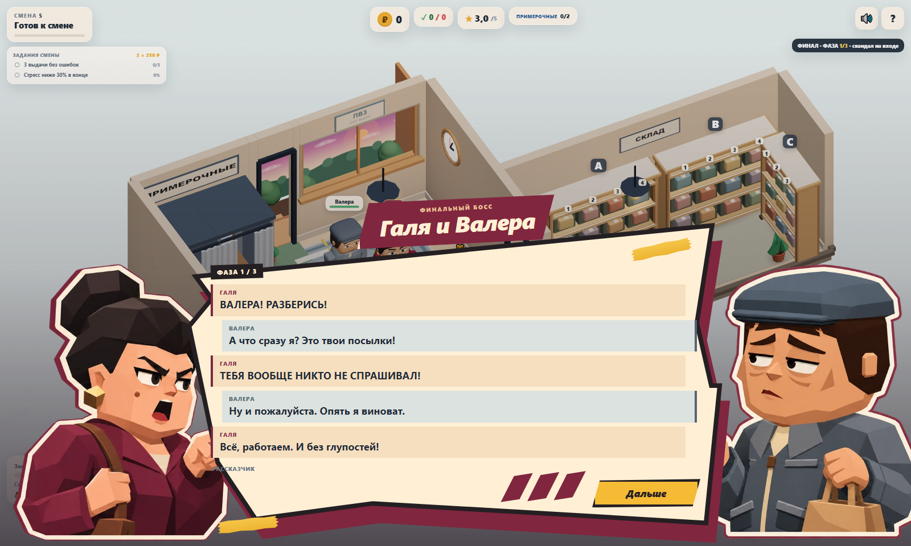
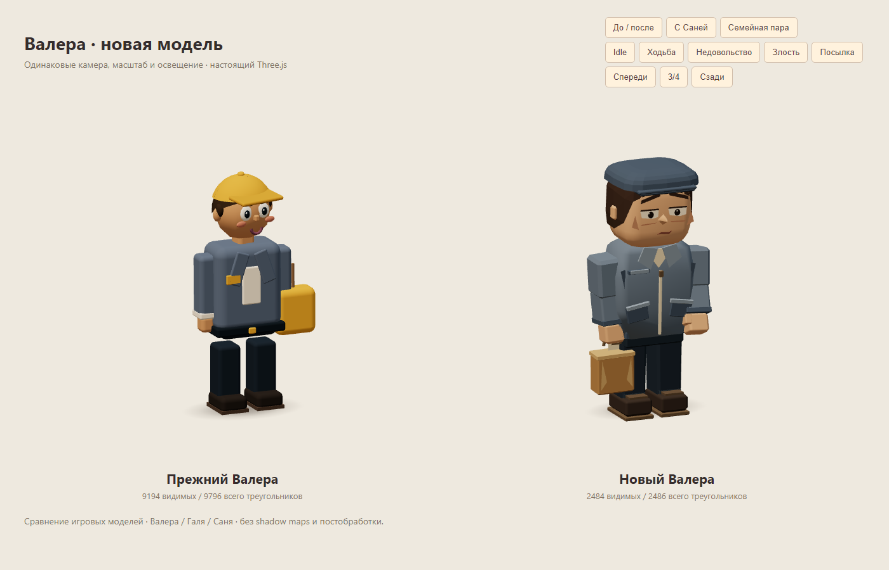

# Финальный босс: парная сценка и Валера

Задание владельца: оформить диалоги финального босса и улучшить модель. Ветка `sol/final-boss-visual-pass`, отдельный worktree от main `c221f93` после PR #30. Отдельный issue не назначен. Результат передаётся на ревью OpenCode Lead; самостоятельного merge нет.



[Фаза 2](screenshots/final-boss/phase-2-desktop.png) · [Фаза 3](screenshots/final-boss/phase-3-desktop.png) · [390×844](screenshots/final-boss/phase-3-mobile.png) · [320×568](screenshots/final-boss/phase-1-small.png) · [568×320](screenshots/final-boss/phase-1-landscape.png)

## Сценка

Вместо одного портрета Гали с обычным списком — парная композиция. Галя слева, Валера справа; между ними прежние реплики в исходном порядке. На широком экране виден ПВЗ, на телефоне портреты располагаются над текстом. Сохраняются общая координатная SVG-бумага, чёрный контур, бордовая подложка, зубчатый скотч и три крупных штриха. Новый SVG path не создан: финал использует существующий compact-силуэт Гали. Кнопка продолжения получила скосы и реакции hover/focus, её действие не изменилось.

Тёплые бордовые строки Гали и серо-синие строки Валеры различаются цветом/стороной акцента; имена остаются в тексте. Рассказчик отделён спокойным курсивом. Все строки существуют одновременно, без автолистания, новых пауз, дополнительных кликов или скрытого изменения реплик. Длинный transcript прокручивается, кнопка продолжения остаётся снаружи прокрутки.

| Существующая сценка | Галя | Валера | Прежняя кнопка |
|---|---|---|---|
| ФАЗА 1 / 3 | Злится | Усталое возражение | Дальше |
| ФАЗА 2 / 3 | Строгая | Удивление | Дальше |
| ФАЗА 3 / 3 | Злится | Возмущение | Забрать возврат |

`BossDialogueScene.openFamily()` задаёт только оформление по номеру фазы. Профиль Гали и существующие DOM-id/API BossView сохранены. Два декоративных узла партнёра создаются один раз при создании view; после закрытия/переключения босса они скрыты. `showFinalBossDialogue()` по-прежнему строит строки из переданных Game данных и вызывает прежнюю кнопку. Фокус открывается на продолжении; Tab/Shift+Tab остаются внутри модального окна, transcript доступен с клавиатуры (Tab → End), фокус восстанавливается при закрытии. Reduced motion отключает входные анимации, без blur и вспышек на весь экран.

Ни `game.ts`, ни FinalBossSystem, данные/реплики, баланс, заказы, таймеры, маршруты, камера и управление не менялись. Уже утверждённая 3D-Галя и её портретный атлас переиспользованы. Зина, Саня, Королева, обычные споры и обучение сохранены.

## Модель Валеры



[Крупный план](screenshots/final-boss/model-close-up.png) · [С Галей](screenshots/final-boss/family-models.png) · [С Саней](screenshots/final-boss/sanya-comparison.png) · [Перед](screenshots/final-boss/model-front.png) · [Спина](screenshots/final-boss/model-back.png)

Валера сохранил серо-синюю куртку, тёмные брюки, кепку и сумку, но получил самостоятельный силуэт: чуть сутулый, мягкий корпус, невысокая широкая кепка с коротким козырьком, короткие каштановые волосы, тяжёлые веки и приподнятые внутренние края бровей. Кепка отличается от спортивной кепки Сани. У куртки — воротник, молния, наклонные карманы, манжеты и нижняя планка; у обуви — отдельная подошва. Сумка стала бумажным пакетом с ручкой и чеком.

`src/view/valeraCharacter.ts` сохраняет `PersonRig`: root/body/head/armL/armR/legL/legR, setCarry/update/dispose. В Client изменён только выбор фабрики `valera`. Есть дыхание, моргание, поворот головы, три кэшированных выражения, недовольный жест и спокойная ходьба. Руки имеют локти, манжеты и кисти с большим пальцем. Пакет компенсирует поворот предплечья; при переноске посылки скрывается, обе руки поддерживают коробку. Цвета 1–4 посылок и общий parcel decal сохранены.

[Ходьба](screenshots/final-boss/model-walking.png) · [Недовольство](screenshots/final-boss/model-impatient.png) · [Злость](screenshots/final-boss/model-angry.png) · [Посылка](screenshots/final-boss/model-carry.png) · [Настоящий путь в примерочную](screenshots/final-boss/fitting-walk.png) · [Возврат у Гали](screenshots/final-boss/return-in-game.png)

| Геометрия | Прежний Валера | Новый Валера |
|---|---:|---:|
| Нейтральный rig: видимые / всего | 9 194 / 9 796 | 2 484 / 2 486 |
| Максимум с четырьмя созданными коробками, всего | — | **2 662** |
| Видимые с четырьмя коробками | — | максимум 2 420 |
| Calls изолированного rig без коробки / 4 коробки | — | 13 / 17 |

В `total` входят скрытые созданные коробки, пакет и decal. После создания одной коробки `total` = 2530; после четырёх = 2662. Angry-выражение меньше на 2 треугольника. Статические детали объединены в `VERTEX_COLOR_MATERIAL`, формы и три выражения используют `cachedGeometry()`/`mat()`. На экземпляр — **9 объединённых геометрий**, до **4 ленивых материалов посылок**; всё зарегистрировано в `personResources` для существующего идемпотентного disposer. Общие кэши, contact shadow/parcel-ресурсы не освобождаются. В `update()` ресурсы не создаются. [Raw геометрии](perf/final-boss/geometry.json).

Галерея: `npm run dev` → `/tests/visual/valera-character.html`. Одинаковые свет/камера/масштаб для сравнения; кнопки перед/3/4/спина и пяти поз. Пара с Галей и сравнение кепки с Саней доступны отдельно. Это стенд моделей, игровая камера не менялась.

## Портрет и память

`src/assets/valera-expressions.webp` — три выражения в одном **2172×724 RGBA** атласе, **225 162 байта**, true alpha. Новый ресурс добавляет около **6 290 112 байт (~6 MiB)** decoded CSS RGBA. Он предзагружается один раз; эмоции переключают background-position, не создавая новые картинки. Галя использует свой прежний атлас. CSS-память не входит в renderer.info.memory и приведена отдельно; новых WebGL-текстур нет.

Портрет создан встроенным **image_gen** по скриншоту новой игровой модели (идентичность) и атласу Гали (графический стиль/раскладка). Использованы крупные low-poly грани, кремово-бордовый контур; генерация сохранила кепку, куртку и пакет во всех кадрах. В интерфейсе атлас зеркально отображён, чтобы Валера смотрел на Галю. Pillow применялся только для PNG → WebP, без перерисовки. [Полный финальный промпт](FINAL_BOSS_PORTRAIT_PROMPT.txt).

## Производительность

Парный замер на Chromium 158 / SwiftShader, seed 73129, 1280×900 DPR 1, одна финальная встреча и штатная камера; 1,5 с прогрева + 5 с RAF. Модальная сценка скрыта, игровая симуляция остаётся приостановленной прежним modalOpen, мир рендерится. Baseline `c221f93`, после `411b963`. [Кадр до](screenshots/final-boss/game-before.png) / [после](screenshots/final-boss/game-after.png).

| Одна встреча финального босса | До | После |
|---|---:|---:|
| Draw calls / triangles | 134 / 79 220 | 135 / 72 510 |
| Geometries / textures / programs | 99 / 17 / 9 | 100 / 17 / 9 |
| avg / p95 / max RAF, мс | 117,44 / 133,20 / 133,40 | 119,44 / 133,30 / 133,40 |

[Raw до](perf/final-boss/before.json) / [после](perf/final-boss/after.json). На 6710 меньше треугольников сцены, один дополнительный call/geometry из-за артикулированной модели. Замер не показывает ускорения RAF; колебания программного рендерера не позволяют заявлять FPS телефона.

| Обычный perf после изменений | Calls | Triangles | Textures / programs | avg / p95 / max RAF, мс |
|---|---:|---:|---:|---:|
| 2 клиента | 122 | 60 615 | 16 / 9 | 107,09 / 116,70 / 133,40 |
| 4 клиента + всё оформление | 173 | 83 430 | 19 / 9 | 120,24 / 133,40 / 133,40 |

[Raw стандартных сцен](perf/final-boss/fresh-scenes.json). Счётчики совпадают с предыдущим проходом. Бюджеты ≤150 calls в типичной сцене / ≤180 на пике и ≤150k triangles соблюдены. Shadow maps выключены, refresh = 0. Новых shadow maps, SSAO, bloom, GLTF, 3D-текстур и постобработки нет.

Production preview 1600×960: одинаковая замороженная сцена с двумя портретами / без окна, 1 с прогрева + 5 с RAF. Оба состояния — **135 calls, 72 510 triangles, 100 geometries, 17 textures, 9 programs**. Без окна RAF **127,49 / 133,40 / 133,50 мс**, с окном **128,33 / 133,40 / 133,40 мс**. Входная анимация исключена. [Raw overlay](perf/final-boss/overlay.json).

## Проверки и ограничения

```sh
npm run build
npm test
npm run test:e2e
npm run perf -- --label final-boss --check-budget
node tests/perf/final-boss.mjs after
node tests/perf/final-dialogue.mjs
```

Build прошёл, **43/43 unit**, **45/45 e2e**, perf budget прошёл. Локальный e2e запускался через временную копию штатного конфига (`--config=test-results/final-playwright.config.ts`, Vite 4189), чтобы не занимать сервер Lead; конфиг проекта не менялся. `final-boss.mjs` сам поднимает/закрывает Vite 4190, записывает JSON и кадр в `test-results/perf/final-boss/<label>/`. `final-dialogue.mjs` использует production preview 4192, снимает три фазы на четырёх viewport через настоящую выдачу/путь, пишет скриншоты в `docs/screenshots/final-boss`, метрики — в `test-results/perf/final-dialogue/`.

Четыре новых e2e покрывают:

- PersonRig, конечность координат, ходьбу, моргание, три выражения, вертикальность пакета, 4 цвета посылок и бюджет геометрии;
- 20 create/render/double-dispose циклов: все instance-ресурсы освобождены ровно один раз, общие кэши живы, geometries/textures/programs после прогрева одинаковы;
- настоящий финал: исходные строки и кнопки, модальная пауза, дебафф, 2/3/4 посылки, пеший путь Валеры, три возврата и results;
- пять viewport до 320×568/568×320, три эмоции, bounds текста/кнопки, Tab/End, reduced motion, отсутствие роста DOM и скрытие Валеры при обычном боссе.

Штатный long-session e2e на 20 start/restart циклов также проходит. `console.error`/`pageerror` отсутствуют в тестах, captures и замерах. Прежние предупреждения bundle >500 kB и deprecated THREE.Clock сохранены.

Вне задачи: переписывание Гали/остальных персонажей, новые реплики/исходы, поочерёдная подача строк, озвучка, cloth simulation, отдельные пальцы и архитектурный рефакторинг. На физических iOS/Android не проверялось. Длинные диалоги на компактном экране требуют прокрутки. Откат: вернуть прежнюю фабрику Валеры и вызов одного портрета в BossView, убрать final-only CSS/новый атлас; игровые данные и сохранения не менялись.
