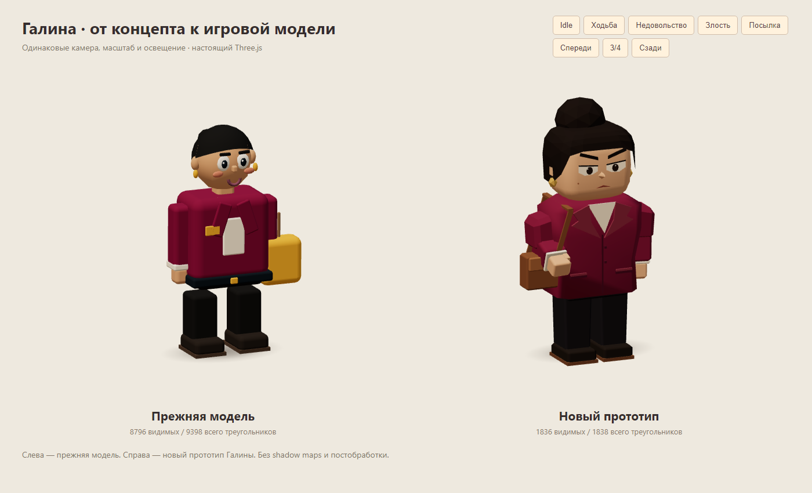

# Галина — игровая модель по утверждённому концепту

Задание владельца: реализовать одобренный образ Галины, прежде чем переносить подход на остальных боссов. Отдельный issue для этой визуальной задачи не назначен. Ветка `sol/galina-character-prototype`, начальная база `main` / `bfe320f`, перед передачей обновлена до `bf018f3`; рабочий каталог изолирован от работы Lead.

## Образ и границы

Новая процедурная фабрика `src/view/galinaCharacter.ts` сохраняет широкую фигуру, бордовое пальто, кремовую блузу и характер Гали. Добавлены цельная гранёная причёска с высоким пучком, веки и выразительные брови, геометрический нос, серьги, лацканы, карманы, манжеты, ладони с большим пальцем, лоферы и коричневая сумка с плечевым ремнём. Левый локоть согнут для хвата ремня; правая рука жестикулирует при недовольстве.

`Client` выбирает новую фабрику только для `archetype.id === 'boss'`: первая встреча и Галя в финальной паре с Валерой. Остальные четыре босса и обычные персонажи используют прежние фабрики. Камера, размеры комнаты, маршруты, очередь, UI/портреты, реплики, заказы и последствия решений не менялись.

Контракт `PersonRig` сохранён: `root/body/head/armL/armR/legL/legR`, `setCarry()`, `update()` и идемпотентный `dispose()`. Есть дыхание, моргание, ходьба, постукивание ногой и три состояния лица (`idle/impatient/angry`). Поза с посылкой поддерживает прежнюю стопку из 1–4 коробок. При переноске сумка скрыта, как аксессуары у общего rig.

## Геометрия и ресурсы

- Обычная поза: **1836 видимых / 1838 всего** треугольников против **8796 / 9398** у прежней нейтральной модели. Измерены реальные BufferGeometry, включая скрытые меши.
- После создания всех четырёх коробок и проверки всех настроений максимум дерева rig — **2016 треугольников**, из них одновременно видно не более **1848**. [Raw подсчёт поз](perf/galina-character/geometry.json).
- Геометрия тела собрана из широких граней; односегментная фаска переиспользует существующий `chamferedBox()` без изменения его реализации. Волосы — непрерывная шапка и один пучок, без множества отдельных прядей.
- Используются `cachedGeometry()`, `mat()` и общий `VERTEX_COLOR_MATERIAL`. Три выражения лица прогреваются при создании, переключение не строит геометрию в кадре.
- Собственные результаты merge и ленивые клоны материала цвета каждой посылки (до четырёх) зарегистрированы в `body.userData.personResources`. `dispose()` освобождает только их; общие геометрии, материалы, contact shadow и parcel decal сохраняются. Поддержан актуальный контракт main: строка или массив цветов в порядке коробок.
- Новых игровых текстур, внешних ассетов, GLTF, shadow maps и постобработки нет. Изображение концепта ниже — только документация, в игровой bundle не импортируется.

## Кадры для ревью

Одинаковый лабораторный кадр, свет и масштаб; слева прежняя модель, справа новая:



[Ходьба](screenshots/galina-character/walking.png), [недовольство](screenshots/galina-character/impatient.png), [злость](screenshots/galina-character/angry.png), [посылка](screenshots/galina-character/carry.png), [спереди](screenshots/galina-character/front.png), [сзади](screenshots/galina-character/back.png), [крупный план](screenshots/galina-character/close-up.png).

В игре, неизменная камера: [смена 1 до](screenshots/galina-character/game-before-1.png) / [после](screenshots/galina-character/game-after-1.png), [финальная пара до](screenshots/galina-character/game-before-5.png) / [после](screenshots/galina-character/game-after-5.png). Валера сохранён прежним.

Утверждённый [художественный концепт](screenshots/galina-character/approved-concept.png) создан ранее встроенным image_gen на основе игрового образа и диалогового портрета; [исходный промпт](screenshots/galina-character/concept-prompt.txt). Модель построена кодом по этому направлению, изображение не является её рендером.

## Воспроизведение

```bash
npm ci
npx playwright install chromium
npm run build
npm test
npm run test:e2e
npm run perf -- --label galina-character --check-budget
node tests/perf/galina-character.mjs after
```

Для визуального осмотра запустить `npm run dev` и открыть `/tests/visual/galina-character.html`. Кнопки показывают позы и ракурсы двух настоящих rig при одинаковом освещении. Для живой игры: F2 → смена 1 или 5 → босс. Камеру игры менять не требуется.

Боссовый perf сам поднимает Vite на `127.0.0.1:4188`: seed 73129, Chromium, 1280×900, DPR 1, настоящие встречи в сменах 1 и 5, обслуживание приостановлено модальным сценарием, мир анимируется. После 1,5 с прогрева собираются 5 с RAF-интервалов, счётчики renderer.info и screenshot; результаты в `test-results/perf/galina/<label>/`. Для baseline на `bfe320f` использован тот же скрипт до подключения новой фабрики. Запускать отдельно от других браузерных проверок.

## Результаты perf

Сравнение повторного baseline и реализации `45efd9d`, Chromium 158.0.8127.18 / SwiftShader. Между базами в main добавлен онбординг; графика контрольных встреч не менялась. Скрипты запущены последовательно. [До](perf/galina-character/before.json), [после](perf/galina-character/after.json), [первый baseline](perf/galina-character/before-initial.json).

| Встреча | Calls до → после | Треугольники сцены до → после | Geometries до → после | Textures | Programs |
|---|---:|---:|---:|---:|---:|
| Галя, смена 1 | 110 → 111 | 63 984 → 56 790 | 86 → 88 | 16 → 16 | 9 → 9 |
| Галя + Валера, смена 5 | 133 → 134 | 86 180 → 79 220 | 96 → 99 | 17 → 17 | 9 → 9 |

| Встреча | Avg ms до → после | P95 ms до → после | Max ms до → после |
|---|---:|---:|---:|
| Смена 1 | 113,0 → 109,8 | 133,2 → 116,7 | 133,3 → 116,7 |
| Смена 5 | 122,4 → 125,4 | 133,4 → 133,4 | 133,4 → 150,0 |

Новая артикуляция добавила один draw call и 2–3 активные геометрии, при этом в кадре стало на 7 тысяч треугольников меньше. Текстуры и программы не выросли. RAF-интервалы близки: этот короткий программный замер не подтверждает заметного выигрыша FPS.

Обычный `npm run perf -- --label galina-character --check-budget` сохранил прежние draw calls и triangles; [raw](perf/galina-character/standard-scenes.json):

| Сцена | Calls | Triangles | Textures / Programs | Avg / P95 / Max ms |
|---|---:|---:|---:|---:|
| 2 клиента | 122 | 60 615 | 16 / 9 | 114,8 / 133,3 / 150,1 |
| 4 + всё оформление | 173 | 83 430 | 19 / 9 | 137,8 / 150,1 / 183,3 |

Бюджеты ≤150/180 calls и ≤150k triangles проходят. Shadow map отключена, refresh отсутствует.

## Проверки

- `npm run build` и `npm test` — проходят, 43 unit-теста. Предупреждение Vite о размере существующего JS chunk остаётся.
- Новые e2e проверяют контракт, конечность геометрии/transform, моргание и смену трёх выражений, ходьбу, 4 посылки, лимит 3000 треугольников, выбор фабрики в обеих встречах и сохранение остальных боссов.
- 20 циклов создания/отрисовки/двойного dispose Галины: owned-ресурсы освобождаются ровно один раз, общие кэши не получают dispose, geometries/textures/programs постоянны после прогрева. Общая проверка 20 start/restart-циклов также проходит.
- Полный локальный набор на начальной базе: 27/28 во втором прогоне; сквозной game-loop превысил 90 с при высокой фоновой нагрузке. Он прошёл отдельно с лимитом 240 с, вместе с dev-toggle и двумя новыми сценариями онбординга после обновления базы — 4/4. Все 30 сценариев проверены, но локальный полный прогон без повторов не заявляется. Первый прогон также прервался на Зине из-за HMR при форматировании; повтор Зины прошёл. Результат чистого полного CI — в PR.
- Сняты и просмотрены одинаковые кадры idle/ходьбы/недовольства/злости/посылки, фронт/спина, крупный план и обе встречи. В новых тестах, визуальном рендере и perf нет `console.error`/`pageerror`.
- Локальный e2e запускал Vite на отдельном порту 4189 через временную копию конфигурации, чтобы не занимать порт Lead. Репозиторная конфигурация не менялась.

## Что смотреть и что осталось за рамками

Проверить читаемость лица и пучка с игровой камеры, хват ремня, стык рукавов/кистей и позу с коробкой. Процедурный low-poly использует простые ладони без пальцев и широкие плоскости одежды без симуляции ткани. Удивление из художественного концепта не добавляет нового игрового состояния: фабрика использует существующие три настроения.

Это прототип одного босса для ревью. Перенос на Зину, Саню, Королеву и Валеру, изменение портретов/диалогов и дальнейшие архитектурные задачи не входят в PR. Мобильный FPS на физическом устройстве здесь не измерен; локальные frame times относятся к программному SwiftShader.
