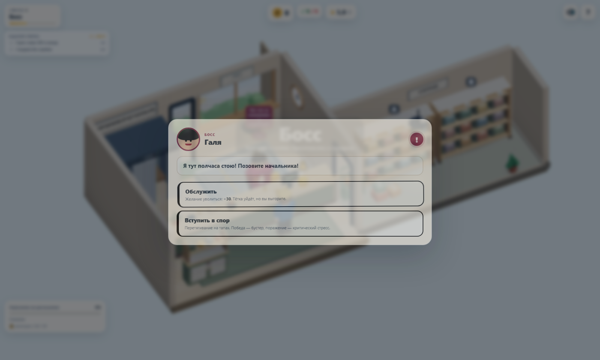
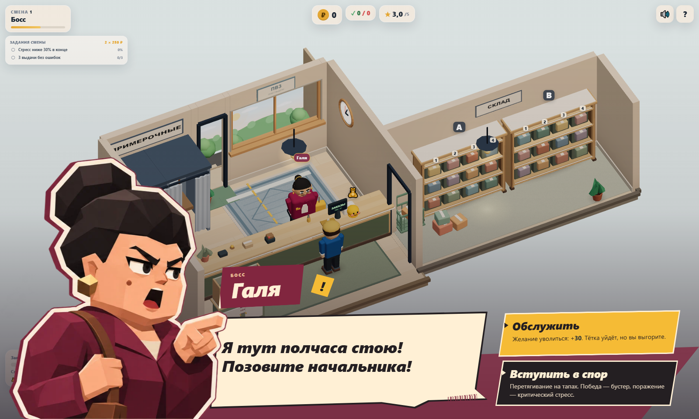
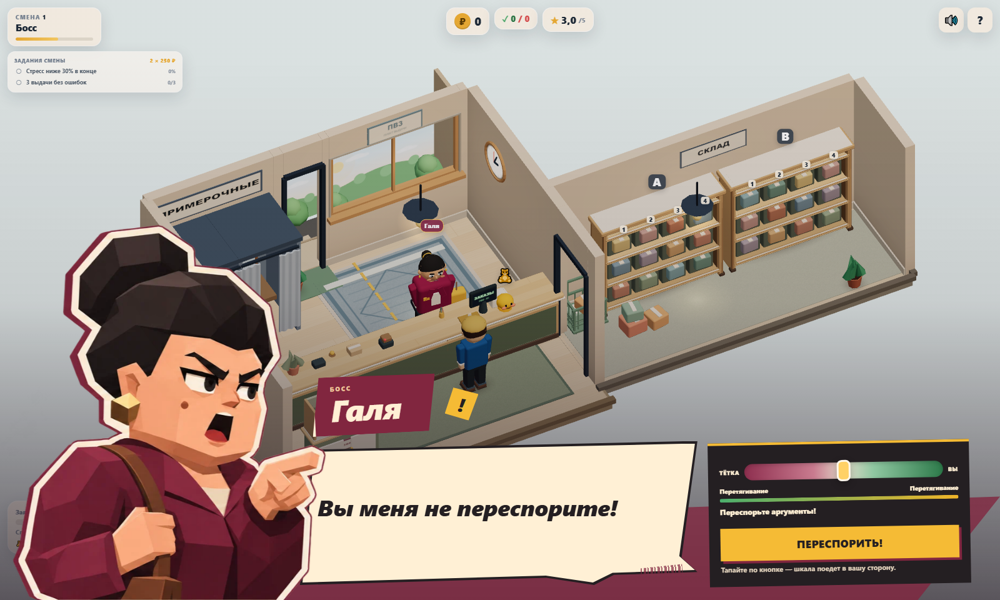
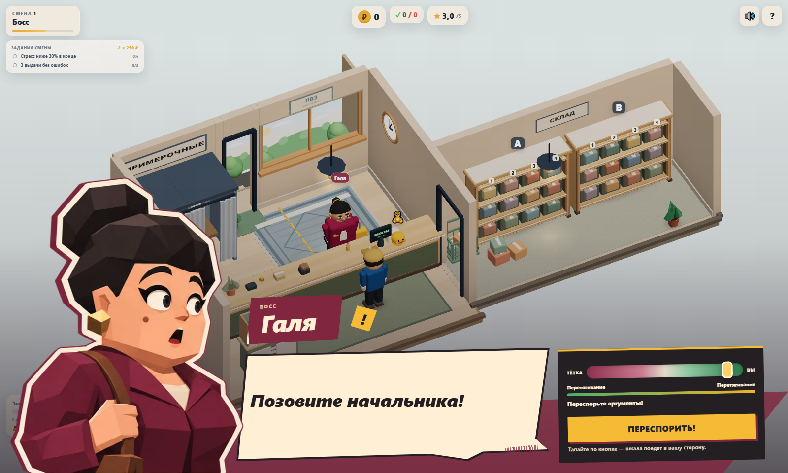
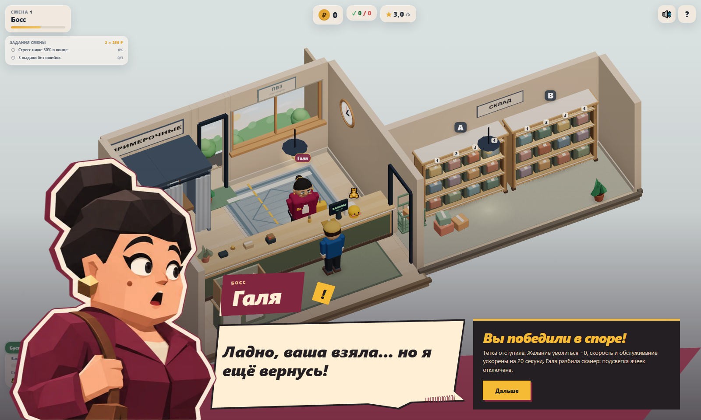
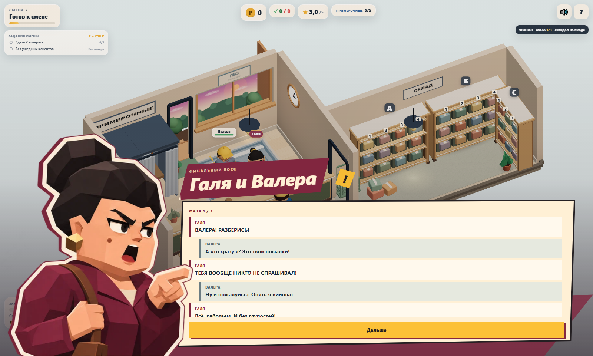

# Галя — визуальная сценка диалога

Прямое художественное задание владельца, отдельный issue не назначен. Ветка `sol/galya-dialogue-scene` от `main` после #9. Новая оболочка только для Гали и существующих семейных диалогов с её участием. Остальные боссы и спор с обычным клиентом используют прежний интерфейс.

## Что изменено

- Большой портрет с тремя выражениями: недовольство, крик, удивление. Бордовый жакет, чёрный пучок, золотые серьги и внешность согласованы с текущей Галей/референсом.
- Нижняя композиция с угловатой кремовой репликой, именной плашкой, бордовыми бумажными слоями, штрихкодом и жёлтым акцентом. Игра остаётся настоящим видимым фоном, камера и Three.js-сцена не меняются.
- Въезд портрета/панели — 330–440 мс, локальные графические акценты — 340–380 мс, встряхивание — 210 мс / 3 px. Новых бесконечных анимаций, fullscreen-вспышек и backdrop blur нет. `prefers-reduced-motion` отключает входы, встряхивание и эффекты.
- Наведение, focus и нажатие выделяют угловатые варианты ответов. Сохранены **исходные** «Обслужить» / «Вступить в спор», описания последствий и callback-и; новые реплики из референса не добавлялись.
- Таунт спора выводится крупно; удивление появляется при перевесе игрока, с гистерезисом .55/.35, чтобы портрет не дрожал между эмоциями от pushback. Эмоция результата не перезаписывается поздними обновлениями шкалы.
- На время крупной сценки скрыты дублирующие надголовные облачка и временный центральный баннер. После закрытия классы/видимость восстанавливаются; сами игровые сообщения не меняются.
- В финале сохранены **все** исходные строки, включая Валеру/рассказчика, в исходном порядке. Длинный обмен прокручивается, кнопка по-прежнему один раз вызывает существующее продолжение; новой пагинации или сюжетных пауз нет. У Валеры пока нет нового портрета.

## Кадры

Одинаковые сцена, камера и существующая реплика `BOSS_LINES[1]`. «До» снято отключением нового presentation-класса на той же сцене; прежние стили/DOM сохранены. Статичные кадры сняты с reduced motion, обычные анимации отдельно проверены при смоуке.













[Телефон, landscape](screenshots/galya/choice-landscape.png) · [Телефон, portrait](screenshots/galya/choice-portrait.png)

## Устройство и расширение

`BossView` сохраняет публичные методы и действия. `BossDialogueScene` — view-контроллер композиции, эмоций, коротких анимаций и фокуса; он не владеет текстом или состоянием encounter. `bossDialogue.css` действует только под `.dialogue-scene`. `game.ts`, `data.ts`, экономика, boss systems и 3D-ресурсы не менялись.

Для следующего босса: добавить профиль в `PROFILES` (URL атласа + координаты эмоций), палитру через CSS variables для `data-portrait-character` и активировать его в соответствующем методе BossView. Игровые callback-и и тексты для этого менять не требуется. Сейчас единственный профиль — `galya`; fallback явно закрывает presentation для Зины и обычного клиента.

Контроллер создаётся один раз. Слушатели не добавляются при каждом открытии; одновременно хранятся не более двух WAAPI-анимаций, при следующем акценте/закрытии они отменяются. Изменение эмоции не создаёт текстур/геометрий. Общий атлас загружается один раз и кэшируется браузером.

Есть keyboard focus/Tab-cycle внутри сцены, Enter/Space для кнопки спора без повтора удержанием, восстановление фокуса после закрытия, прокручиваемый финальный текст с клавиатуры. Escape не пропускает обязательный игровой выбор.

## Проверки

- `npm run build` — успешно. Прежнее предупреждение о размере JS bundle остаётся.
- `npm test` — 43/43.
- `npm run test:e2e` — 12/12, в том числе 4 новых сценария Гали: обслуживание/стресс/сломанный сканер, победа/бустер, поражение/отложенное увольнение, финальные строки/продолжение, fallback Зины и клиента, клавиатура, reduced motion и 20 повторных открытий без роста DOM.
- Viewport для choice: 1600×960, 844×390, 667×375, 568×320, 390×844, 360×640, 320×568. Кнопки/имя/реплика остаются в границах экрана и доступны hit testing. Дополнительный смоук argue/result/final на 568×320, 320×568 и 390×844 также не обнаружил выхода контролов за экран.
- Основной игровой цикл, terminal game over и lifecycle 20 restart-циклов из предыдущих задач остаются зелёными.
- console.error/pageerror отсутствуют в проверках/смоуке/perf. Прежнее предупреждение THREE.Clock остаётся.

## Производительность

`npm run perf -- --label galya-dialogue --check-budget` сохраняет **122/173 draw calls**, **60 615/83 430 triangles**, **16/19 textures**, **9 programs**. [Raw свежих сцен](perf/galya/fresh-scenes.json).

Дополнительно: после `npm run build` выполнить `node tests/perf/galya-dialogue.mjs`. Скрипт поднимает production preview на 4178, сравнивает одну и ту же приостановленную сцену Гали с закрытой оболочкой и открытым choice. 1280×900 / DPR 1, 1 с прогрева и 5 с RAF; короткая входная анимация исключена. JSON сохраняется в `test-results/perf/galya-overlay/`.

| Состояние | avg / p95 / max RAF, мс | Calls | Triangles | Geometries | Textures | Programs |
|---|---:|---:|---:|---:|---:|---:|
| Только сцена | 111.48 / 116.80 / 133.30 | 110 | 63 984 | 86 | 16 | 9 |
| Сценка Гали | 115.90 / 133.30 / 150.00 | 110 | 63 984 | 86 | 16 | 9 |

[Raw overlay](perf/galya/overlay.json). Это **SwiftShader**, не физический мобильный GPU. Показан небольшой расход DOM/compositing в этом окружении, а не гарантия мобильного FPS. Счётчики WebGL не включают память CSS-картинки. Атлас 2172×724 с альфой: 175 702 байта WebP (~6,3 МБ декодированных RGBA-пикселей); один ресурс на все три эмоции. Нового WebGL renderer/canvas, shadow maps, SSAO, bloom или постобработки нет.

## Портрет: происхождение и финальный промпт

Файл проекта: `src/assets/galya-expressions.webp`. Использован встроенный **image_gen** через навык `imagegen`, без CLI/API генерации и без сторонних скачанных ассетов. Опора — прикреплённый владельцем референс; весь интерфейс выполнен кодом. Сгенерирован один PNG-атлас с прозрачностью и тремя равными кадрами. В проект сохранён WebP quality 86 с сохранённой альфой; без изменения рисунка/композиции. Исходный PNG оставлен в каталоге generated_images Codex, игра от него не зависит.

Финальный промпт:

```text
Use case: stylized-concept. Create a production-ready TRANSPARENT PNG expression atlas for the woman Galya in the LOWER LEFT of the supplied reference (reference for character identity and angular low-poly illustration only; do NOT reproduce the UI, game world, text, or other characters). One single wide sprite sheet, exactly THREE equal-width vertical cells side by side. Each cell contains the SAME middle-aged stout woman waist-up, same scale, head height, clothing, three-quarter view facing RIGHT, fully isolated against genuine transparent alpha. Galya has a large angular black hair bun, sculpted sweeping black fringe, thick expressive eyebrows, warm peach skin, small cheek beauty mark, gold earrings, burgundy jacket with cream blouse, brown handbag strap. Match the polished faceted hand-painted low-poly/comic cutout of reference, NOT anime or realism. A warm ivory silhouette stroke and thin deep burgundy offset outline unify each cutout. Left cell: stern skeptical raised eyebrow, closed mouth, arms crossed or hand on handbag strap. Middle cell: angry outspoken shouting, open mouth and sharply lowered brows, pointing assertively to the right. Right cell: surprised taken aback, raised eyebrows, wide eyes, small open mouth, same hands/torso silhouette as left. Keep all three isolated within their own cells with generous transparent gutters, no overlaps, no cuts through hair/bun/fingers, bust bottoms aligned, character fills about 85% of each cell. NO words, labels, lettering, symbols, panels, backgrounds, floor, rectangular borders or mockup. The ONLY artwork is the three character cutouts. Important: visually consistent same identity and same large readable eyes across all three cells; designed for CSS background-position expression switching in a browser game.
```

Вне задачи: портреты остальных боссов, новые реплики/исходы/озвучка, изменение темпа/таймеров спора и физическое мобильное профилирование. Готово к ревью Lead; merge не выполняется.
