# ПВЗ-Тайкун — полный справочник по игре

> Актуально для текущего прототипа. Здесь собраны механики, характеристики, все смены, боссы, экономика и хронология введения механик. Скриншоты лежат в `docs/screenshots/`.

## Содержание

1. [Коротко об игре](#коротко-об-игре)
2. [Управление](#управление)
3. [Основные характеристики](#основные-характеристики)
4. [Базовый игровой цикл](#базовый-игровой-цикл)
5. [Склад, ячейки и заказы](#склад-ячейки-и-заказы)
6. [Клиенты, очередь и терпение](#клиенты-очередь-и-терпение)
7. [Стресс, репутация и антистресс](#стресс-репутация-и-антистресс)
8. [Экономика и магазин](#экономика-и-магазин)
9. [Примерочная и возвраты](#примерочная-и-возвраты)
10. [Смены: хронология и механики](#смены-хронология-и-механики)
11. [Боссы и мини-игры](#боссы-и-мини-игры)
12. [Dev-консоль](#dev-консоль)
13. [Известные упрощения и планы](#известные-упрощения-и-планы)
14. [Структура проекта](#структура-проекта)

---

## Коротко об игре

**«ПВЗ-Тайкун»** — казуальный тайм-менеджмент-симулятор работника пункта выдачи заказов. Игрок сканирует заказы, бегает на склад, собирает посылки, выдаёт их клиентам и пытается не уволиться от стресса.

- **Платформа:** Яндекс Игры, HTML5, мобильный веб и десктоп.
- **Визуальный стиль:** Cozy Low-Poly Diorama — тёплое дерево, шалфей, крем, скруглённые формы, посылки со скотчем и штрихкодами.
- **Камера:** статичная ортографическая 3/4, без движения и зума.
- **Комната:** L-образная: основной зал, широкая стойка, зона сотрудника, расширенное складское крыло и одна примерочная.
- **Сессия:** одна смена — примерно 3–6 минут в зависимости от босса.
- **Управление:** один палец / мышь, клики по полу, клиентам, стеллажам и ячейкам.

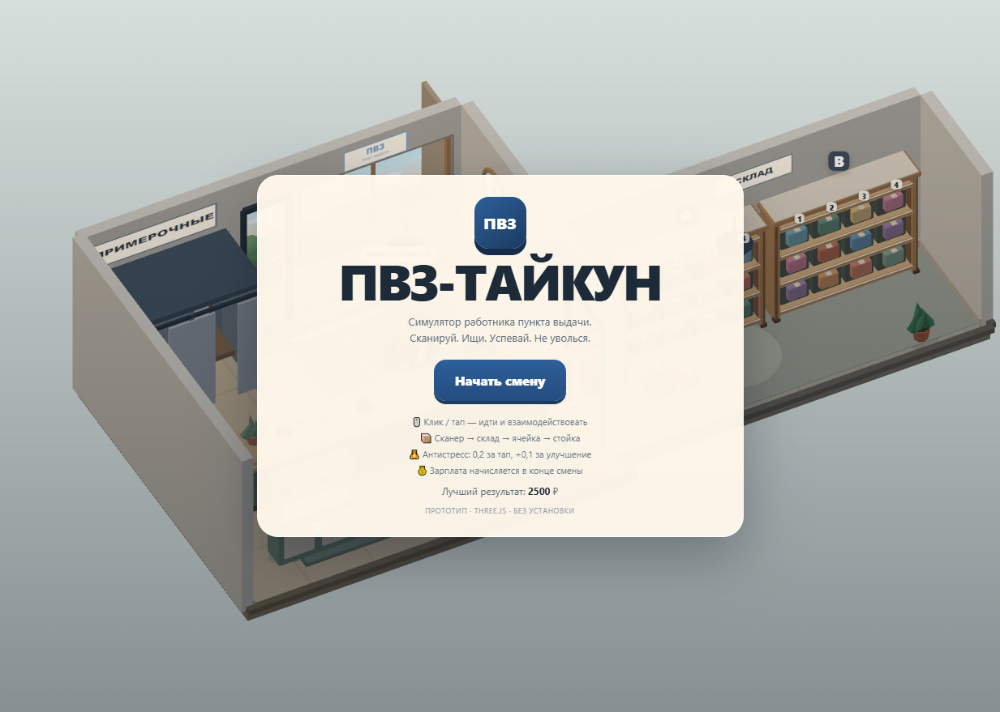

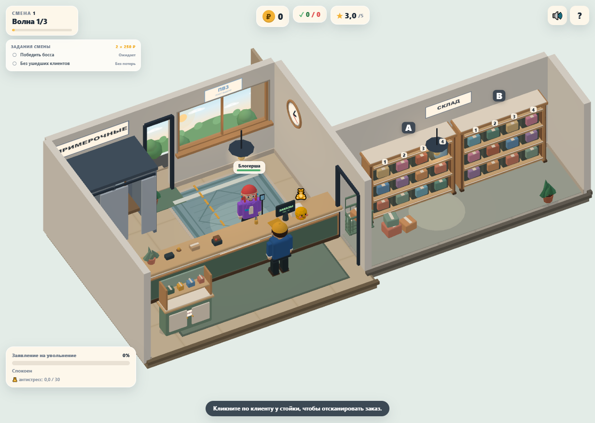

---

## Управление

| Действие | Что делает |
|---|---|
| Клик / тап по полу | Идти в точку |
| Клик по клиенту или его имени | Подойти к стойке, открыть сканер |
| Удержание кнопки сканера | Отсканировать заказ |
| Клик по стеллажу | Подойти к нужному стеллажу |
| Клик по ячейке в панели | Взять посылку |
| Клик по клиенту / стойке | Выдать посылку |
| Клик по клиенту с возвратом | Забрать возврат у Королевы / Гали |
| Клик по шкафчику «Возврат» | Сдать возврат |
| 🧸 у монитора | Тапнуть антистресс |
| F2 / ` | Dev-консоль |
| ? | Помощь |
| 🔊 | Звук |

На мобильном в портретной ориентации появляется подсказка повернуть телефон горизонтально.

HUD во время смены выполнен в стиле диалогов: кремовая бумага, бордовая подложка, тёмный ломаный контур и жёлтые акценты. На ПК задания раскрыты по умолчанию. На горизонтальном телефоне панель заданий компактная: тапните заголовок, чтобы увидеть список; дробь рядом с заголовком показывает выполненные задания. Кнопки звука и помощи — 44×44 px. Бирки клиентов компактнее и разнесены по высоте без изменения очереди.

После сканирования карточка с номером ячейки остаётся внизу, повторяющая его текстовая плашка про стеллаж скрыта. Подсказки поиска перепутанных ячеек, выдачи, возвратов и обучение сохранены. Сцена, камера, механика сканера и движения не менялись. Если открыть помощь или модалку во время удержания сканера, скан отменяется; после закрытия начните удержание заново.


---

## Основные характеристики

| Параметр | Значение |
|---|---|
| Очередь клиентов | 4 места, обслуживается только первый |
| Стеллажи | A, B и C. A/B — 4 колонки × 3 полки, C — 3 × 3 |
| Ячейки | 24 на первых сменах, 33 после появления C |
| Нумерация полок | Сверху вниз: 1 — верхняя, 2 — средняя, 3 — нижняя |
| Базовое терпение клиента | 35 с в волнах 1–2, 30 с в финальной; −2 с за смену, минимум 18 с |
| Сканер | Удержание 0,72 с; ускорение от бустера и замедление от дебаффа |
| Многоячейковые заказы | На 3-й смене 2–3; на 4–5 обычные 1–2; финальный босс — 2/3/4 |
| Стресс | 0–100%; на 100% — увольнение |
| Антистресс-лимит | Максимум −30% стресса за смену |
| Споры клиентов | 10% у обычных клиентов со 2-й смены |
| Репутация | 0–5, старт 3,0 |
| Деньги | 2000–2500 за успешную смену; 700–1000 за провал |
| Мини-квесты | 2 случайных задания за смену, по 250 ₽ |
| Улучшения | 4 прокачиваемых улучшения + замена сканера (1 раз) |
| Оформление | 7 предметов; 6 покупаются навсегда, телевизор — на забег |
| Примерочная | 1 кабинка, активна с 4-й смены |
| Возвраты | Шкафчик «Возврат» в зоне сотрудника |
| Смены | 1–5; после 5-й — финал и выход в меню |
| Dev-консоль | F2, смены 1–5, кнопка «Босс», +500 ₽, «В меню» |

---

## Окружение и детали

- Над стойкой в клиентской зоне — широкое окно почти на всю стену, ниже прежнего, с вывеской ПВЗ над ним.
- Окно — настоящий проём с толщиной, боковыми откосами и подоконником; рама утоплена в стену.
- За окном — объёмная стилизованная улица с пятиэтажками, берёзами, кустами, переходом, знаком и дорожным фонарём. Только градиент неба остаётся плоскостью; дома и деревья имеют геометрию и глубину.
- Листва слегка покачивается, облака медленно смещаются, одна машина проезжает 8 секунд раз в 36 секунд. Декоративных пешеходов перед стеклом нет. Геометрия улицы объединена в несколько мешей без тяжёлых эффектов.
- Клиенты приходят по прежнему тротуару снаружи, проходят мимо окна и только у двери получают бирку с именем. Размеры и положение входа, точки входа/выхода и маршруты сохранены.
- Ближние объекты перекрывают дальние; края скрыты откосами, стеной и clipping-плоскостями только материалов улицы. Глубина дальнего плана сжата под высокую камеру.
- Освещение и вид за окном плавно меняются по существующим волнам: утро — первая, день — вторая, вечер — третья. Утро золотистое, день голубой, вечер розово-оранжевый с тёплыми окнами домов и фонарём. Финальный босс проходит при вечернем свете.
- В клиентской зоне — компактный синий коврик; жёлтая разметка осталась только на складе.
- Склад расширен: A/B/C, крупные буквы на верхних панелях, C у боковой стены; проволочной корзины больше нет.
- На стойке — рабочий ноутбук экраном к игроку и антистресс; шкаф «Возврат» стоит у видимого края. Встроенный декор убран.
- Таблички «НЕ КРИЧИТЕ», «ВХОД» и «ВЫДАЧА» убраны.
- Под потолком — лампы с тёплым светом и мягкими световыми пятнами.
- В примерочной есть зеркало и крючки для одежды.
- Часы на стене имеют минутную и секундную стрелки; секундная двигается.
- Кот, телевизор и неоновая вывеска появляются после покупки в магазине оформления.
- Кот-талисман не стоит на стойке по умолчанию: он появляется только после покупки и сохраняется как постоянная косметика.

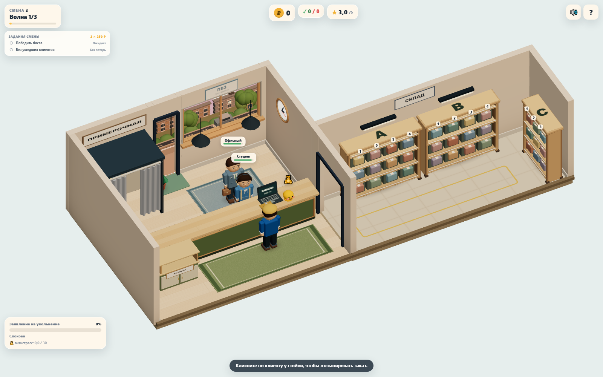

---

## Обучение

Первый запуск начинается с короткого обучения на 1-й смене. Оно проходит прямо в игре и не требует отдельного режима.

- **5 шагов:** клиент → сканер → склад → ячейка → выдача.
- На каждом шаге слева снизу появляется крупная карточка с объяснением.
- Нужный объект подсвечивается: жёлтое кольцо и стрелка в мире, золотая рамка у кнопки сканера или ячейки.
- На время обучения терпение клиентов заморожено, чтобы никто не ушёл, пока игрок читает.
- Обучение можно пропустить кнопкой «Пропустить обучение».
- После завершения или пропуска обучение больше не появляется при новых запусках.
- После первой выдачи финальная карточка объясняет, что смена продолжается: зачем следить за терпением и стрессом, как мини-квесты дают бонус к зарплате и что игрушка на стойке снижает стресс.
- На итогах первой смены один раз показывается карточка «Как читать итоги и магазин»: звёзды, зарплата, бонусы квестов, вкладки улучшений и оформления, замена разбитого сканера. Кнопка «Понятно» закрывает её; при следующих забегах карточка не появляется.
- На старте 2-й смены после сюжетного баннера показывается карточка про споры: «Уступить» добавляет стресс, «Спорить» запускает тапы, победа снижает стресс и добавляет репутацию, «Обаяние» даёт фору.
- На старте 4-й смены — карточка про заказы из нескольких ячеек и одну примерочную: сначала собрать все посылки, а занятая кабинка злит очередь; Королева может её занять.
- Карточки новых механик ставят игру на паузу до «Понятно» и повторно не появляются.
- Первая поломка сканера показывает отдельную карточку-событие «Галя разбила сканер» с кнопкой «Понятно». Она ставит игру на паузу и объясняет, где купить замену; повторно не появляется.

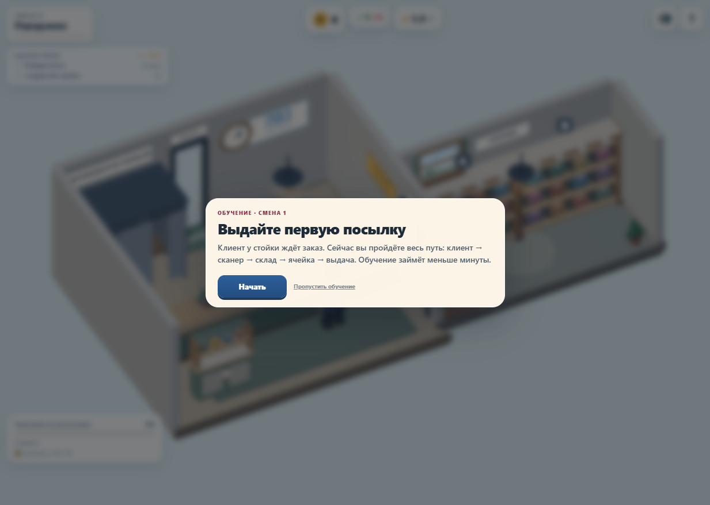

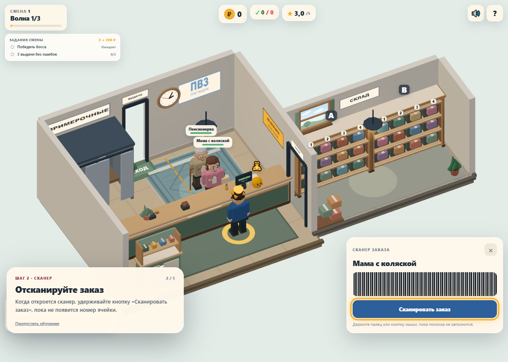

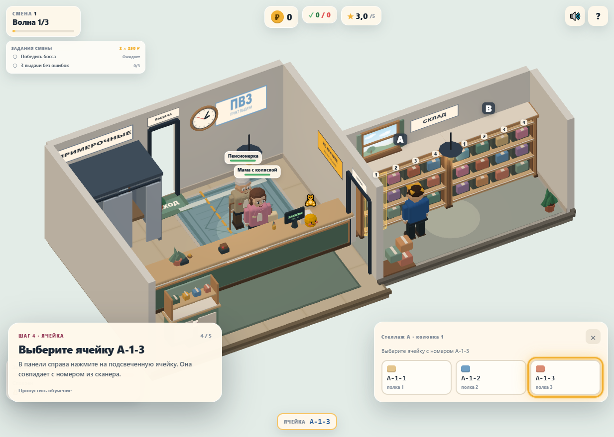

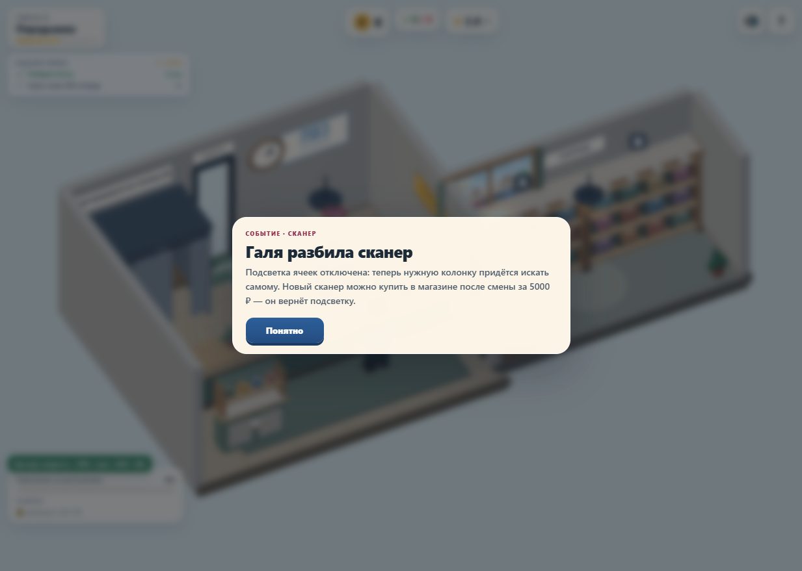

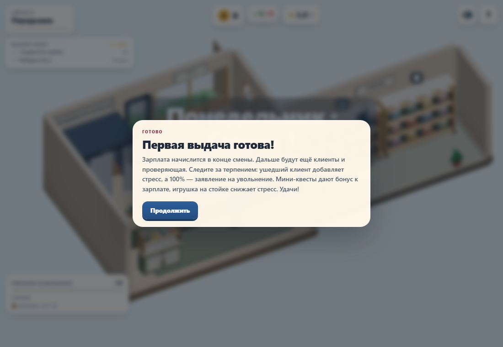

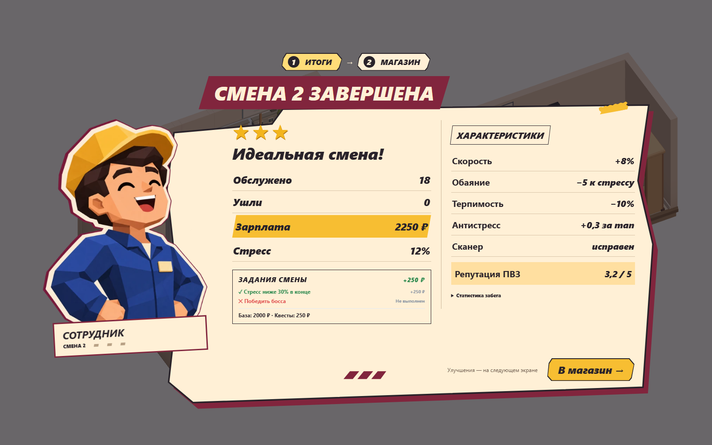

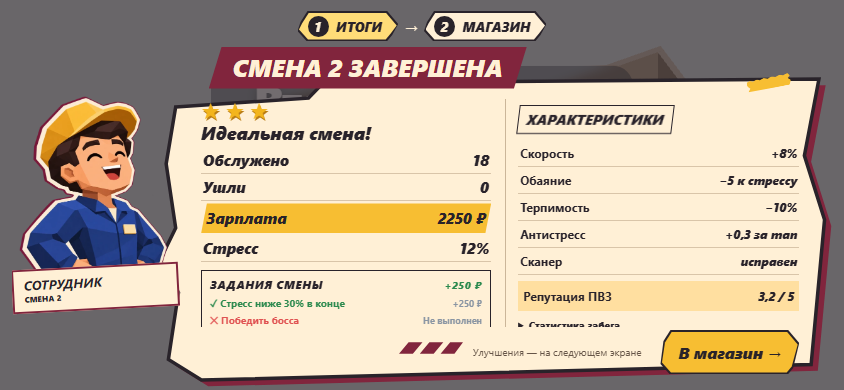

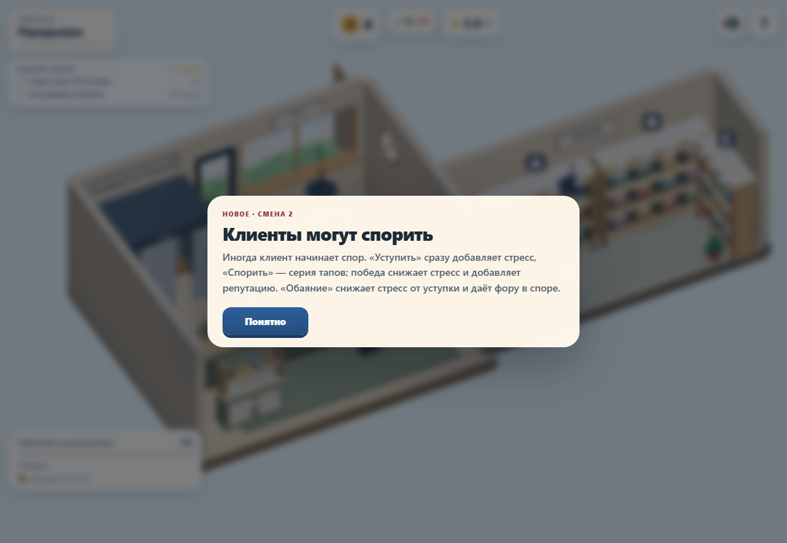

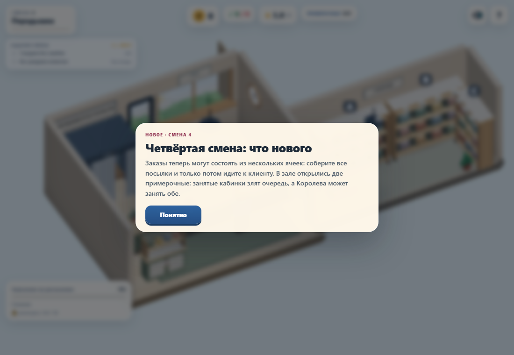

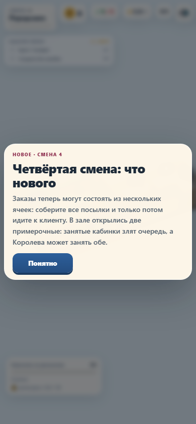

---

## Базовый игровой цикл

1. Клиент входит в зал и встаёт в очередь.
2. Игрок кликает по первому клиенту и открывает сканер.
3. Удерживает кнопку сканера и получает номер ячейки (или список ячеек).
4. Идёт через дверь на склад, подходит к нужному стеллажу.
5. В панели выбирает нужную ячейку — иногда сначала нужно найти её по сигналу сканера.
6. Забирает посылку и возвращается к стойке.
7. Выдаёт посылку клиенту: получает зарплату в конце смены, репутацию и снимает немного стресса.
8. Если клиент не дождался — теряет репутацию и получает стресс.
9. Между волнами — передышка и антистресс-игрушка.
10. В середине смены появляется босс (или финальный босс после второй волны).
11. В конце — зарплата, звёзды, магазин улучшений и оформления.

---

## Склад, ячейки и заказы

### Стеллажи

- **A** и **B** — по 4 колонки × 3 полки = 12 ячеек каждый, доступны с 1-й смены.
- **C** — 3 колонки × 3 полки = 9 ячеек, появляется со 2-й смены.
- Визуальный порядок слева направо: **A → B → C**.
- Полки считаются **сверху вниз**: 1 — верхняя, 2 — средняя, 3 — нижняя.
- ID ячейки: `стеллаж-колонка-полка`, например `A-2-1` — стеллаж A, вторая колонка, верхняя полка.
- В начале каждой волны несобранные посылки возвращаются на полки. Ячейка, с которой посылку уже сняли, не назначается новому клиенту до пополнения.
- Новый заказ использует только видимые незарезервированные ячейки активных стеллажей, без повторений. Если их меньше требуемого, выполняется пополнение и повторный подсчёт. Если свободных ячеек всё ещё недостаточно, но есть хотя бы одна, заказ уменьшается до доступного количества; обычные размеры и финальные 2/3/4 на полном складе сохраняются.
- Если все ячейки заняты резервами, создание нового заказа откладывается до освобождения ячейки. Пустой заказ не создаётся, чужие резервы не снимаются.

### Обычный заказ

- Один клиент — одна ячейка.
- Игрок сканирует штрих, идёт к стеллажу, выбирает ячейку и несёт посылку к стойке.

### Многоячейковый заказ

- Появляется после знакомства с курьером Саней на 3-й смене.
- На 3-й смене у обычных клиентов — 2–3 ячейки, у Сани — 4.
- На 4–5-й сменах обычные клиенты чаще просят 1–2 ячейки.
- В сканере показывается весь список ячеек.
- Панель ведёт по текущей цели и показывает остаток.
- Клиенту можно отдать заказ **только после сбора всех посылок**.
- При переноске нескольких посылок каждая коробка в стопке сохраняет цвет своей ячейки.

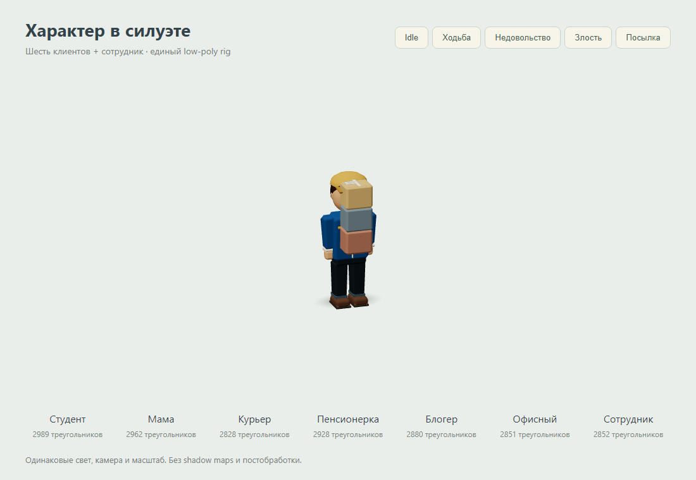

### Панель выбора ячейки

- Если подсветка включена, показывается нужная колонка и 3 полки.
- Без подсветки показывается весь стеллаж.
- Панель — таблица по колонкам стеллажа: A/B — 4 колонки × 3 ряда, C — 3 × 3.
- В карточке видны цвет посылки, ID и номер полки.
- В режиме поиска проверенные ячейки блокируются.

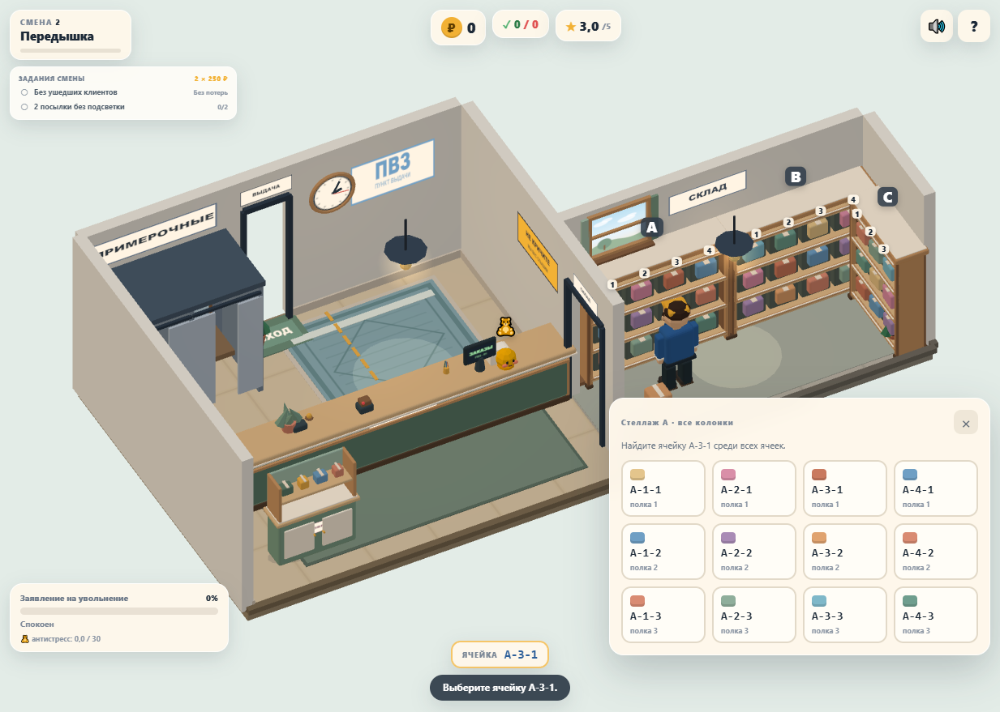

### Событие «перепутанные ячейки»

- Один раз за смену, во второй волне, у случайного клиента.
- Сканер показывает ячейку, но она пустая.
- Клиент получает **+15 секунд терпения**; игрок получает **+2 стресса**.
- Открывается панель поиска по всем ячейкам стеллажа.
- После каждой ошибки — сигнал «Горячо / Тепло / Прохладно / Холодно».
- Проверенные ячейки блокируются.

---

## Клиенты, очередь и терпение

### Архетипы клиентов

| Клиент | Силуэт и детали | Особенность |
|---|---|---|
| Студент | Стройный, короткие волосы, наушники, рюкзак | Обычный клиент |
| Мама с коляской | Каре, серьги, сумка | Обычный клиент |
| Курьер | Кепка, телефон в руке | Обычный клиент |
| Пенсионерка | Пучок, очки, трость | Обычный клиент |
| Блогерша | Длинные волосы, серьги, селфи-палка | Обычный клиент |
| Офисный | Галстук, сумка, короткие волосы | Обычный клиент |

Боссы используют отдельные архетипы: Галя, Баба Зина, Курьер Саня, Королева примерочной, Валера.

Персонажи собраны из скруглённых low-poly форм. У них есть моргание, смена эмоций (спокойный / нетерпеливый / злой), лёгкие idle-жесты и поза с посылкой или возвратом.

### Очередь

- 4 позиции.
- Обслуживается только первый клиент.
- Остальные ждут и теряют терпение.
- Если первый ушёл, очередь сдвигается.

### Терпение

- Базово 35 секунд в волнах 1–2 и 30 секунд в финальной волне.
- Каждая следующая смена уменьшает базу на 2 секунды, но не ниже 18.
- У боссов своё терпение: Саня — 34 с, Гали — 120 с на три штрихкода.
- Телевизор замедляет падение терпения на 20%.
- Если единственная примерочная занята, терпение падает на 20% быстрее.
- Если клиент не дождался: +6 стресса, −0,5 репутации, клиент уходит.

### Споры с клиентами

Со 2-й смены обычный клиент при попытке начать обслуживание может устроить спор. Шанс — **10%**, проверяется один раз при появлении клиента. Боссы и Королева примерочной в этот пул не входят.

Когда спор начался, игра ставится на паузу и открывается окно с двумя вариантами:

| Вариант | Результат |
|---|---|
| Уступить | Клиент успокаивается, обслуживание продолжается. Стресс +6, но «Обаяние» снижает штраф до +2 |
| Вступить в спор | 6 секунд перетягивания на тапах. Победа: −8 стресса, +0,1 репутации, +5 с терпения. Поражение: +10 стресса, −0,2 репутации, −4 с терпения |

- «Обаяние» даёт стартовую фору в споре и ослабляет напор клиента.
- После любого исхода клиент остаётся у стойки, и вы продолжаете обслуживание.
- Спор сам по себе не проваливает смену, но может добить стресс до 100%.

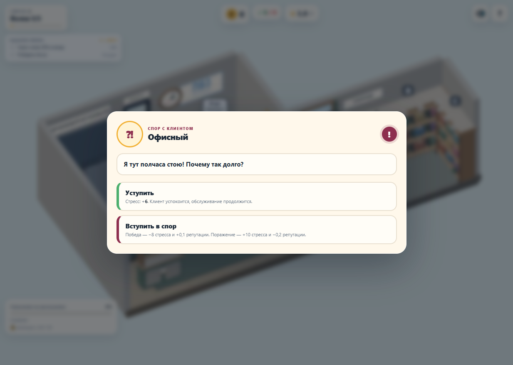

---

## Стресс, репутация и антистресс

### Стресс

- Шкала 0–100%.
- На 100% — увольнение и экран game over.
- Источники: ушедшие клиенты, ошибки в ячейках, проигрыш в споре/мини-игре, отдельные события.
- Снижение: успешная выдача, победа над боссом, антистресс-игрушка, некоторые награды.

| Стресс | Состояние | Эффект |
|---|---|---|
| 0–29% | Спокоен | — |
| 30–59% | Раздражён | — |
| 60–84% | На взводе | Скорость передвижения −15% |
| 85–99% | На грани | Скорость передвижения −30% |
| 100% | Заявление подписано | Увольнение |

«Терпимость» уменьшает **рост** стресса на 10% за уровень.

### Антистресс-игрушка

- Стоит на стойке со стороны сотрудника.
- Базовый тап снимает **0,2 стресса**.
- Каждый уровень улучшения добавляет **+0,1** к тапу.
- Без кулдауна: игрок платит только временем, пока очередь ждёт.
- **Лимит — 30% за смену.** После этого игрушка не снимает стресс до следующей смены. В HUD видно, сколько лимита уже использовано.

### Репутация

- Шкала 0–5, старт 3,0.
- Успешная выдача: **+0,1**.
- Ушедший клиент: **−0,5**.
- Смена без потерь: **+0,2**.
- Победа над некоторыми боссами и сдача возвратов дают бонусы.
- Репутация видна в HUD и карточке сотрудника.

---

## Экономика и магазин

Между сменами два экрана в стиле диалогов. Сначала видны итоги, задания, начисленная зарплата и характеристики сотрудника. Дополнительные показатели забега раскрываются в «Статистика забега». Кнопка «В магазин →» открывает второй экран с балансом, вкладками улучшений/оформления и покупками. «← Итоги» или Escape возвращают к первому экрану: зарплата повторно не начисляется, купленные улучшения сразу отражаются в характеристиках.

«Следующая смена →» запускает прежний переход к следующей смене. После пятой смены кнопка второго экрана называется «В меню». Цены, уровни, условия появления сканера и правила сохранения покупок прежние. На горизонтальном телефоне кнопки перехода остаются доступны, длинные списки прокручиваются внутри окна. Tab перемещает фокус по интерфейсу, стрелки переключают отдел магазина.


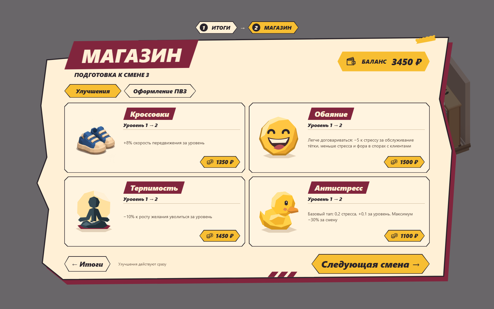


### Зарплата

**Успешная смена:**

```
2000 + 250 × число выполненных мини-квестов (0–500)
```

- База — **2000 ₽**.
- Каждый из двух мини-квестов добавляет **+250 ₽**.
- Идеальная смена с двумя квестами — **2500 ₽**.
- Обычная смена с одной звездой или меньше **не считается провалом**: база всё равно 2000 ₽ плюс выполненные квесты.

**Провал:**

- Провалом считается проигрыш финального босса.
- Зарплата — **700–1000 ₽** в зависимости от доли обслуженных клиентов.
- Бонусы мини-квестов за провальную смену **не выплачиваются**.
- Увольнение при 100% стресса остаётся отдельным game over.

### Мини-квесты

В начале каждой смены игрок получает **2 случайных задания**. Они выполняются естественно во время обычной игры, без отдельных мини-игр. За каждое — **250 ₽** на экране итогов.

| Квест | Условие | Когда доступен |
|---|---|---|
| Без ушедших клиентов | Никто не ушёл за смену | Все смены |
| Стресс ниже 30% в конце | Закончить смену со стрессом <30% | Все смены |
| 3 выдачи без ошибок | 3 успешные выдачи подряд; ошибка/ушедший клиент сбрасывают серию | Все смены |
| 2 посылки без подсветки | Взять 2 посылки, когда подсветка отключена | Со 2-й смены, если сканер разбит и не куплена замена |
| Сдать 1 возврат | Успешно сдать возврат в шкафчик | 4-я смена |
| Сдать 2 возврата | Успешно сдать два возврата | 5-я смена |
| Победить босса | Победить босса смены | 1, 2, 3 и 5-я смены |

- Задания не появляются, если механика ещё не открыта.
- Возвраты не выдаются на сменах 1–3; задание на два возврата — только на 5-й смене, где финальный босс гарантирует три возврата.
- «Победить босса» на 4-й смене не выдаётся: там нет классической победы над боссом.
- Прогресс виден в панели «ЗАДАНИЯ СМЕНЫ» слева сверху.
- Выполненные задания отмечаются зелёным, проваленные — красным.
- На экране итогов показывается список заданий, база и бонус.

### Улучшения

| Улучшение | Эффект | Уровни и цены |
|---|---|---|
| Кроссовки | +8% скорость передвижения за уровень | 850 / 1350 / 1900 ₽ |
| Обаяние | −5 к стрессу за обслуживание; меньше стресса и фора в спорах с клиентами | 950 / 1500 / 2100 ₽ |
| Терпимость | −10% к росту стресса за уровень | 900 / 1450 / 2000 ₽ |
| Антистресс | Базовый тап: 0,2 +0,1 за уровень; максимум −30% за смену | 700 / 1100 / 1600 ₽ |
| Сканер | Замена разбитого сканера: подсветка ячеек возвращается | 5000 ₽ (1 раз) |

- Улучшения действуют до конца забега.
- После увольнения и нового прохождения сбрасываются.
- После одной успешной смены можно купить одно-два начальных улучшения.
- Полностью прокачать все улучшения за пару смен нельзя — к финальному боссу нужен выбор.
- Сканер появляется в магазине только после того, как Галя его разобьёт. Это дорогая покупка, но она возвращает подсветку ячеек до конца забега.

### Оформление ПВЗ

| Предмет | Эффект | Цена | Хранение |
|---|---|---|---|
| Кот-талисман | Анимированный кот на стойке | 400 ₽ | Навсегда |
| Синие часы | Новый циферблат с секундной стрелкой | 450 ₽ | Навсегда |
| Морской коврик | Узорный ковёр в клиентской зоне | 550 ₽ | Навсегда |
| Неоновая вывеска | Светящаяся вывеска «ПВЗ» на стене | 900 ₽ | Навсегда |
| Мятные стены | Новый цвет стен | 1250 ₽ | Навсегда |
| Дубовый пол | Тёплый пол в зале | 1500 ₽ | Навсегда |
| Телевизор | Терпение клиентов падает на 20% медленнее | 2600 ₽ | До конца забега |

- Косметика сохраняется после увольнения и нового прохождения.
- Телевизор — временное улучшение в рамках текущего забега; после нового старта его нужно покупать снова.
- Все покупки идут из общего баланса, поэтому игрок постоянно выбирает между прокачкой и оформлением.


Замена сканера остаётся в отделе улучшений и появляется после поломки; цена и результат покупки прежние.

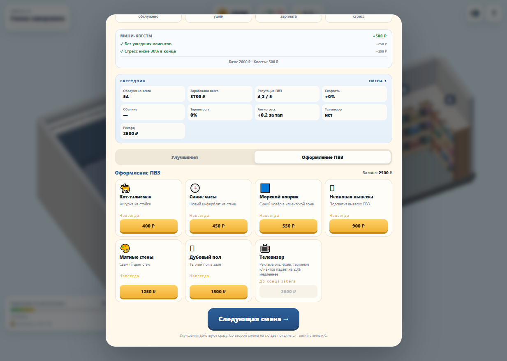

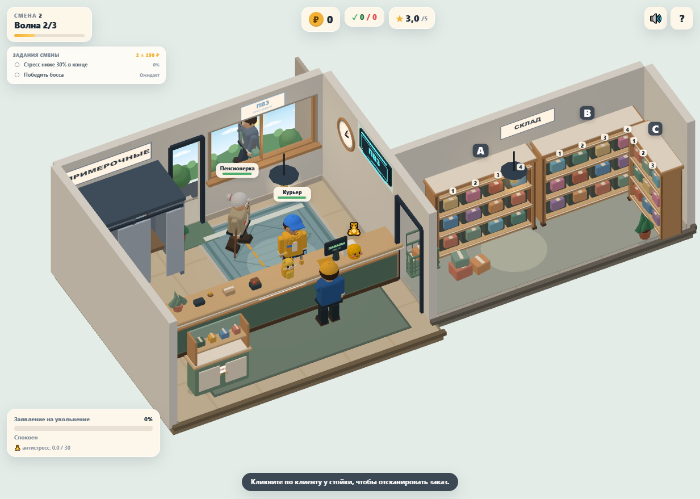

---

## Примерочная и возвраты

### Примерочная

- Одна кабинка в восточной части клиентской зоны.
- Активна с 4-й смены.
- В HUD отображается `ПРИМЕРОЧНАЯ 0/1`.
- Обычные клиенты занимают кабинку случайно: 7–13 секунд занято, 5–10 секунд свободно.
- Если единственная кабинка занята, терпение всех клиентов падает на 20% быстрее.
- Во время финального босса случайные таймеры отключаются: сначала 0/1, затем Валера занимает единственную кабинку (1/1), включая обычный штраф терпения +20%.

### Возвраты

- Сдаются в шкафчик **«Возврат»** в зоне сотрудника.
- Пока возврат в руках, новые заказы не сканируются.
- Сдача возврата даёт **+0,1 репутации**.

**Королева примерочной:**
- После выдачи заказа уходит в примерочную на 6 секунд.
- Занимает единственную кабинку, затем выходит и идёт к стойке.
- Первый раз возвращается с возвратом, дальнейшие возвраты — примерно через раз.
- Если возврат не сдан, волна не завершится.

**Финальный босс:**
- После примерки Валера занимает одну кабинку.
- Галя требует вернуть всё: игрок по очереди забирает **три возврата** у стойки и относит их в шкафчик.

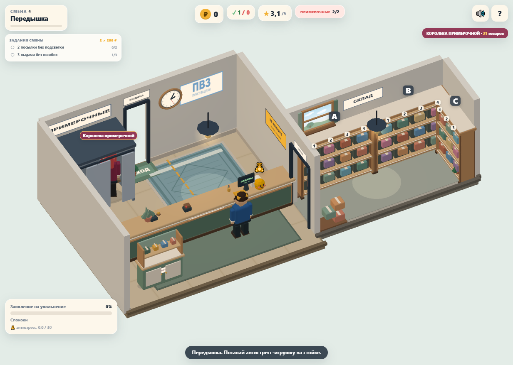

---

## Смены: хронология и механики

### Краткая таблица

| Смена | День | Что происходит | Босс | Новые механики |
|---|---|---|---|---|
| 1 | Понедельник | Обучающая смена, 2 стеллажа | Галя | Сканер, ячейки, терпение, стресс, репутация, мини-квесты, магазин, поломка сканера |
| 2 | Вторник | Появляется стеллаж C | Баба Зина | C, «перепутанные ячейки», пятнашки и заказ из конкретной ячейки |
| 3 | Среда | Много заказов | Курьер Саня | Многоячейковые заказы, заказ на скорость |
| 4 | Четверг | Открывается примерочная | Королева примерочной | Примерочная, возвраты, постоянный босс |
| 5 | Пятница | Финал | Галя и Валера | Дебафф, 3 штрихкода, 3 возврата, финальный экран |

### Смена 1 — Понедельник

- Два стеллажа A и B, 24 ячейки.
- Подсветка колонок работает, пока сканер исправен.
- В начале смены выдаются **2 случайных мини-квеста**.
- Волны: 2 → 3 клиента, затем босс, затем финальная волна.
- **Босс: Галя.** После второй волны идёт к стойке и открывает диалог:
  - «Обслужить» — она уходит, но игрок получает стресс.
  - «Вступить в спор» — перетягивание шкалы тапами.
- В споре 6 секунд; реплики Гали появляются стартовой и далее каждые 15% шкалы (всего 7). На 100% новых фраз нет.
- Победа: стресс −30, на 20 секунд скорость +30% и скан +50%.
- Поражение: при стрессе 50%+ — увольнение, иначе стресс становится критическим (85%).
- **В любом исходе Галя разбивает сканер.** Подсветка ячеек отключается до конца забега, пока в магазине не куплена замена за 5000 ₽.
- При первой поломке показывается карточка-событие с объяснением и кнопкой «Понятно».

**Что вводится:** базовый цикл, сканер, выбор ячейки, терпение, стресс, антистресс, репутация, итоги и магазин.

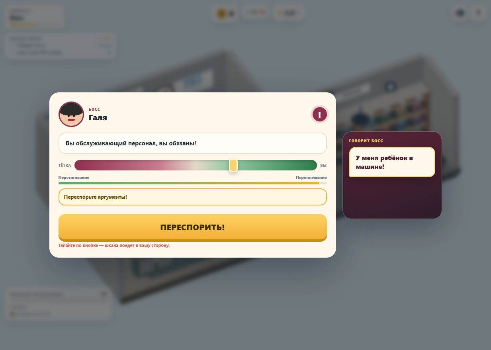

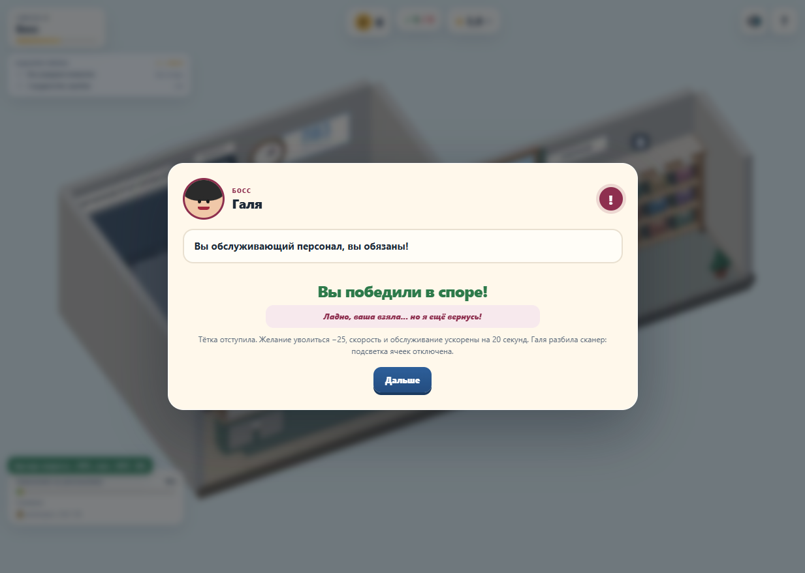

### Смена 2 — Вторник

- Появляется стеллаж C: 3 колонки × 3 полки.
- Подсветки нет, если сканер разбит и замена не куплена. С купленным сканером подсветка работает во всех волнах.
- Со 2-й смены обычные клиенты могут начинать спор с шансом 10%.
- Во второй волне срабатывает событие «перепутанные ячейки».
- **Босс: Баба Зина.** После второй волны просит помочь с телефоном.
- Мини-игра «Пятнашки»: 3×3 плитки, простой штрихкод из четырёх цветных фрагментов, 75 секунд. Нужно выставить фрагменты в подсвеченные клетки 2×2 по порядку.
- Победа: −8 стресса, +0,2 репутации. Баба Зина называет конкретную ячейку: заберите оттуда посылку и выдайте ей. Сканировать заказ не нужно.
- Поражение: +15 стресса, −0,5 репутации.

**Что вводится:** третий стеллаж, споры обычных клиентов, событие с перепутанными ячейками, мини-игра «Пятнашки» и заказ из конкретной ячейки.

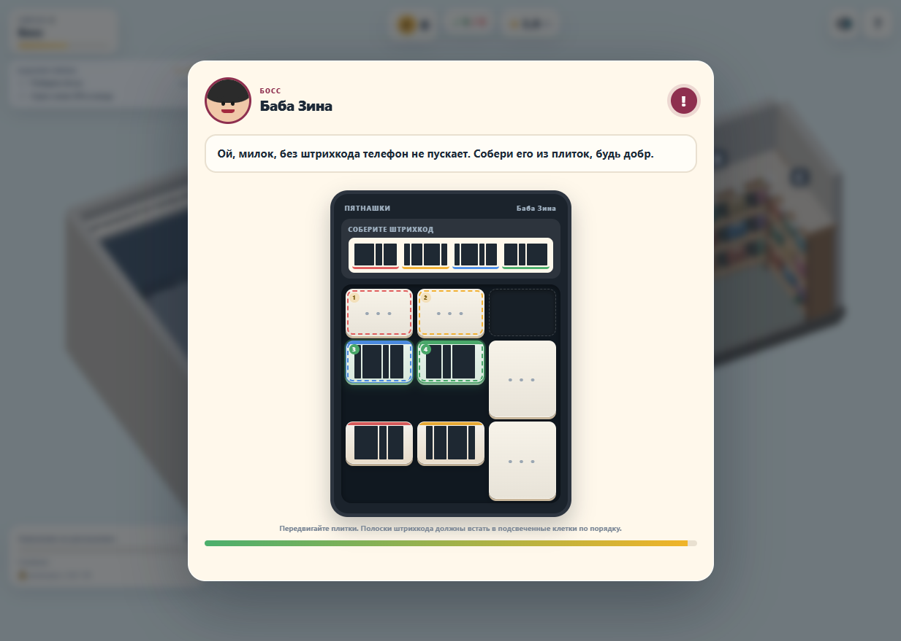

### Смена 3 — Среда

- Три стеллажа, 33 ячейки.
- **Босс: Курьер Саня.** Появляется после второй волны.
- Без диалога и паузы: сразу заказ из 4 ячеек и 34 секунды терпения.
- Нужно быстро собрать все 4 посылки и выдать их.
- После Сани механика многоячейковых заказов остаётся: на 3-й смене обычные клиенты получают 2–3 ячейки, на 4–5-й — 1–2.
- Успех — смена продолжается; провал — потеря клиента, репутации и стресс.

**Что вводится:** многоячейковые заказы, таймерный босс без остановки игры.

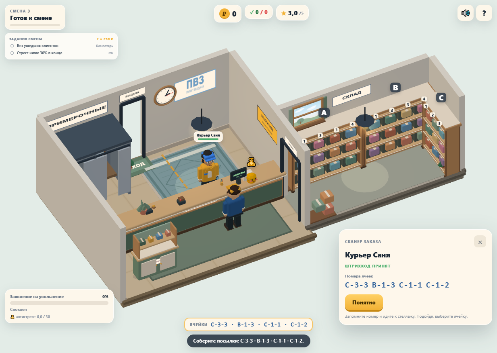

### Смена 4 — Четверг

- Открывается примерочная.
- **Королева примерочной** появляется после первой волны и остаётся до конца смены.
- У неё 20–30 товаров на смену; заказ — 3 ячейки или меньше, если остался маленький бюджет.
- Пока игрок собирает её заказ, она его не меняет.
- После выдачи уходит в примерочную на 6 секунд, занимает единственную кабинку, затем выходит и идёт к стойке.
- Первый раз всегда возвращается с возвратом, дальше — 50%.
- Возврат забирается у стойки и сдаётся в шкафчик «Возврат».
- Пока Королева активна, терпение клиентов падает быстрее.
- После её ухода примерочная остаётся активной.

**Что вводится:** примерочная, постоянный босс, возвраты, шкафчик «Возврат», HUD примерочной и Королевы.

### Смена 5 — Пятница, финал

- Две обычные волны, затем **финальный босс «Галя и Валера»**.
- Три фазы:
  1. **Вход.** Галя приводит Валеру: «ВАЛЕРА! РАЗБЕРИСЬ!» Валера спорит, Галя перебивает. Игрок получает дебафф «Семейный спор»: терпение +40%, скорость −15%, скан −20% до конца смены.
  2. **Три штрихкода.** Галя показывает три штрихкода: 2, 3 и 4 ячейки. Всего 9 посылок, 120 секунд базового терпения (с дебаффом около 86). Таймер между штрихкодами не сбрасывается. После двух сданных штрихкодов — диалог, третий штрихкод оказывается Валериным. Галя периодически кричит «Быстрее!», «У вас что, совсем ноги не ходят?» и т.п.; каждый крик +2 стресса, сдача штрихкода −1.
  3. **Примерка и возврат всего.** Галя достаёт куртку, отправляет Валеру в примерочную. Валера идёт пешком и занимает одну кабинку. После диалога игрок по очереди сдаёт три возврата в шкафчик «Возврат».
- Провал по таймеру — босс проигран, смена заканчивается с потерей и низкими звёздами. Зарплата за провал — 700–1000 ₽, бонусы квестов не начисляются.
- После победы — финальные итоги; кнопка «В меню», шестая смена не запускается.

**Что вводится:** финальный трёхфазный босс, дебафф, три штрихкода, Валера в примерочной, три возврата, финальный экран.

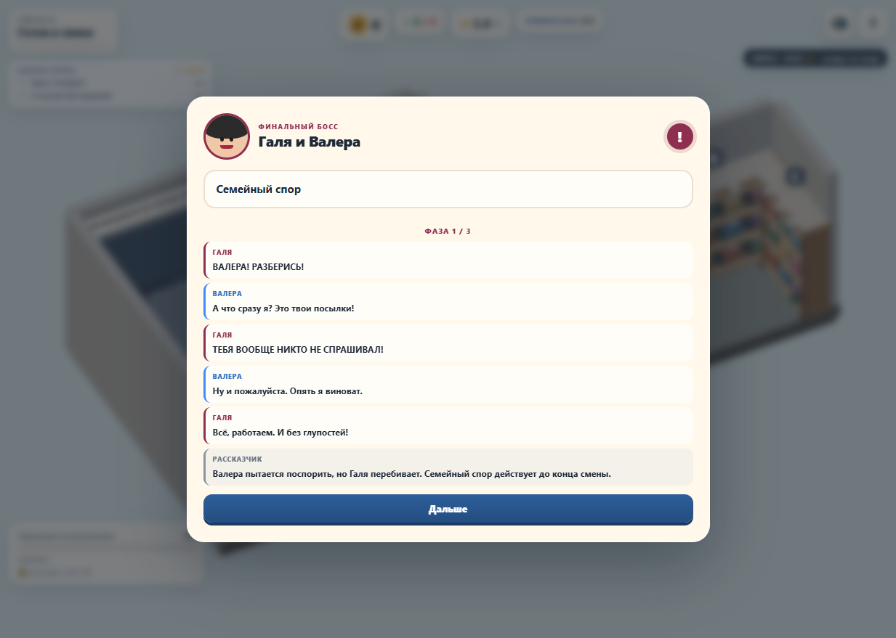

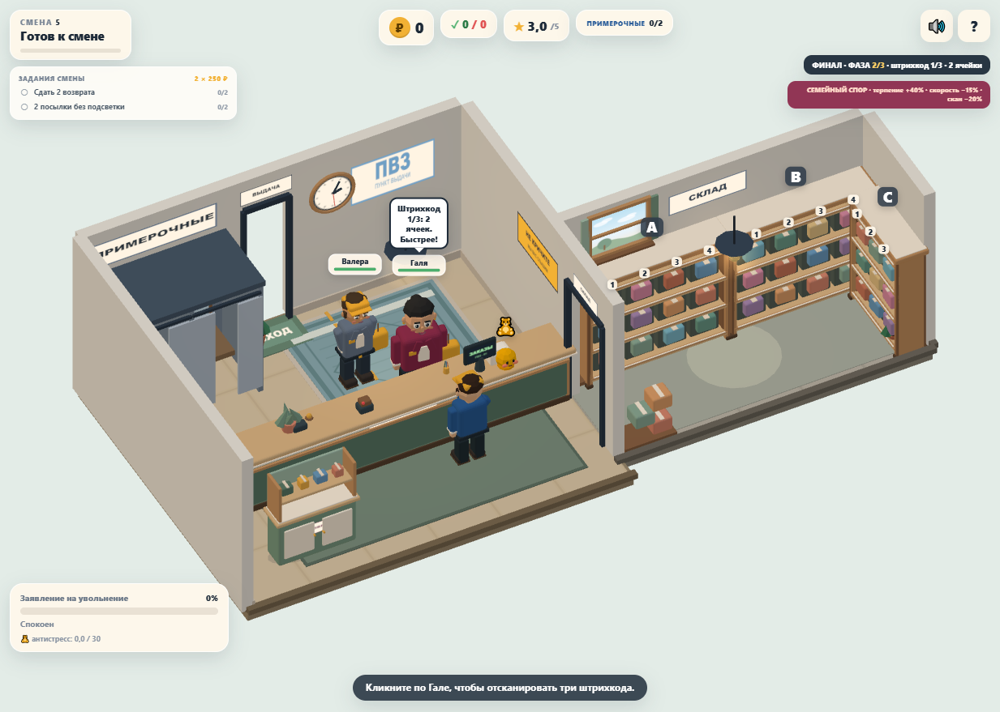

### Хронология введения механик

| Механика | Когда появляется |
|---|---|
| Сканер, ячейки, терпение, стресс, репутация | Смена 1 |
| Поломка сканера Галей и отключение подсветки | Смена 1, после боя с Галей |
| Замена сканера за 5000 ₽ | После смены 1, в магазине улучшений |
| Мини-квесты смены | Смена 1 |
| Итоги смены, магазин улучшений и оформления | После смены 1 |
| Постоянная косметика | После первой покупки в магазине оформления |
| Стеллаж C | Смена 2 |
| Споры с обычными клиентами (10%) | Смена 2 |
| Событие «перепутанные ячейки» | Смена 2, вторая волна |
| Пятнашки, босс Баба Зина и заказ из конкретной ячейки | Смена 2 |
| Многоячейковые заказы | Смена 3, после Сани |
| Курьер Саня и заказ на скорость | Смена 3 |
| Примерочная | Смена 4 |
| Королева примерочной и возвраты | Смена 4, после первой волны |
| Финальный босс, дебафф, три штрихкода | Смена 5, после второй волны |
| Валера в примерочной и три возврата | Смена 5, третья фаза |
| Финальный экран «В меню» | После смены 5 |

---

## Боссы и мини-игры

В окне босса подпись — «БОСС»; у финального — «ФИНАЛЬНЫЙ БОСС». Спор с обычным клиентом подписан отдельно: «СПОР С КЛИЕНТОМ».

### Галя — смена 1

- Появляется после второй волны.
- Варианты: обслужить или вступить в спор.
- Спор: 6 секунд, тапы по кнопке. Чем выше шкала, тем лучше.
- Реплики: стартовая и далее каждые 15% (7 штук). На 100% новых нет.
- Победа: стресс −30, 20 секунд бустера (скорость +30%, скан +50%).
- Поражение: при стрессе 50%+ — увольнение, иначе стресс 85%.
- В любом исходе Галя разбивает сканер: подсветка ячеек отключается. Замена — в магазине за 5000 ₽.

### Баба Зина — смена 2

- После второй волны просит помочь с телефоном.
- Мини-игра «Пятнашки»: 3×3, четыре фрагмента штрихкода, четыре плитки-заглушки и пустая клетка. Сверху — образец штрихкода.
- Нужно передвинуть плитки так, чтобы цветные фрагменты встали в подсвеченные клетки 2×2 по порядку. 75 секунд.
- Победа: −8 стресса, +0,2 репутации. Она называет ячейку — заберите оттуда посылку и выдайте ей.
- Поражение: +15 стресса, −0,5 репутации, она уходит.

### Курьер Саня — смена 3

- Появляется после второй волны.
- Заказ из 4 ячеек, 34 секунды терпения.
- Без диалога и остановки: игрок сразу бежит собирать.
- При входе — портретная заставка на 3 секунды; таймер и управление продолжают работать. При открытии сканера/панели ячеек заставка скрывается.
- Успех — смена продолжается; провал — потеря клиента, репутации и стресс.
- После Сани многоячейковые заказы входят в игру.

### Королева примерочной — смена 4

- Вход, повторный заказ, возврат и уход сопровождаются короткими портретными сообщениями с разными выражениями. Игра продолжается; при открытом сканере/панели ячеек они скрываются.

- Появляется после первой волны и остаётся до конца смены.
- 20–30 товаров на смену.
- Заказ 3 ячейки; не меняет заказ во время сбора.
- После выдачи идёт в примерочную; примерка и занятость кабинки начинаются по прибытии и длятся 6 секунд.
- Первый возврат гарантирован, дальше — 50%.
- Возврат забирается у стойки и сдаётся в шкафчик «Возврат».
- Пока возврат в руках, новые заказы не сканируются.
- Сдача возврата: +0,1 репутации. После сдачи Королева автоматически возвращается с новым заказом через 2 секунды, если бюджет ещё не исчерпан.
- Когда бюджет товаров заканчивается, она уходит навсегда: +0,5 репутации.
- Если игрок занят другим клиентом, Королева ждёт, а не ломает заказ.

### Галя и Валера — смена 5, финал

- Три фазы, начинается после второй волны.
- **Фаза 1:** вход, диалог, дебафф «Семейный спор» (терпение +40%, скорость −15%, скан −20%).
- **Фаза 2:** три штрихкода 2/3/4, всего 9 посылок, 120 секунд базового терпения (около 86 с дебаффом), таймер не сбрасывается.
- После двух сданных штрихкодов — диалог: третий штрихкод Валерин.
- Галя кричит каждые 4–7 секунд; +2 стресса за крик, −1 за сданный штрихкод.
- **Фаза 3:** куртка, Валера идёт в примерочную и занимает одну кабинку, диалог, затем три возврата по очереди.
- Каждый возврат: +0,1 репутации. Победа: +0,5 репутации.
- Провал по таймеру: потеря клиента, репутации и низкие звёзды.
- После победы — финальный экран и «В меню».

---

## Dev-консоль

Открывается по **F2** или **`**.

- Кнопки смен **1–5**.
- **«Босс»** — сразу запускает босса текущей смены:
  - 1 — Галя;
  - 2 — Баба Зина;
  - 3 — Саня;
  - 4 — Королева;
  - 5 — финальный босс.
- **+500 ₽**.
- **«В меню»**.

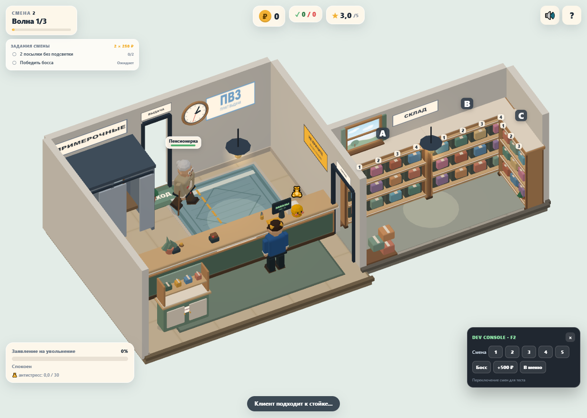

---

## Известные упрощения и планы

Сейчас в прототипе:

- Примерочная работает на таймерах, без отдельных клиентских моделей внутри кабинки.
- Мини-игры между фазами финального босса пока не добавлены: сложность держится на трёх штрихкодах, дебаффе и криках Гали.
- Поломка сканера пока показывается сообщением и отключением подсветки, без отдельной 3D-анимации.
- Идея улучшения Сани: «курьерский маршрут» с подсветкой следующей ячейки и бонусом за скорость.
- Отдельного рекламного бустера подсветки нет: её возвращает покупка нового сканера за 5000 ₽.
- Диалоги боссов подгружаются отдельным чанком. Если загрузка не удалась, игра показывает повтор и сохраняет текущий диалог; после повтора он открывается ровно один раз.

Возможные следующие шаги:

1. Мини-игра между фазами финального босса.
2. Анимация поломки сканера и его замена на стойке.
3. Реальные клиенты в примерочной.
4. Маршрут и бонусы для Сани.
5. Финальные экраны и сохранение прогресса.

---

## Структура проекта

| Файл | Назначение |
|---|---|
| `index.html` | HUD, панели, модалки, магазин, dev-консоль |
| `src/main.ts` | Рендер, камера, игровой цикл, Yandex SDK |
| `src/game.ts` | Смены, волны, боссы, заказы, экономика, dev-методы |
| `src/core/eventBus.ts` | Типизированная шина уведомлений |
| `src/domain/events.ts` | Типы игровых событий |
| `src/domain/run.ts` | Стартовые значения, сброс забега и начало смены |
| `src/domain/save.ts` | Версионированный снимок прогресса, нормализация и resume-смена |
| `src/domain/orders.ts` | Данные заказа и его позиций, без отдельного флага переноски |
| `src/systems/serviceSystem.ts` | Единственный владелец активного обслуживания: picked, стопка/цвета, carrying, readyToDeliver и снимок clear() |
| `src/systems/warehouseSystem.ts` | Складское состояние: stock ячеек, резервы заказов, доступность активных полок и restock |
| `src/systems/encounterCoordinator.ts` | Верхнеуровневый phase, modal/help и единая pause-политика |
| `src/systems/queenScenario.ts` | Сценарий Королевы: появление, примерка, возврат, новый заказ и уход |
| `src/systems/bossScenario.ts` | Lifecycle обычных боссов: Галя, Саня, Зина, Zina-загадка и заказ |
| `src/systems/argumentScenario.ts` | Клиентские споры и спор с Галей: mash, награды и scanner break |
| `src/systems/finalBossScenario.ts` | Сценарий финального босса: Галя, Валера, штрихкоды, примерка и возвраты |
| `src/systems/playerMovement.ts` | Позиция, путь, направление и прибытие игрока |
| `src/view/scene.ts` | Сборка сцены и применение оформления |
| `src/view/kit.ts` | Палитра, материалы, скруглённые примитивы и merge-утилиты low-poly кита |
| `src/view/primitives.ts` | Общие примитивы, тени, текстуры, parcel-геометрия и кэш |
| `src/view/characters.ts` | Персонажи, анимации и босс-персонажи |
| `src/view/props.ts` | Стеллажи, ячейки, стойка, декор, ТВ, игрушка и растение |
| `src/view/environment.ts` | Стены, полы, примерочная, вывески, зоны |
| `src/client.ts` | Клиенты, очередь, терпение, вход/выход, ходьба |
| `src/nav.ts` | Сетка проходимости и A* |
| `src/ui.ts` | Тонкий фасад DOM-интерфейса и view-модулей |
| `src/ui/hud.css` | Стиль и адаптивность игрового HUD и бирок клиентов |
| `src/ui/intermission.css` | Бумажные экраны итогов/магазина и responsive-композиция |
| `src/sound.ts` | Синтезированные звуки |
| `src/yandex.ts` | Обёртка Yandex Games SDK |
| `src/data.ts` | Архетипы, константы, боссы, улучшения, оформление |
| `src/style.css` | Стили и адаптивность |
| `docs/GAME_GUIDE.md` | Этот документ |
| `docs/GDD.md` | Дизайн-документ и roadmap |
| `docs/ROADMAP_ARCHITECTURE_GRAPHICS.md` | План развития архитектуры и графики |
| `docs/STYLE_GUIDE.md` | Визуальный style guide |
| `README.md` | Краткое описание и запуск |

Активную сессию и отметки взятых посылок меняет `ServiceSystem`. `carrying` означает хотя бы одну посылку в руках, `readyToDeliver` — активную сессию с непустым полностью собранным заказом. Game использует готовность для выдачи, сканера, панели и подсказок. При отмене `clear()` возвращает `{ client, order, carried } | null` до сброса состояния: после взятых посылок полки пополняются, без них запас не меняется. Очередь, правила заказов и возвратов сохранены; `clear()` не сбрасывает `carryingReturn`, а полный `reset()` сбрасывает сессию, стопку и возврат.

Складским состоянием владеет `WarehouseState`: `stock` показывает, есть ли посылка в ячейке, `reserved` — занята ли она заказом. `available(activeShelfCount)` отдаёт только доступные ячейки, `reserve`/`release` меняют резервы, `consume`/`restock` — наличие посылок. Game синхронизирует `parcel.visible` только для отображения; генерация заказов, Zina и финальные штрихкоды больше не читают графическое состояние.

Позиция заказа (`currentItem`, `cellId`, `shelf`, `actual*`, `mixed`) вычисляется из `items`. `createOrderRecord()` создаёт getter-поля, поэтому после взятия посылки UI и сканер автоматически переходят к следующему item; ручной `syncOrderTarget()` не нужен.

`EncounterCoordinator` хранит phase, общие pause-состояния (`modalOpen`, `helpOpen`) и overlay-флаги (`tutorialOpen`, `mechanicCardOpen`, `scannerBreakCardOpen`). Переходы идут через `enterMenu/enterBreak/enterPlaying/enterBoss/enterResults/enterGameOver`, а ввод блокируется через `inputBlocked` в menu/results/gameover и при открытой модалке/help. Сценарий Королевы вынесен в `QueenScenario` (6.52), финального босса — в `FinalBossScenario` (6.53), lifecycle обычных боссов — в `BossScenario` (6.54), argue/mash — в `ArgumentScenario` (6.55). AUD-04 закрыт.

Прогресс забега сохраняется на старте смены и на итогах в `localStorage`. `domain/save.ts` описывает версионированный снимок, безопасно нормализует данные и определяет смену для продолжения. Чекпоинт хранит деньги, суммарные показатели, репутацию, улучшения, scannerBroken и декор. «Продолжить» перезапускает сохранённую смену или начинает следующую после итогов; game over, финал и новая игра очищают сейв. Середина смены не сохраняется.

### Запуск

```bash
npm install
npm run dev
```

Обычно игра открывается на `http://localhost:5173/`.

Сборка:

```bash
npm run build
npm run preview
```
