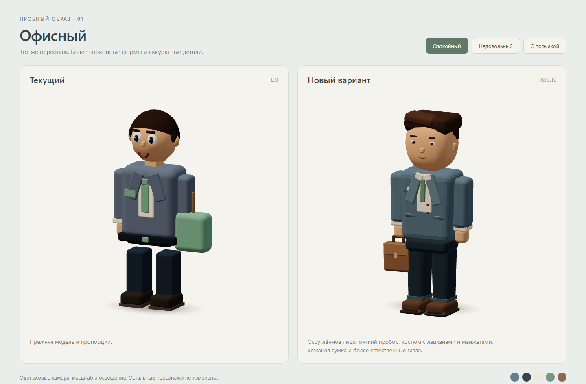
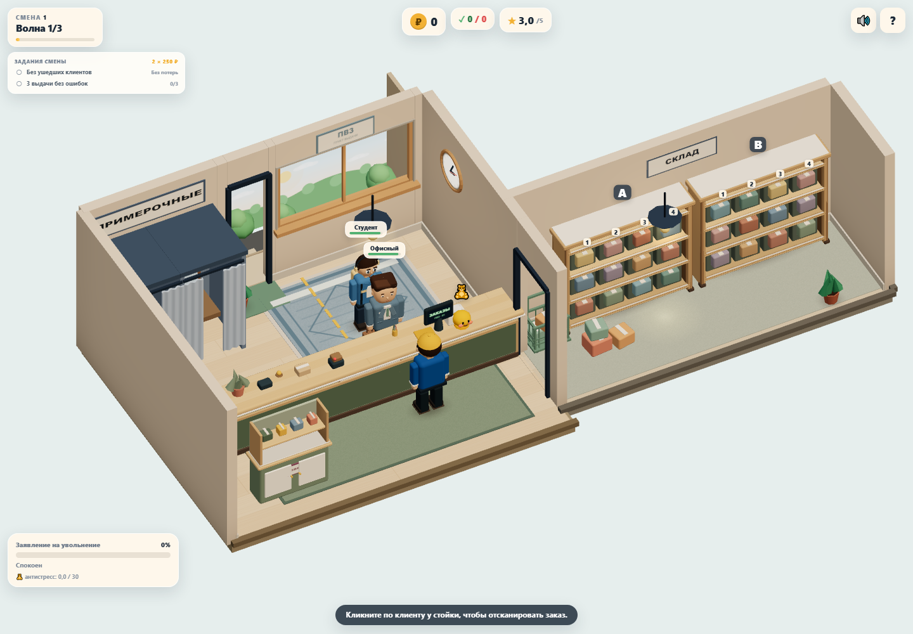
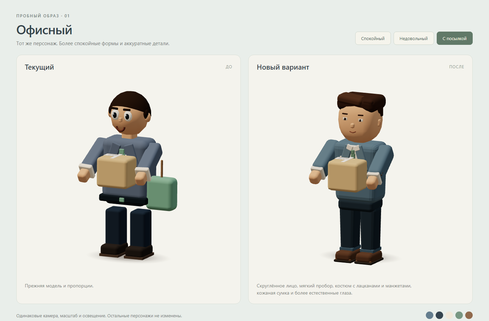
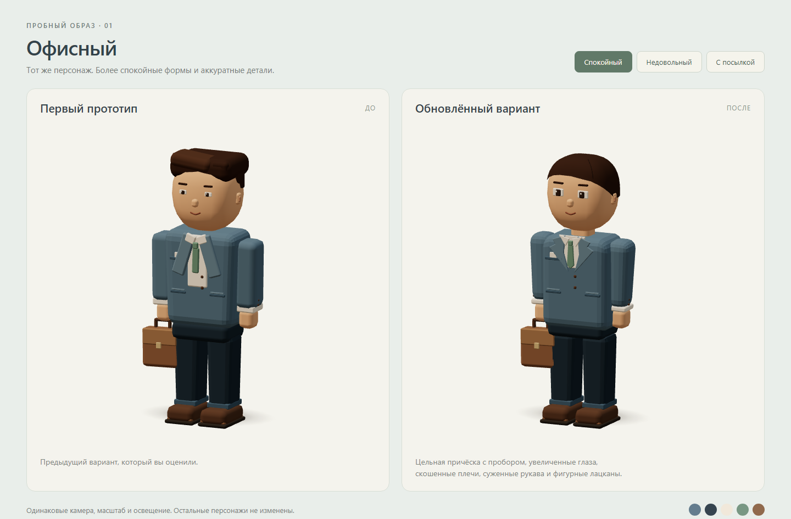
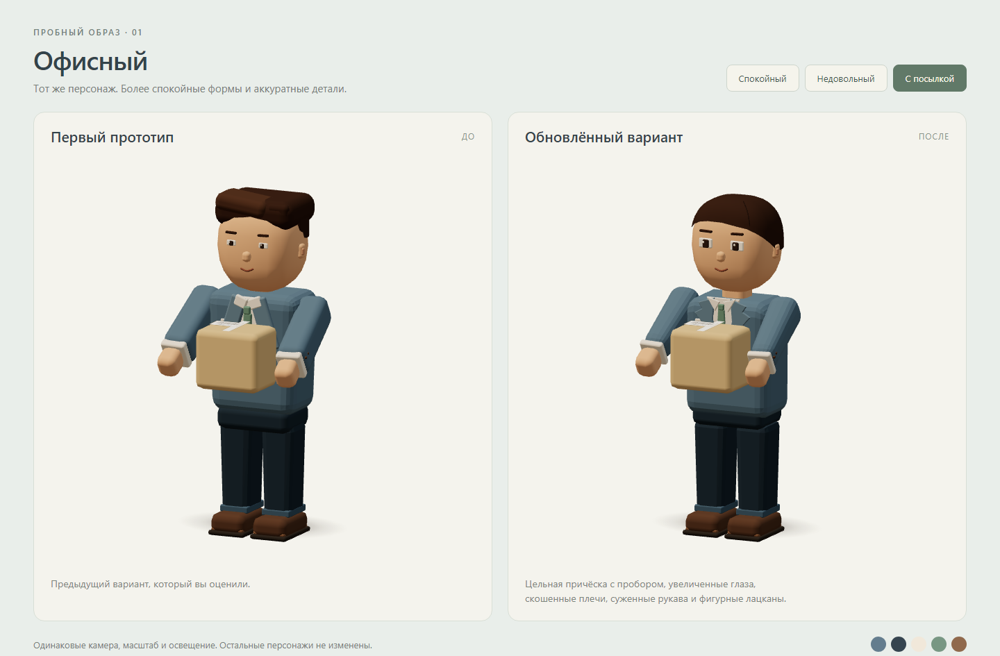
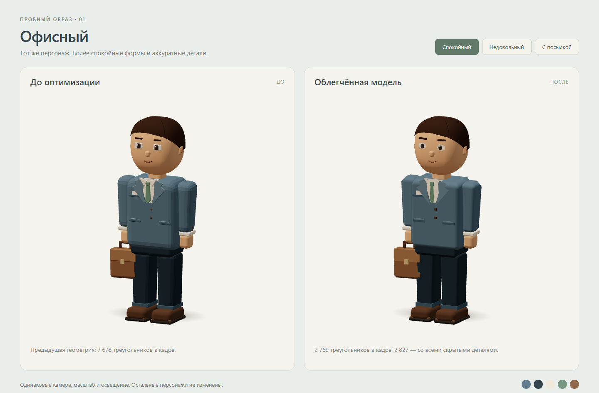
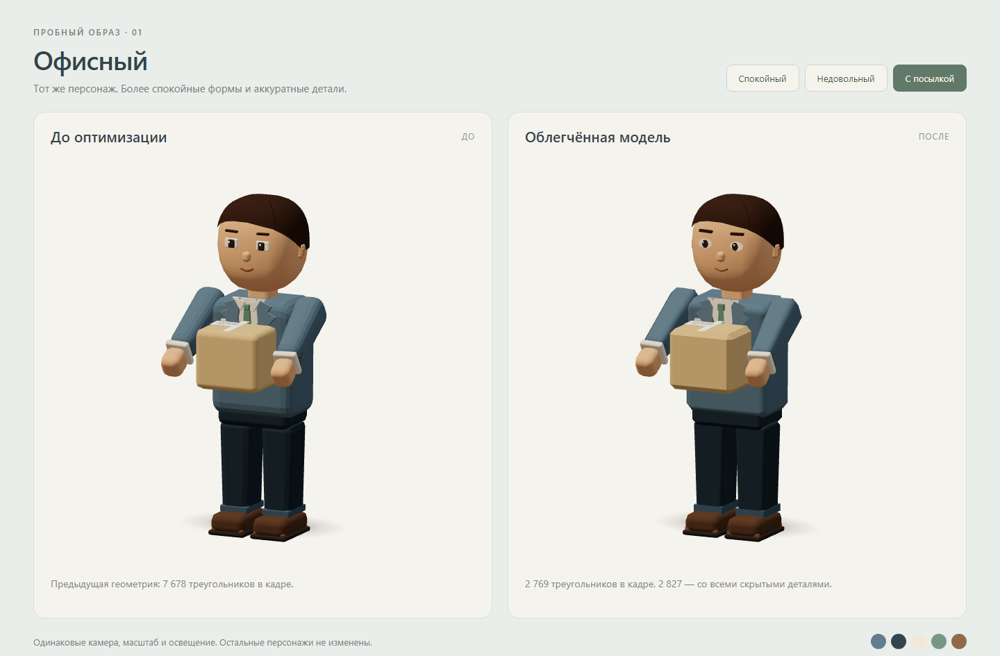
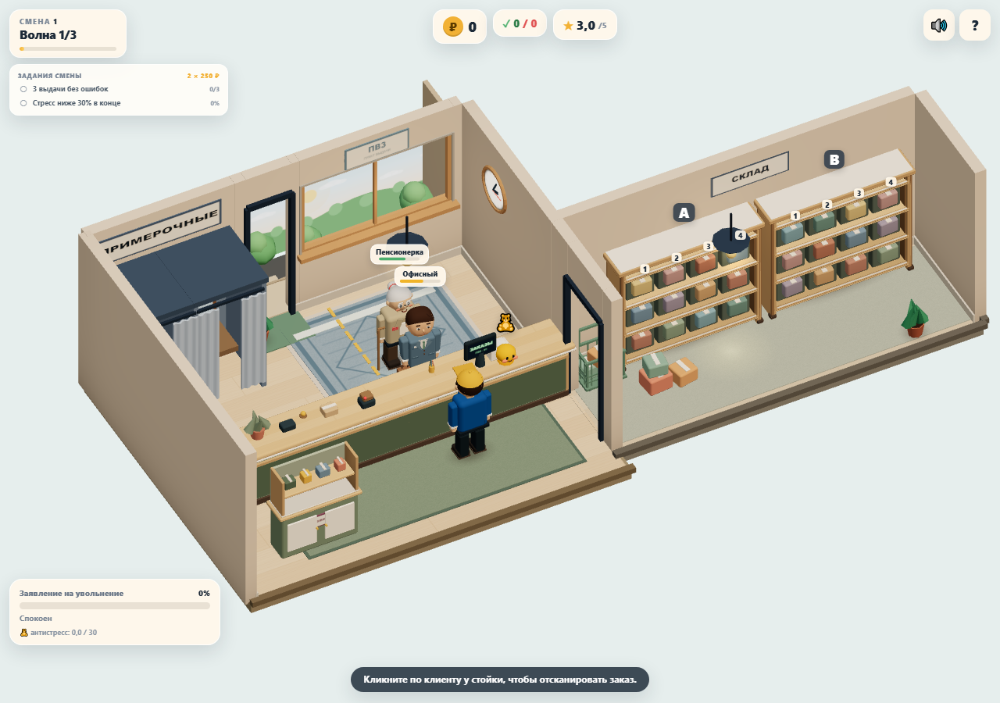

# Пробный образ: «Офисный»

Статус: направление первого прототипа одобрено владельцем; уточнение причёски, глаз и костюма ожидает новой оценки. Перенос стилистики на остальные архетипы не выполнялся.

## Что изменилось

Только архетип `office` использует отдельную визуальную фабрику `src/view/officeCharacter.ts` с прежним контрактом `PersonRig`. Сохранены движение клиента, очередь, терпение, взаимодействия, сканирование и выдача. Визуальная анимация новой модели поддерживает ходьбу, моргание, выражения лица и перенос посылки.

- Более мягкие щёки и подбородок, небольшие глаза вместо крупных выступающих белков.
- Объёмная причёска с пробором и сдержанная улыбка.
- Цельный силуэт костюма, лацканы, воротник, манжеты, карманы и пуговицы.
- Кожаная сумка с ручкой, более аккуратные брюки и обувь. При переносе посылки сумка скрывается.
- Приглушённая сине-серая ткань, кремовая рубашка, шалфейный галстук и коричневая кожа.

Общая фабрика `createPerson` и остальные архетипы не изменены. Этот вариант не является согласованным стилем всей игры.

## Просмотр

```bash
npm run dev
```

Открыть `/tests/visual/office-character.html` на адресе Vite. Страница показывает старую и новую модели с одинаковыми масштабом, камерой и светом. Кнопки позволяют сравнить спокойное/недовольное выражение и позу с посылкой. Это отдельный стенд, не изменение игрового интерфейса.







## Проверка

- `npm run build` — успешно.
- `npm test` — 41/41.
- `npm run test:e2e` — 1/1.
- Отдельный браузерный сценарий именно для «Офисного»: клиент → удержание сканера → ячейка → получение → выдача; счётчик обслуженных увеличился. Ошибок console.error/pageerror нет.
- Preview: проверены обе эмоции и перенос посылки; ошибок страницы нет.
- `npm run perf -- --label office-prototype --check-budget` — бюджет пройден. Фиксированные сцены: 125 / 177 draw calls, 77 826 / 112 962 треугольника, 16 / 19 текстур, 10 программ. Эти счётчики не являются подтверждением FPS на телефоне.
- В сравнительном стенде одна нейтральная модель: 12 → 13 draw calls, 9 012 → 7 930 треугольников. Мелкие фаски используют меньше сегментов; shadow maps и новые текстуры не добавлены.

## Уточнение после первой оценки

- Вместо нескольких отдельных объёмов причёска построена как единая поверхность по форме головы, с асимметричной линией роста волос и небольшим боковым пробором.
- Глаза увеличены примерно в полтора раза по ширине; увеличены радужки и блики, сохранены моргание и выражения.
- У пиджака скошены плечи и уточнена талия, рукава сужены к манжетам. Прямоугольные накладки заменены фигурными лацканами; воротник, рубашка и галстук согласованы по контуру и глубине. Пуговицы рукавов посажены на поверхность ткани.

Слева на сравнении — первый прототип `87e2852`, справа — уточнённый. Прежние иллюстрации выше сохранены для истории.






Повторно прошли build, 41 unit-тест, e2e 1/1 и perf с проверкой бюджета. Нейтральная модель: 13 draw calls / 7 678 треугольников (первый прототип: 13 / 7 930). Контрольные сцены: 125 / 177 calls, 77 574 / 112 710 треугольников; 16 / 19 текстур и 10 программ. На стенде проверены увеличенные глаза, недовольное выражение и перенос; кадр в игре просмотрен. Новых эффектов, shadow maps и текстур нет.

## Упрощение геометрии до 1500–3000 треугольников

После одобрения направления владелец запросил сокращение геометрии. Корпус, одежда и сумка используют недорогие фаски с интерполированными нормалями; самые мелкие детали — простые короба. Лацканы/воротник/галстук стали плоскими поверхностями с прежними контурами. Белки, радужки и блики глаз собраны из плоских дисков. Уменьшена детализация кривых улыбки и пробора; убраны маленькие шнурки и пуговицы на рукавах.

Сохранены голова и причёска, пропорции, мягкая геометрия кистей, носа, ушей, обуви и манжет. Кэширование геометрии, прежний контракт rig и анимации сохранены; остальные архетипы не изменены.

| Измерение одной модели | До | После |
|---|---:|---:|
| Видимые треугольники, обычная поза | 7 678 | 2 769 |
| Видимые треугольники, с посылкой | 7 140 | 2 711 |
| Все меши, включая скрытые позы/посылку | 7 896 | 2 827 |
| Draw calls, обычная поза | 13 | 13 |

Сокращение треугольников — примерно 64%; это не обещание пропорционального роста FPS. Обычные draw calls не изменились. Временный вариант на ~2000 треугольников выглядел слишком угловато, поэтому часть бюджета возвращена важным мягким деталям.







Слева на сравнении — версия `37da80c`, справа — облегчённая модель, при одинаковой камере/свете/масштабе. Build и 41 unit-тест прошли. Браузерные проверки — 2/2: основной цикл и новый тест `office-geometry.spec.ts`, ограничивающий все меши и видимую геометрию в нейтральной/недовольной/злой позах, ходьбе и переносе лимитом 3000. Ошибок страницы/консоли нет. Perf с `--check-budget` прошёл: 125 / 177 draw calls, 72 665 / 107 801 треугольник для фиксированных сцен; текстуры и программы не добавлены.

Следующий шаг — визуальная оценка облегчённого образа владельцем. Изменения остальных персонажей зависят от этой оценки.

## Продолжение: visual pass всех обычных персонажей

После одобрения облегчённой модели выполнен [общий visual pass](CHARACTER_VISUAL_PASS.md) в отдельной ветке `sol/character-visual-pass`. `officeCharacter.ts` сохраняет совместимую фабрику и вызывает общий `characterRig.ts`; исторические сравнения выше относятся к этапу прототипа. Новые образы, метрики и ограничения перечислены в отдельном отчёте. Merge ожидает ревью Lead.
