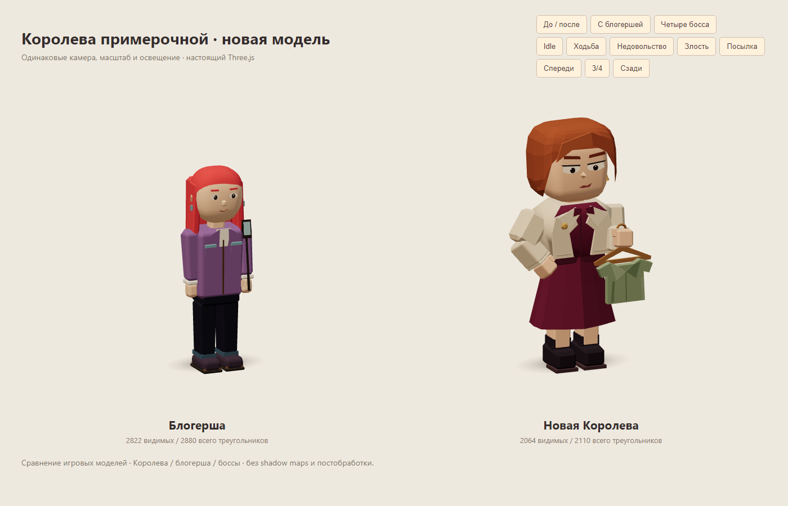
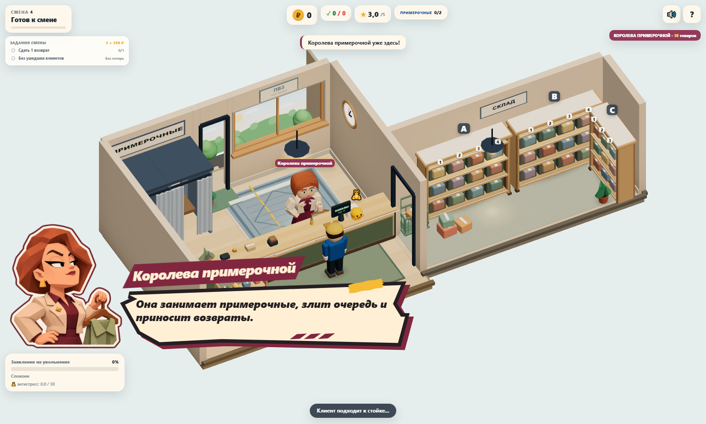

# Королева примерочной: перенос одобренного концепта

Задание владельца без отдельного issue. Ветка `sol/queen-character-concept`, отдельный worktree от `c2953fb` (main после PR #26), перед PR обновлён до main с исправлением #17 / PR #27 (`6cc40bc`). Готовый результат передаётся OpenCode Lead на ревью; самостоятельного merge нет.



[Одобренный концепт](screenshots/queen-character/approved-concept.png) · [До / после](screenshots/queen-character/idle.png) · [Крупный план](screenshots/queen-character/close-up.png) · [Четыре босса](screenshots/queen-character/lineup.png)

## Образ и реализация

Вместо длинноволосой клиентки с селфи-палкой — требовательная взрослая модница: короткое медное каре с боковым пробором, приподнятый подбородок, выразительные глаза, светлый укороченный жакет с лацканами и золотой брошью, бордовая блузка и расширяющаяся юбка миди, тёмные ботильоны на низком каблуке. Правая рука держит шалфейную блузку на открытой деревянной вешалке, левая стоит на бедре. Силуэт и аксессуары отличаются от обычной блогерши; её модель не менялась.

`src/view/queenCharacter.ts` реализует прежний `PersonRig`: root/body/head/armL/armR/legL/legR, setCarry/update/dispose. В `Client` изменён только выбор фабрики для `fitting-queen`. Размер персонажа берётся из прежнего archetype. Одежда и причёска задаются внутри view-фабрики, как у остальных обновлённых боссов; игровые данные не переписаны.

- Спокойный idle с дыханием и взглядом, уверенная ходьба, моргание, прищур и три кэшированных выражения. При недовольстве — постукивание ногой, при злости — поднятая рука и открытый рот.
- Два сегмента рук, манжеты, кисти с большим пальцем; кисти поддерживают посылку с двух сторон. При переноске вешалка скрывается. В остальных позах она компенсирует поворот предплечья и остаётся вертикальной.
- Юбка имеет широкие low-poly складки, жакет — отдельный перед с лацканами и цельную спинку. Волосы построены крупными гранями без отдельных прядей.
- Стопка из 1–4 посылок сохраняет отдельные цвета коробок и общий parcel decal. Геометрия/материалы общих кэшей, contact shadows и parcel-ресурсы не освобождаются при уничтожении персонажа.

Изолированные позы: [ходьба](screenshots/queen-character/walking.png), [недовольство](screenshots/queen-character/impatient.png), [злость](screenshots/queen-character/angry.png), [посылка](screenshots/queen-character/carry.png), [спереди](screenshots/queen-character/front.png), [сзади](screenshots/queen-character/back.png). Одинаковые камера, свет, масштаб и время позы для прежней и новой модели. Галерея доступна через `npm run dev` → `/tests/visual/queen-character.html`.

## Геометрия и ресурсы

| Состояние | Прежняя модель | Новая модель |
|---|---:|---:|
| Нейтральная, видимые треугольники | 9 816 | 2 064 |
| С четырьмя созданными коробками, всего | — | максимум 2 242 |
| Видимые с четырьмя коробками | — | максимум 2 060 |
| Calls изолированной модели, без посылки / 4 коробки | — | 13 / 17 |

В `total` включены скрытые созданные коробки, вешалка и decal; запасные выражения в кэше не являются одновременно отображаемыми мешами. До создания коробок нейтральный rig содержит 2 066 треугольников. Разница angry/idle — 8 треугольников лица. [Raw по всем настроениям и переноске](perf/queen-character/geometry.json).

Статические детали батчатся в `VERTEX_COLOR_MATERIAL`. Исходные формы и три выражения переиспользуют `cachedGeometry()`/`mat()`. На экземпляр приходятся **9 объединённых геометрий**, до **4 ленивых материалов цветов посылок**; они зарегистрированы в `personResources` и освобождаются существующим идемпотентным disposer. В `update()` новые ресурсы не создаются.

20 циклов create → render всех выражений/четырёх коробок → double dispose проверяют однократное освобождение instance-ресурсов, сохранность общих кэшей и одинаковые `geometries/textures/programs` после прогрева. Это проверка жизненного цикла нового rig; штатные long-session проверки проекта сохранены.

## Портреты того же персонажа



[Возврат](screenshots/queen-character/dialogue/return-desktop.png) · [Довольный уход](screenshots/queen-character/dialogue/departure.png) · [Новый заказ](screenshots/queen-character/dialogue/new-order.png) · [390×844](screenshots/queen-character/dialogue/return-portrait.png) · [320×568](screenshots/queen-character/dialogue/return-small.png) · [568×320](screenshots/queen-character/dialogue/return-landscape.png)

Новый `src/assets/queen-expressions-v2.webp` согласован с одобренным концептом: каре, кремовый жакет, брошь, бордовая блузка и вешалка; раздражённый кадр показывает возврат. Требовательное / раздражённое / довольное выражения занимают прежние три ячейки. CSS и preload переключены на v2; старая картинка сохранена для истории/отката. Силуэт SVG-окна, тексты, таймеры, ввод и логика диалога не менялись.

Атлас: **2172×724 RGBA, 215 370 байт** против прежних 223 296, true alpha и прозрачные промежутки. Decoded RGBA — **6 290 112 байт (~6 MiB)**, как прежде. Память CSS-картинки не входит в `renderer.info.memory`; новых WebGL-текстур нет, переключение трёх эмоций переиспользует один атлас.

Концепт и портреты созданы встроенным **image_gen**, режим генерации по изображениям-референсам. Для нового атласа одобренный концепт задавал внешность, старый атлас — только расположение ячеек и графический стиль. Затем Pillow использовался только для PNG → WebP, без перерисовки. Полные промпты: [концепт](QUEEN_CHARACTER_CONCEPT_PROMPT.txt), [портреты](QUEEN_CHARACTER_PORTRAIT_PROMPT.txt). Изображение концепта — документация, оно не импортируется в production.

## Производительность

Одинаковый Chromium 158 / SwiftShader, seed 73129, 1280×900 DPR 1, штатная камера, встреча Королевы в 4-й смене. Service simulation приостановлена, мир анимируется; 1,5 с прогрева и 5 с RAF. Baseline снят до изменения фабрики/атласа на `c2953fb`, после — на `0e85070`. Фикстура оставляет сцену в передышке; это сравнение рендеринга, а не прохождение смены. Изображения: [до](screenshots/queen-character/game-before.png) / [после](screenshots/queen-character/game-after.png).

| Встреча Королевы | До | После |
|---|---:|---:|
| Видимые треугольники персонажа, angry | 10 052 | 2 056 |
| Draw calls сцены | 121 | 122 |
| Triangles сцены | 78 242 | 70 246 |
| Geometries / textures / programs | 87 / 16 / 9 | 88 / 16 / 9 |
| avg / p95 / max RAF, мс | 118,21 / 133,40 / 133,50 | 115,53 / 116,70 / 133,30 |

[Raw до](perf/queen-character/before.json) / [после](perf/queen-character/after.json). Один дополнительный draw call/geometry связан с артикулированной моделью и вешалкой; бюджет соблюдён. Изменение RAF в программном рендерере не доказывает ускорения на телефоне.

| Штатный perf после изменений | Calls | Triangles | Textures / programs | avg / p95 / max RAF, мс |
|---|---:|---:|---:|---:|
| 2 клиента | 122 | 60 615 | 16 / 9 | 108,51 / 116,70 / 133,30 |
| 4 клиента + всё оформление | 173 | 83 430 | 19 / 9 | 122,35 / 133,40 / 133,40 |

[Raw стандартных сцен](perf/queen-character/fresh-scenes.json). Счётчики совпадают с main/предыдущим проходом: обычные архетипы не менялись. Shadow maps выключены, refresh = 0; нет SSAO, bloom, GLTF, 3D-текстур или постобработки.

Дополнительный production preview 1600×960, одна замороженная сцена, 1 с прогрева + 5 с RAF: без портрета **126,66 / 133,40 / 133,40 мс**, с портретом **128,63 / 150 / 150 мс**. В обоих состояниях **122 calls, 70 254 triangles, 88 geometries, 16 textures, 9 programs**. [Raw overlay](perf/queen-character/overlay.json). Восемь дополнительных треугольников относительно angry-фикстуры — нейтральное выражение. В capture-фикстуре срок баннера продлён до 30 с, в игре прежние 3/2,2 с; измерение исключает входную анимацию. Production build соответствует `0e85070`, dirty tree в JSON — добавляемая документация.

## Проверки и границы

```sh
npm run build
npm test
npm run test:e2e
node tests/perf/queen-character.mjs after
npm run perf -- --label queen-character --check-budget
```

Build прошёл, **43/43 unit**, **41/41 e2e**, perf budget прошёл. Для локальной изоляции полный e2e запускался через временную копию конфигурации (`--config=test-results/queen-model-playwright.config.ts`, Vite 4198); штатный конфиг не менялся. Новый boss perf поднимает и закрывает Vite на 4196, сохраняет JSON/кадр в `test-results/perf/queen-model/<label>/`. Формат baseline/after одинаковый.

Три новых e2e проверяют контракт, позы, моргание, три выражения, вертикальность вешалки, четыре цвета, бюджет, 20 dispose-циклов, реальную фабрику и три прозрачных кадра атласа. Существующий natural-entry тест по-прежнему проходит настоящий переход во вторую волну desktop/mobile и теперь подтверждает `queen-body`. Полный набор покрывает сканер/ячейки/выдачу/итоги/магазин, очередь, возвраты и остальных боссов. `console.error`/`pageerror` отсутствуют в тестах и замерах. Прежние предупреждения размера bundle и deprecated THREE.Clock остаются.

Игра, баланс, заказы, тексты, QueenSystem, камера, управление, окружение и другие персонажи этим проходом не менялись. Исправление автоматического нового заказа после возврата (#17 / PR #27) сохранено из main: полный e2e проходит настоящий cooldown без ручного `returnQueen()`. Снимки/overlay сняты до обновления ветки; для снимка нового заказа использован прежний отдельный вызов обработчика, а не доказательство автоматического перехода. У юбки нет cloth simulation, у кистей — отдельных пальцев; проверка на физических iOS/Android не проводилась. Откат: вернуть прежний выбор фабрики и два URL атласа; игровые сохранения/контракты не менялись.
