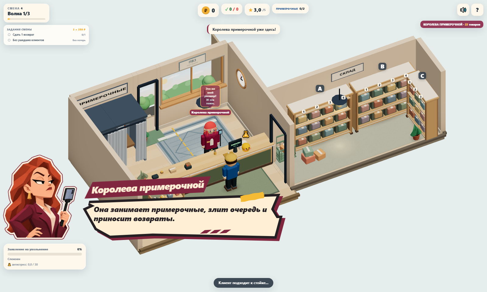
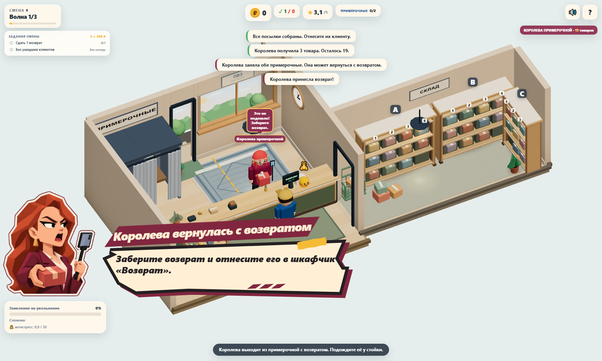

# Королева примерочной: портретные сообщения

Задание владельца: оформить четвёртого босса в общей стилистике диалогов. Ветка `sol/queen-dialogue-scene`, отдельный worktree. Исходная база — `9e3ac6d` (после PR #13); перед ревью ветка обновлена merge-коммитом с `main` (`c0ecc58`, после PR #15), чтобы развести нумерацию разделов roadmap. Отдельный issue не назначен; merge остаётся Lead/владельцу.





[Примерка](screenshots/queen/fitting.png) · [Новый заказ](screenshots/queen/new-order.png) · [Уход](screenshots/queen/departure.png) · [Portrait](screenshots/queen/return-portrait.png) · [320×568](screenshots/queen/return-small.png) · [568×320](screenshots/queen/return-landscape.png)

## Что изменилось

Королева остаётся постоянным участником четвёртой смены. Через существующие сообщения о её состояниях показаны большой low-poly портрет, бордовая плашка имени, общая SVG-бумага, контур, подложка, скотч и три штриха. Управление, очередь, сканер и примерочные продолжают работать. Новых остановок игры, ответов или реплик нет.

| Существующий заголовок | Выражение | Исходная длительность |
|---|---|---:|
| Королева примерочной | Требовательное, надменное | 3 с |
| Королева вернулась | Требовательное | 2,2 с |
| Королева вернулась с возвратом | Раздражённое, с посылкой | 3 с |
| Королева ушла | Довольное, самоуверенное | 3 с |

Рыжие длинные волосы, серьги, бордовая одежда и телефон на селфи-палке следуют `QUEEN_ARCHETYPE`. Один атлас содержит три выражения: 0% / 50% / 100%. Переключение background-position переиспользует ресурс.

`HudView.banner` добавляет профиль и выражение для четырёх уже существующих заголовков. Тексты и длительности принадлежат прежним вызовам Game; API banner не менялся. На обычном сообщении атрибуты удаляются, на Сане используется его прежний портрет. При открытых сканере или панели ячеек портретное сообщение скрыто; фокус/ввод не перехватываются, reduced motion сохранён.

Новых SVG path нет: используется та же поверхность, обводка, подложка, скотч и штрихи, что у Сани/Гали. Для длинных заголовков Королевы ограничена ширина плашки и подобран размер шрифта; доступность вплоть до 320×568 и 568×320 проверяется автоматически.

Не изменялись `game.ts`, `data.ts`, `QueenSystem`, заказы, экономика, примерки, камера, маршруты, 3D-модели и их ресурсы. Правки стопки посылок и выхода клиентов из #12 сохранены. Галя, Зина, Саня и обычные уведомления остаются в общей проверке.

## Исправление обычного входа во вторую волну

Оформление из PR #16 присутствовало в main, но при обычном прохождении четвёртой смены его сразу скрывал следующий вызов banner. `startWave(2)` сначала вызывал `spawnQueen()` с трёхсекундным портретным сообщением, затем безусловно показывал «Волна 2». Общий HudView заменял текст, убирал профиль Королевы и сбрасывал таймер. Старый смоук использовал `debugBoss()` после запуска волны и не покрывал эту последовательность.

Регрессия на main `ae03fc2`: переход «волна 1 → передышка → волна 2», без `debugBoss()` / прямого `spawnQueen()`, ожидал «Королева примерочной», получил «Волна 2». [Кадр до исправления](screenshots/queen/natural-entry-before.png).

В `startWave()` сохранено исходное условие и место появления Королевы. Только в волне, в которой она впервые появилась, обычный баннер волны пропускается; номер волны в HUD обновляется как прежде. Портрет получает исходные 3 секунды. Порядок создания клиента/заказа, RNG, бюджет, спавн обычных клиентов, фаза и управление не менялись. Новых пауз, реплик, ассетов или изменений CSS нет.

Добавлены два e2e (1400×900 и 390×844) через настоящий директор смены: первая волна, её завершение, передышка, вход во вторую. Проверяются обычный баннер первой волны, наличие Королевы/бюджет/следующие клиенты, отсутствие модальной паузы, портрет/выражение/исходный текст и автоматическое скрытие. Показ через F2 остаётся в прежних тестах.

[Обычный вход после исправления — desktop](screenshots/queen/natural-entry-desktop.png) · [mobile](screenshots/queen/natural-entry-mobile.png).

Проверки исправления: `npm run build`, 43 unit-теста и полный набор 38 e2e проходят; ошибок `console.error`/`pageerror` нет. Для изоляции от рабочего каталога Lead тесты запускаются в отдельном worktree, локальный Vite — порт 4194 через временную копию конфигурации. Production-конфиг и исходные ассеты не менялись.

Ошибка автоматического нового заказа после сдачи возврата исправлена отдельно в issue #17 / PR #27 (см. ниже).

## Автоматический новый заказ после возврата

В исходной базе `9e3ac6d` после сдачи возврата Королева не возвращалась автоматически. `deliverReturn()` устанавливал cooldown = 2, но `inFitting` оставался false; `readyToReturn` требует true. При положительном бюджете cooldown достигал нуля, а условие возврата не выполнялось.

Исправление: `deliverReturn()` теперь возвращает Королеву в примерочную на 2 секунды, поэтому `readyToReturn` срабатывает после cooldown, и `Game.updateQueen()` сам вызывает `returnQueen()` с новым заказом. Последний товар по-прежнему завершает смену через `finishQueen()`.

[Зафиксированный результат и последовательность вызовов](perf/queen/baseline-return.json). Минимальная последовательность на исходном классе:

```js
const queen = new QueenSystem();
queen.spawn(20);
queen.deliver(3);
queen.startFitting(6);
queen.tickCooldown(6);
queen.beginReturn(true);
queen.takeReturn();
queen.deliverReturn();
queen.tickCooldown(2.1);
// budget = 17, cooldown = 0, returnInHand = false,
// inFitting = true, readyToReturn = true
```

E2E проходит реальный путь «выдача → шестисекундная примерка → возврат → приём/сдача возврата → новый заказ» без ручного вызова `Game.returnQueen()`: после сдачи тикает настоящий cooldown и `updateQueen()` автоматически возвращает Королеву. Unit-тест проверяет `inFitting` и `readyToReturn` после `deliverReturn()`. Уход проверяется на фикстуре последнего заказа через штатные pickup/deliver/finish.

## Поход в примерочную

Раньше `hideQueen()` сразу переносил Королеву в точку примерочной и запускал 6-секундную примерку. Теперь после получения заказа она видимо идёт от стойки к примерочной: `queen.state === 'entering'`, `inFitting === false`, кабинки свободны. Примерка и `fittingOccupied = [true, true]` включаются только по прибытии. `checkWaveComplete()` не завершает волну, пока Королева в пути. E2E проверяет начальную позицию у стойки, число кадров движения, прибытие и только затем примерку.

## Проверки и воспроизведение

```sh
npm run build
npm test
npm run test:e2e
npm run perf -- --label queen-dialogue --check-budget
node tests/perf/queen-dialogue.mjs
```

Два новых e2e покрывают исходные тексты/бюджет, выдачу 3 товаров, примерку 6 с, первый возврат, приём/сдачу, существующий обработчик нового заказа, награду/завершение, три выражения, все четыре заголовка на семи viewport, отсутствие перекрытия текста портретом, доступность сканера, reduced motion, сохранение фокуса и сброс профиля на Саню/обычный баннер.

Capture/perf-скрипт сам поднимает production preview на 4183 и закрывает его. Seed `20261111`, DPR 1, штатная камера. Для фикстур срок баннера продлён до 30 с, чтобы записать кадры и 5 с RAF; production использует прежние 3/2,2 с. Одна сцена/поза заморожена, render loop активен; 1 с прогрева и 5 с RAF в каждом состоянии. Файл сохраняется в `test-results/perf/queen-overlay/metrics.json`, изображения — в `docs/screenshots/queen`.

Build успешно, **43/43 unit**, **24/24 e2e** после merge с `main`: 22 сценария базы (включая онбординг первой смены/магазина) и 2 сценария Королевы. Полный браузерный набор включает проверки стопки посылок/очереди, lifecycle 20 циклов, terminal game over и предыдущих боссов. Ошибок console.error/pageerror нет. Прежние предупреждения размера bundle и THREE.Clock остаются.

Локальный полный e2e после merge с `main` выполнен на штатном порту 4174: 24/24. На исходной базе использовался временный игнорируемый конфиг на 4184, поскольку порт был занят другой работой; в PR он не входил. CI запускает штатный `npm run test:e2e`.

## Производительность и ограничения

WebP `src/assets/queen-expressions.webp`: **2172×724 RGBA, 223 296 байт**, около **6,3 МБ** decoded RGBA. Один атлас предзагружается при создании HUD, новые показы меняют только CSS-атрибуты/позицию кадра. Память CSS-картинки не входит в renderer.info.memory.

Новых canvas, shadow maps, материалов/геометрий Three.js, SSAO, bloom и постобработки нет. Замеры на SwiftShader показывают сравнение одного окружения; производительность на физических iOS/Android требует отдельной проверки.

| Обычная сцена, 1280×900 | Calls | Triangles | Textures | Programs | avg / p95 / max RAF, мс |
|---|---:|---:|---:|---:|---:|
| 2 клиента | 122 | 60 615 | 16 | 9 | 127,91 / 150,00 / 150,00 |
| 4 клиента + всё оформление | 173 | 83 430 | 19 | 9 | 136,48 / 150,10 / 166,60 |

[Raw fresh scenes](perf/queen/fresh-scenes.json): рабочее дерево поверх `9e3ac6d`, seed `73129`, 5 с RAF. `--check-budget` успешно; счётчики соответствуют базе предыдущего визуального прохода. Shadow maps отключены, refresh = 0.

| Одна сцена Королевы, 1600×960 | avg / p95 / max RAF, мс | Calls | Triangles | Geometries | Textures | Programs |
|---|---:|---:|---:|---:|---:|---:|
| Портрет скрыт | 227,53 / 250,00 / 266,60 | 121 | 78 006 | 87 | 16 | 9 |
| Портрет показан | 222,45 / 233,40 / 233,40 | 121 | 78 006 | 87 | 16 | 9 |

[Raw overlay](perf/queen/overlay.json). Колебания времени кадра в программном рендерере не означают ускорения от UI; WebGL-счётчики одинаковы в обоих состояниях. Короткая входная анимация исключена, память CSS-атласа приведена отдельно выше.

## Ассет и финальный промпт

Использован встроенный **image_gen**, навык `imagegen`, без CLI/API генерации и внешних скачанных ассетов. Референсы: атлас Гали как стиль/композиция и скриншот текущей 3D-Королевы как внешность. Результат кодирован WebP quality 90 с сохранением alpha. Ассеты предыдущих персонажей не заменялись.

```text
Use case: stylized-concept. Production transparent three-expression portrait atlas for PVZ Tycoon, matching its existing Galya, Baba Zina and Sanya dialogue cutouts. Image 1 is STYLE/ATLAS COMPOSITION REFERENCE ONLY: same faceted low-poly casual-game illustration, warm controlled light, bold expressive eyes and eyebrows, thick ivory paper outline plus thin burgundy outer edge, three equal square cells in one horizontal 3:1 strip. Image 2 is CHARACTER IDENTITY REFERENCE ONLY: the slim tall young adult woman behind the counter with vivid copper-red LONG hair, burgundy coat, ivory shirt and gold earrings, holding her smartphone on a short selfie stick. She is the Fitting Room Queen, a demanding fashion shopper, NOT a literal monarch. Create this stylish young Slavic woman, late twenties, fair warm peach skin, refined angular face and slim shoulders, confident dramatic brows, copper-red side-parted long hair with faceted locks past shoulders, small geometric gold drop earrings. Burgundy tailored jacket with clear lapels, ivory blouse, slim silhouette. Smartphone/selfie stick visible in one hand across all three frames. NO crown, tiara, royal costume or Galya's black hair/bun or round heavy body. Three-quarter bust facing screen RIGHT with same head size, identity, outfit and baseline in every cell. LEFT CELL: imperious unimpressed confidence, one eyebrow slightly raised, half-lidded eyes, closed mouth with a haughty smirk, free hand on hip. MIDDLE CELL: irritated at an unsuitable purchase, brows knitted, mouth open in a complaint; free hand extends a small muted red parcel for a return, other hand still holds phone. RIGHT CELL: pleased and self-satisfied after shopping, raised chin, relaxed eyebrows, small knowing smile, free hand lightly adjusting her jacket lapel. Entire head, torso, phone and hands safely inside their own square cell with transparent gutters, no overlap between cells. Keep strong readable silhouettes and large expressive faces at mobile thumbnail size. Angular polygonal shading, crisp clean low-poly planes and graphic comic portrait finish exactly matching the STYLE reference, no photorealism/anime or smooth plastic rendering. Three independent ivory/burgundy outlined die-cut bust silhouettes on true alpha transparency. No environment, UI, text, captions, logos or watermarks.
```
