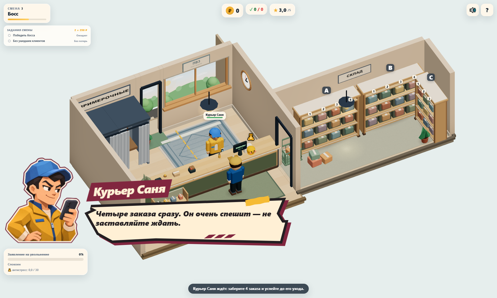

# Визуальный вход курьера Сани

Задание владельца: третий босс после Гали и Зины. Работа в `sol/sanya-dialogue-scene`, отдельный worktree от свежего `main` (`946bdec`, после PR #12). Отдельный issue не назначен. Merge остаётся Lead/владельцу.



[Portrait](screenshots/sanya/entrance-portrait.png) · [Landscape](screenshots/sanya/entrance-landscape.png) · [320×568](screenshots/sanya/entrance-small.png) · [568×320](screenshots/sanya/entrance-small-landscape.png) · [Сканер поверх игры, заставка скрыта](screenshots/sanya/scanner.png)

## Поведение и границы

У Сани уже есть сценарий выдачи четырёх заказов за 34 секунды. Его вход оформлен через **существующий баннер на 3 секунды**: портрет, имя и исходная подпись «Четыре заказа сразу. Он очень спешит — не заставляйте ждать.». Игрок сразу продолжает работу, терпение убывает, фокус и управление остаются у игры.

- Синяя кепка, короткие тёмные волосы, жёлтая куртка и телефон следуют `SANYA_ARCHETYPE`. В runtime используется один выбранный портрет; эмоциональные фазы и новые реплики не добавлялись.
- SVG повторно использует `galya-frame-compact`, слои бумаги/контура/подложки, общий блок трёх штрихов и контур скотча. Координаты формы в одном месте, без отдельной копии силуэта Сани. У существующего блока штрихов появился ID для ссылки через SVG use.
- `HudView.banner` выбирает оформление для уже существующего заголовка «Курьер Саня». Таймер баннера, его текст и API сохранены. Все остальные баннеры имеют прежний вид.
- `bossEntrance.css`: короткий вход 350 мс, reduced motion, pointer-events остаётся none. Затемнение, blur, backdrop, фокус-ловушка и дополнительные кнопки не применяются. При открытии сканера или панели ячеек заставка скрывается; таймер её жизни продолжает идти.
- При 320×568 и 568×320 портрет, заголовок и подпись помещаются в кадр, текст не перекрывается портретом. На desktop заставка поднята над карточкой стресса.

Не менялись `game.ts`, данные, заказы, терпение, баланс, последствия, маршруты, камера и 3D. Галя/Зина, обычные клиенты и финальный диалог сохраняют прежнее поведение. Постоянный портрет у сканера, новые диалоги и смена выражений по игровым событиям остаются за рамками этого прохода.

## Проверка и воспроизведение

```sh
npm run build
npm test
npm run test:e2e
npm run perf -- --label sanya-entrance --check-budget
node tests/perf/sanya-entrance.mjs
```

Два новых e2e проверяют обычные 3 секунды жизни баннера, отсутствие modal/pause, убывание терпения, кликабельность за ним, настоящий сканер и четыре ячейки, скрытие заставки при открытом сканере, адаптивность, отсутствие перекрытия текста, сохранение фокуса, reduced motion, двадцать повторных показов без роста DOM и сброс оформления на обычном баннере.

Сценарий скрытия при сканировании проверяется отдельно с продлённым **только в фикстуре** баннером: тест требует отсутствия класса hidden при вычисленной невидимости. Так истечение обычного трёхсекундного таймера не может замаскировать неверный CSS-селектор.

Скрипт поднимает production preview на отдельном порту 4182, сохраняет кадры в `docs/screenshots/sanya`, raw JSON — в `test-results/perf/sanya-entrance/metrics.json`. Seed `20261111`, DPR 1, камера игры. Для кадров/замера баннер продлён до 30 с только в фикстуре; производство использует прежние 3 с. Одна и та же сцена/поза заморожена, render loop работает; 1 с прогрева и 5 с RAF для скрытого/видимого оформления. Входная анимация исключена. Сканер открывается реальным кликом по клиенту и выполнением ожидающего перемещения.

Build, **43/43 unit** и **19/19 e2e** проходят. Полный e2e включает предыдущие 17 сценариев и 2 новых; ошибки `console.error`/`pageerror` отсутствуют. Сохраняются прежние предупреждения bundle size и THREE.Clock.

## Производительность

[Обычные сцены, raw](perf/sanya/fresh-scenes.json): рабочее дерево поверх `946bdec`, 1280×900, Chromium/SwiftShader, фиксированный seed, 5 с RAF.

| Сцена | Calls | Triangles | Textures | Programs | avg / p95 / max, мс |
|---|---:|---:|---:|---:|---:|
| 2 клиента | 122 | 60 615 | 16 | 9 | 106,74 / 116,70 / 116,70 |
| 4 клиента + всё оформление | 173 | 83 430 | 19 | 9 | 121,82 / 133,40 / 150,00 |

Счётчики соответствуют базе визуальных проходов, бюджет соблюдён. Shadow maps отключены, refresh = 0. Портрет и SVG относятся к DOM и не добавляют геометрии, материалов, shader-программ или WebGL draw calls.

Файл `src/assets/sanya-portrait.webp`: **1254×1254 RGBA, 141 554 байта**, около **6,3 МБ** декодированных пикселей. Один ресурс предзагружается при создании HUD, повторные показы переиспользуют его. Память CSS-картинки не входит в renderer.info.memory. Кадры и отдельный overlay raw приложены к отчёту.

| Одна сцена Сани, 1600×960 | avg / p95 / max RAF, мс | Calls | Triangles | Geometries | Textures | Programs |
|---|---:|---:|---:|---:|---:|---:|
| Заставка скрыта | 127,50 / 133,40 / 133,40 | 121 | 76 936 | 87 | 16 | 9 |
| Заставка показана | 126,66 / 133,40 / 133,40 | 121 | 76 936 | 87 | 16 | 9 |

[Raw overlay](perf/sanya/overlay.json). Колебание avg около 0,84 мс между состояниями находится в пределах шума этого окружения. Ошибок страницы/консоли нет. Это сравнение замороженной сцены в том же окружении; WebGL-счётчики одинаковы.

Это SwiftShader на компьютере, не физический мобильный GPU. Замер RAF служит сравнением одного окружения; проверка на физических iOS/Android остаётся отдельной работой. Новых shadow maps, WebGL canvas, SSAO, bloom и постобработки нет.

## Происхождение портрета и промпты

Использован встроенный **image_gen**, навык `imagegen`, без CLI/API генерации и скачанных ассетов. Сначала получены три рабочих выражения по референсам существующего атласа Гали и скриншота 3D-Сани. Затем выбран входной портрет отдельным квадратным ассетом. В проект включён только финальный портрет, кодированный WebP quality 90 с сохранением alpha; рабочий лист выражений остаётся вне runtime.

Промпт рабочего листа:

```text
Use case: stylized-concept. Asset: production portrait expression atlas for PVZ Tycoon, matching the existing Galya and Baba Zina cut-paper dialogue portraits. Image 1 is ONLY the style and sprite-sheet composition reference: faceted low-poly casual-game illustration, controlled polygonal planes, warm soft light, large expressive eyes, thick ivory cut-paper outline with thin burgundy outer edge, independent busts in three equal square cells in one horizontal 3:1 strip. Image 2 is ONLY the character identity reference: the young male courier Sanya behind the counter wearing a blue baseball cap and mustard-yellow jacket. Depict THAT young adult man (mid-20s, slim athletic shoulders, tan peach skin, short dark hair beneath a clean blue cap, straight dark eyebrows, warm brown eyes, clean-shaven, no glasses or headphones). His outfit is a mustard golden yellow courier jacket with angular lapels, blue collar/zipper trim, ivory undershirt and small cream cuffs. Hold a dark smartphone visibly in one hand. Three-quarter bust facing screen RIGHT, same angle/head size/baseline across all cells. LEFT CELL: impatient but charismatic, one eyebrow raised, determined half-smile, glancing between player and phone; his free hand rests on his hip or near chest. MIDDLE CELL: stressed and annoyed because he is late, furrowed brows, open mouth calling out, free hand gesturing toward his phone. RIGHT CELL: relieved satisfied smile with raised eyebrows, free hand a simple clean thumbs-up. Distinguish him strongly from Galya: slim young male face with slightly angular jaw and small nose, energetic courier posture. Preserve his in-game blue cap, short dark hair, yellow coat and phone, no facial hair, no invented logos or uniform labels. All three drawings must have the same recognizable face, proportions, clothing and cap. Full head, shoulders, upper torso and hands safely inside each square, with transparent gutters so nothing crosses cells. Crisp broad polygon facets, cozy professional low-poly game finish, graphic comic portrait quality consistent with Image1, no smooth photorealism or anime. True transparent background around each ivory/burgundy outlined die-cut silhouette. Wide 3:1 sheet, three separate portraits, no scene background, no text, no logos, no UI or watermark.
```

Финальный промпт:

```text
Production asset extraction: isolate ONLY the LEFTMOST Sanya portrait from this three-cell atlas as a single square transparent portrait. Preserve exactly that young male courier's identity, confident impatient half-smile, dark short hair, blue baseball cap, mustard-yellow jacket with blue zipper, ivory undershirt/cuffs, dark smartphone in one hand and other hand resting on hip. Preserve the original angular low-poly faceted illustration and ivory/burgundy die-cut outline. Full head, phone, shoulders, upper torso and hands safely inside one square, same square-cell framing as the source left cell, transparent margin around silhouette. Do not include the middle or right portrait, do not add text, logos, scene, UI, shadow or watermark. This is the selected single entrance portrait; no other expressions or characters. True alpha transparency.
```
