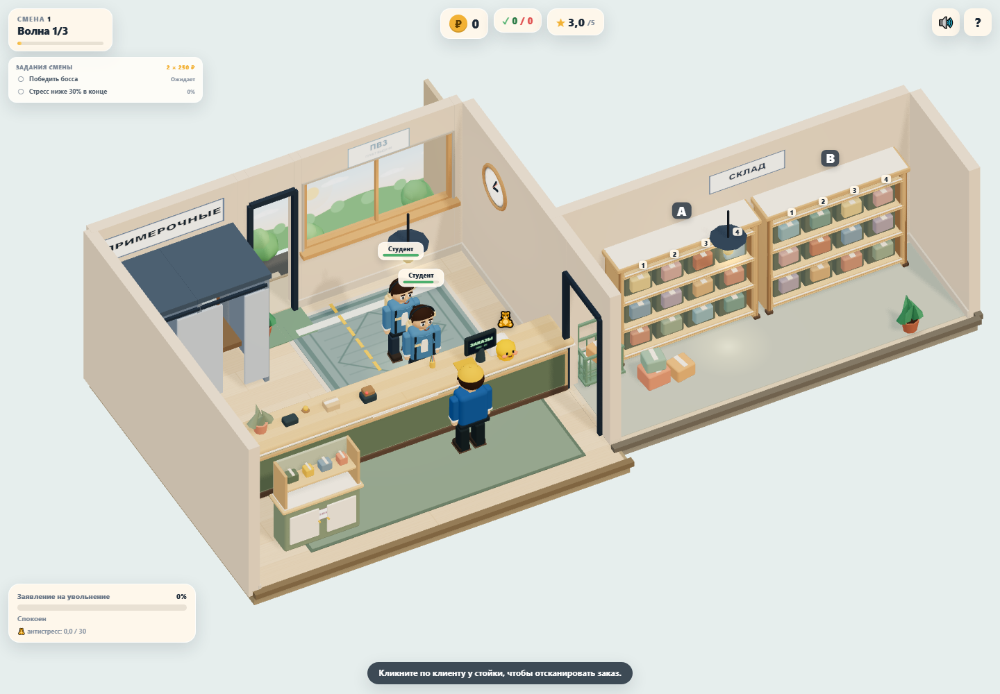

# Визуальный style guide: Cozy Low-Poly Diorama

Короткий практический гайд по графике «ПВЗ-Тайкун». Цель — чтобы комната, персонажи, предметы и UI выглядели как одна уютная диорама, а не как набор примитивов.

## 1. Образ

Маленький ПВЗ, в котором хочется задержаться: тёплый свет, дерево, бумага, растения, аккуратные полки и разноцветные посылки. Камера — фиксированная 3/4, как будто мы смотрим на комнату-домик.

Ключевые слова: **уютно, тактильно, читаемо, живо, по-доброму смешно**.

## 2. Палитра

| Роль | HEX | Где использовать |
|---|---|---|
| Фон | `#e6eeed` | Задник сцены, фон приложения |
| Стены | `#e9d5bf` | Стены комнаты |
| Светлое дерево | `#e7bd88` | Столешницы, полки, верх стойки |
| Дерево | `#cda475` | Каркасы, торцы, рамы |
| Тёмное дерево | `#997653` | Ножки, плинтусы, акценты |
| Шалфей | `#85947c` | Корпус стойки, панели |
| Светлый шалфей | `#b4bca4` | Задние стенки стеллажей |
| Крем | `#fff4e3` | Накладки, бумага, светлые панели |
| Бумага | `#f6e7d2` | Ярлыки, скотч, детали |
| Коралл | `#d98b72` | Тёплые акценты, растения, одежда |
| Горчица | `#f0b44c` | Кнопки, ручки, мелкие акценты |
| Пыльный синий | `#8098a8` | Холодный акцент, посылки |
| Слива | `#8e5a6e` | Боссы, важные акценты |
| Чернила | `#26313a` | Текст, тёмные детали |

Правило: **70% тёплых нейтральных, 20% шалфея/дерева, 10% акцентов**. Не заливать сцену насыщенными цветами.

## 3. Формы

- Базовый объект — скруглённый короб. Радиус 2–6 см в мировых единицах.
- Крупные пропорции: лучше один читаемый объём, чем десять мелких.
- Фаски на стойке, полках, посылках.
- Цилиндры — 8–12 сегментов, сферы — 8–10.
- Избегать острых углов и «пластиковых» бликов.

## 4. Материалы

- `MeshLambertMaterial`: плоские грани на простых примитивах, интерполированные нормали на скруглённых деталях кита и посылках, чтобы фаски читались мягче.
- Матовые поверхности, без металла и стекла.
- Один материал на цвет, кэшировать.
- Текстуры — смысловые (экран, вывеска, штрихкод, наклейка) и небольшие процедурные фактуры дерева на полу и столешнице. Фактура генерируется детерминированно и кэшируется.
- Контактные тени — мягкий общий градиент 64×64. Для статической мебели — одна кэшируемая карта теней 1024×1024 с PCF-фильтрацией, без SSAO.

## 5. Свет

- Тёплый ключевой свет `#ffe5c4`, направленный со стороны открытой части диорамы.
- Холодный заполняющий `#ddeaf4`.
- HemisphereLight: небо `#e5eff2`, земля `#c7ae91`.
- ACES tone mapping, экспозиция 1.15: мягкое ограничение светлых участков.
- Мягкое тёплое пятно у стойки.
- Без тяжёлого SSAO, SSR и теней от каждого объекта.
- Карта теней обновляется при `applyDecor()` (старт/смена/покупки), затем переиспользуется. Движущиеся персонажи, кот, исчезающие при сборе посылки и секундная стрелка не отбрасывают кэшируемые тени.

## 6. Стеллажи

- Каркас — тёплое дерево.
- Задняя стенка — светлый шалфей.
- Полки — светлое дерево с кремовой кромкой.
- Ножки и торцы — тёмное дерево.
- Ячейки — глубокий шалфей-серый, чтобы посылки читались.
- Номер колонки и буква стеллажа остаются DOM-лейблами.

## 7. Посылки

- Скруглённый короб 3–4 цветов из палитры.
- Обязательные детали: скотч сверху, бумажная наклейка со штрихкодом.
- Лёгкий разброс размера/поворота, но в пределах ячейки.
- Цвета — приглушённые: крафт, коралл, шалфей, пыльный синий, горчица, слива.

## 8. Стойка

- Корпус — шалфей.
- Столешница — светлое дерево с кремовой кромкой.
- Нижняя часть — тёмное дерево.
- Фронтальная панель — крем с деревянной рамой и ручками.
- На стойке: монитор, сканер, принтер, терминал, звонок, растение, стаканчик с ручками.
- Вывеска «СТОЙКА» — кремовый фон, тёмный текст, аккуратная рамка.

## 9. Персонажи

- Крупная голова, простые лица, 3–4 цвета.
- Читаемые брови и рот: спокойный, нетерпеливый, злой.
- Позы: стоит, идёт, несёт посылку, несёт возврат.
- Анимация: моргание, idle-покачивание, поворот головы, редкие жесты, squash/stretch.
- Боссы отличаются силуэтом и акцентным цветом, а не только палитрой.

Система персонажа:

- `build`: `slim / regular / round / tall` — пропорции тела и высота;
- `hairStyle`: `short / bob / long / bun / bald`;
- `headwear`: `none / cap / scarf`;
- `accessory`: очки, тёмные очки, наушники, серьги, галстук, бейдж-лента;
- `prop`: рюкзак, сумка, телефон, трость, селфи-палка;
- эмоции: спокойный, нетерпеливый, злой — меняют глаза, брови и рот.

## 10. UI

- Кремовые карточки, скругление 14–20 px.
- Тёмные чернильные заголовки.
- Мягкие тени, без резких чёрных обводок.
- Акценты: горчица, коралл, шалфей.
- Кнопки — крупные, с понятным состоянием.
- Модалки — как бумажные карточки в диораме.
- Онбординг — крупная кремовая карточка с коротким текстом, прогрессом и золотой подсветкой цели.
- Мини-игры — крупные «физические» плитки и кнопки; золото показывает правильную цель, зелёный — успех.

## 11. Анимация и «сок»

- «Поп» посылки при выборе.
- Вспышка и полоса сканирования.
- Монетки/звёзды на итогах.
- Реакции клиентов: довольный, нетерпеливый, злой.
- Плавные переходы панелей и модалок.
- Звук на каждое значимое действие.

## 12. Производительность

- ≤ 150k треугольников.
- ≤ 150 draw calls в типичной сцене, ≤ 180 в пике.
- 60 fps на среднем мобильном.
- Кэш геометрии и материалов.
- Инстансинг для повторяющихся посылок — при необходимости.
- GLTF — только для сложных персонажей/предметов, не для всего.

## 13. Чего избегать

- Фотореализма и PBR-блеска.
- Мелкой детализации, которая исчезает на телефоне.
- Кислотных цветов и «пластикового» low-poly.
- Тяжёлых постэффектов на мобильных.
- Разных стилей у сцены и UI.
- Острых углов и тонких длинных элементов без необходимости.

## 14. Текущий шаг

В этой итерации переведены на кит:

- стойка;
- стеллажи A/B/C;
- шкафчик возвратов;
- посылки в ячейках.

Персонажи 2.0 уже собраны по этому гайду: скруглённые тела и головы, разные пропорции, причёски, головные уборы, аксессуары, эмоции и позы с посылкой.

Environment/decor pass тоже сделан: широкое окно почти на всю стену над стойкой с настоящим проёмом, откосами и подоконником, вывеска ПВЗ над ним, смена света утро/день/вечер, 3D-двор за окном с передним планом и плоским дальним фоном, расширенный склад с разнесёнными стеллажами, проволочной корзиной между стеной и стеллажом A и коробками, логичная левая часть стойки, разметка очереди, тёплые лампы, объёмные часы, узорный ковёр, неоновая вывеска, анимированный кот и телевизор с полкой.

Проход по референсу: бежевые стены, дубовый пол и столешница с тонкой фактурой, спокойные посылки, мягкие фаски и тени. Камера, геометрическое размещение и механики сохранены. Текущий кадр:

Следующие кандидаты: сезонный декор и более сложные анимации окружения. Дальнейшие эффекты — только после замера на целевом телефоне.
