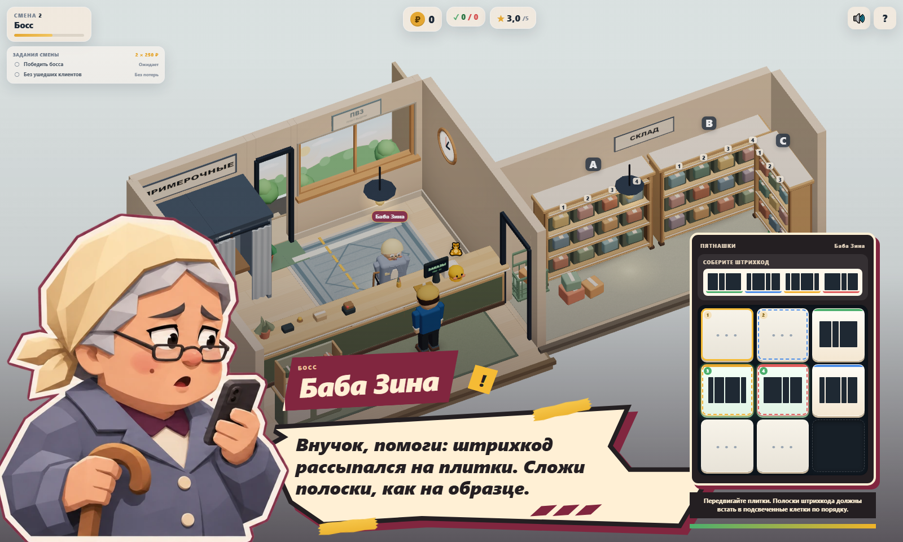
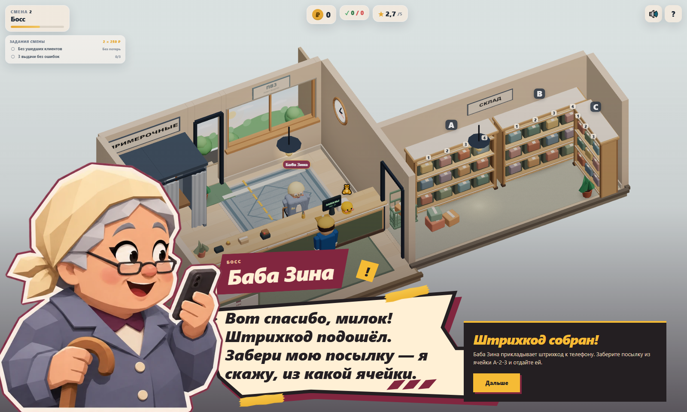

# Диалоговая сценка Бабы Зины

Задание владельца: перенести утверждённое оформление Гали на следующего босса. Следующая по игровому порядку — Баба Зина, вторая смена. Отдельный issue не назначен. Ветка `sol/zina-dialogue-scene`, stacked PR с base `sol/galya-dialogue-scene` (PR #10 ещё открыт). Merge выполняет Lead/владелец после ревью.

## Результат





[Тревога при нехватке времени](screenshots/zina/worried.png) · [Таймаут](screenshots/zina/timeout.png) · [Portrait](screenshots/zina/puzzle-portrait.png) · [Landscape](screenshots/zina/puzzle-landscape.png) · [320×568](screenshots/zina/puzzle-small.png) · [568×320](screenshots/zina/puzzle-small-landscape.png)

[Длинная победная реплика, 320×568](screenshots/zina/success-portrait.png) · [Та же реплика, 568×320](screenshots/zina/success-landscape.png)

- Платок, очки, серо-голубое пальто и трость следуют существующему `BABA_ARCHETYPE`. Телефон связан с её текущими пятнашками. Три выражения: растерянная просьба (`stern`), тревога/досада (`angry`), радость от помощи (`surprised`).
- Общий SVG-силуэт из PR #10 используется без копирования: те же кремовая поверхность, чёрный контур, бордовая подложка, скотч и три штриха. Портрет, анимации, reduced motion и фокус обслуживает `BossDialogueScene`.
- `showZinaGame` открывает профиль `zina` в режиме `puzzle`. Действующая панель телефона размещена справа, на portrait — под репликой. Её высота не растягивает бумажное окно. Плитки равного размера; локально устранено влияние высоты общего класса `.barcode` на кнопки пятнашек.
- При остатке времени <28% выражение меняется на тревожное. Неверный ход даёт прежнюю подсказку с коротким общим акцентом; текст подсказки выводится поверх инструкции, без сдвига поля. Победа показывает радость, таймаут — досаду. Это отображение уже имеющихся состояний; таймер и последствия не менялись.
- После перестроения поля клавиатурный фокус остаётся внутри пятнашек. Enter/Space — штатные кнопки, Tab замыкается внутри диалога. На маленьких экранах портрет не перекрывает начало реплики, плитки не меньше 44×44 px.

`game.ts`, `data.ts`, boss systems, правила пятнашек, тексты, экономика и 3D-ресурсы не менялись. Публичный контракт BossView сохранён. Галя и финальные реплики используют прежнее оформление; Саня и обычные клиенты не подключались к новому профилю.

## Проверки и воспроизведение

```sh
npm run build
npm test
npm run test:e2e
npm run perf -- --label zina-dialogue --check-budget
node tests/perf/zina-dialogue.mjs
```

Последний скрипт требует готовый build, сам поднимает production preview на 4178 и закрывает его после проверки. Seed `20261111`, DPR 1; начальная сцена второй смены. Скриншоты сохраняются в `docs/screenshots/zina`, raw overlay-метрики — в `test-results/perf/zina-overlay/metrics.json`. Начальная сцена фиксирована; победа для скриншота достигается поиском и выполнением реальных разрешённых ходов, не вызовом обработчика результата.

Результат: build успешно, **43/43 unit**, **15/15 e2e**, perf `--check-budget` успешно.

Три e2e проверяют реальные игровые пути:

- исходные реплики, невалидный ход без изменения поля, Tab/Enter, решение перемешанного поля, награда −8 стресса/+0,2 репутации и продолжение выдачи посылки;
- тревога по таймеру, настоящий таймаут, штраф +15 стресса/−0,5 репутации и переход после результата;
- адаптивность 1600×960, 1280×720, 844×390, 667×375, 568×320, 390×844, 360×640, 320×568, hit testing и размер плиток, отсутствие перекрытия текста портретом на portrait, длинная победная реплика на телефоне, reduced motion и 20 повторных открытий без накопления DOM.

Сценарий Гали обновлён только в ожидании перехода к Зине: теперь там включён её портрет; fallback обычного клиента по-прежнему проверяется. Сохранены тесты основного цикла, terminal game over и 20 start/restart-циклов персонажей. Ошибок `console.error`/`pageerror` нет. Предупреждения о размере bundle и `THREE.Clock` существовали ранее.

## Производительность и ограничения

Сравнивается одна и та же приостановленная сцена Зины: скрытая оболочка и открытые пятнашки. После 1 с прогрева собирается 5 с RAF; входная анимация исключена. В обоих состояниях WebGL-счётчики одинаковы: **122 calls, 78 488 triangles, 88 geometries, 16 textures, 10 programs**. CSS-портрет не добавляет draw calls или Three.js-текстур; WebGL-счётчики не включают память картинки в DOM.

Атлас `src/assets/zina-expressions.webp`: 2172×724, RGBA, **228 628 байт**, около 6,3 МБ декодированных пикселей; один файл на три эмоции. Генерация встроенным image_gen, затем кодирование WebP quality 90 с сохранением alpha, без runtime-зависимостей. Профиль предзагружается один раз при создании UI.

| Оболочка одной сцены Зины, 1600×960 | avg / p95 / max RAF, мс | Calls | Triangles | Geometries | Textures | Programs |
|---|---:|---:|---:|---:|---:|---:|
| Скрыта | 132,89 / 150,00 / 150,00 | 122 | 78 488 | 88 | 16 | 10 |
| Портрет + пятнашки | 134,21 / 150,10 / 150,10 | 122 | 78 488 | 88 | 16 | 10 |

[Raw overlay](perf/zina/overlay.json). Разница avg +1,32 мс в этом прогоне. RAF-замер выполнен на SwiftShader, не на физическом GPU телефона. Он показывает стоимость полной сцены в программном рендерере и шум окружения; не является обещанием мобильного FPS.

| Обычный perf, 1280×900 | Calls | Triangles | Textures | Programs | avg / p95 / max RAF, мс |
|---|---:|---:|---:|---:|---:|
| 2 клиента | 122 | 60 615 | 16 | 9 | 116,28 / 133,30 / 133,40 |
| 4 клиента + всё оформление | 173 | 83 430 | 19 | 9 | 125,83 / 133,40 / 133,40 |

[Raw fresh scenes](perf/zina/fresh-scenes.json): прогон на рабочем дереве этой ветки поверх `f93a9dc` (поле revision указывает HEAD до коммита). Calls/triangles/textures/programs обычных сцен совпадают с [базой PR #10](perf/galya/fresh-scenes.json). Shadow maps отключены, цена refresh — 0. Новых canvas/WebGL renderer, shadow maps, фильтров или постобработки нет. Проверка на физических iOS/Android остаётся за рамками этой задачи.

## Ассет и финальный промпт

Файл проекта: `src/assets/zina-expressions.webp`. Использован встроенный **image_gen** через навык `imagegen`, без CLI/API и внешних скачанных ассетов. Первый вход — существующий атлас Гали как референс стиля/композиции, второй — скриншот существующей 3D-Зины как референс внешности. Исходные ассеты Гали не заменялись.

```text
Use case: stylized-concept. Asset: production transparent three-expression portrait sprite sheet for a cozy low-poly browser game, PVZ Tycoon. Image 1 is STYLE/ATLAS COMPOSITION REFERENCE ONLY: keep exactly its angular faceted low-poly painted 3D/comic cutout style, thick ivory paper outline and thin burgundy outer edge, three equally spaced square portrait cells in one horizontal row. Image 2 is CHARACTER IDENTITY REFERENCE ONLY: the elderly woman behind the counter, Baba Zina. Do not depict Galya or copy the younger woman's face. Create Zina, a short stout elderly Slavic grandmother with kind expressive large eyes behind dark thin reading glasses, soft warm peach skin, rosy cheeks, grey eyebrows, small wisps of silver hair under a pale buttery-beige headscarf tied at the back, muted dusty slate-blue coat over ivory blouse with dark plum collar, small cream coat buttons. Three quarter view facing screen RIGHT. Head and upper torso fill each square cell, same head size, same baseline and clothing across all frames. Hold a small dark smartphone in one hand and the curved handle of a wooden walking cane in the other, hands anatomically clean with stylized fingers. Left cell: worried/puzzled gentle request, eyebrows raised inward, slightly open mouth, glancing at her phone. Middle cell: distressed/frustrated at the phone, eyebrows furrowed, mouth open in exasperation, not villainous rage. Right cell: genuinely delighted and relieved, eyes bright, eyebrows raised, broad warm smile, slightly lifting her phone in gratitude. All three remain unmistakably the same elderly lady. Flat polygonal planes, controlled warm lighting, bold readable facial features, polished professional casual-game character illustration matching Image 1 rather than photorealism/anime. THREE INDEPENDENT full bust cutouts, precisely one per equal square column, generously separated transparent gutters, no overlap across cells, entire head and hand silhouettes inside each cell. Wide 3:1 sprite sheet, true alpha transparency surrounding figures, no backdrops, text, logos, labels, UI, or watermarks. Keep cream and burgundy die-cut borders around each silhouette as Image1. Prioritize coherent identity and identical scale/baseline across frames.
```
