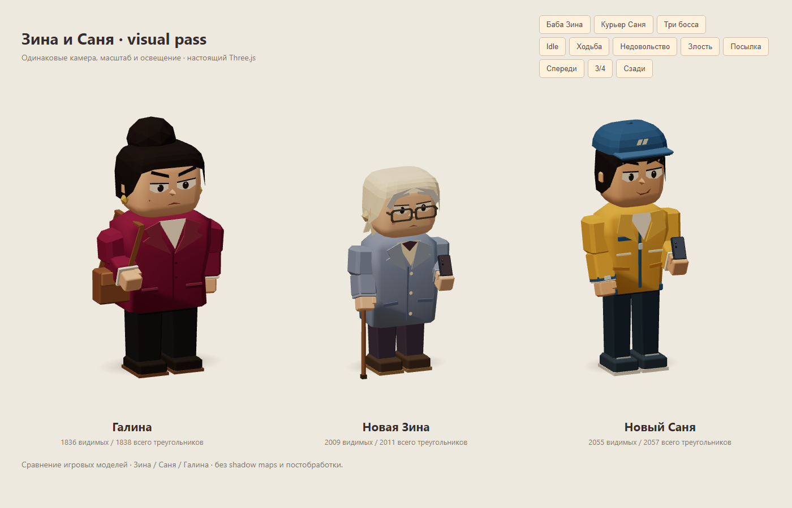

# Зина и Саня — визуальный проход игровых моделей

Задание владельца: довести 2-го и 3-го босса до стилистики одобренной Галины. Отдельный issue не назначен. Ветка `sol/zina-sanya-character-pass` начиналась поверх PR #23; после его merge перенесена на `main` / `5195fdf` без изменения файлов базы. Новый PR направлен в main.

## Образы

**Баба Зина.** Низкий силуэт, небольшая сутулость, длинное серо-голубое пальто, пуговицы и кремовая блуза с бордовым воротником. Кремовый платок с узлом/концами, седые пряди, крупная открытая оправа очков без прозрачных линз, мягкие щёки и тревожные брови. Левая рука держит трость с изогнутой ручкой, правая — телефон. Анимация шага спокойнее и с меньшей амплитудой, чем у Сани; трость следует шагу. Скорость перемещения Client не менялась.

**Курьер Саня.** Более высокий подтянутый силуэт, горчичная рабочая куртка с синими вставками, молнией, карманами и светлыми полосами. Гранёная синяя кепка, цельная короткая причёска на висках/затылке, уверенный взгляд и асимметричная улыбка. Светлая подошва кроссовок, часы и телефон. Быстрый шаг, более широкие движения ног и постукивание ногой в ожидании.

Оба получили веки/моргание, три существующих настроения, шарнирные локти, ладони с большим пальцем и хват посылки двумя руками. Телефон и трость скрываются при переноске. Поддержаны 1–4 коробки и актуальный контракт строки/массива цветов, включая вывод количества из массива.



[Зина: до/после](screenshots/boss23-characters/zina-idle.png), [крупный план](screenshots/boss23-characters/zina-close-up.png), [спина](screenshots/boss23-characters/zina-back.png), [посылка](screenshots/boss23-characters/zina-carry.png).

[Саня: до/после](screenshots/boss23-characters/sanya-idle.png), [крупный план](screenshots/boss23-characters/sanya-close-up.png), [спина](screenshots/boss23-characters/sanya-back.png), [посылка](screenshots/boss23-characters/sanya-carry.png).

В том же каталоге лежат фронт, ходьба, недовольство и злость обоих. Одинаковая камера в игре: [Зина до](screenshots/boss23-characters/game-before-2.png) / [после](screenshots/boss23-characters/game-after-2.png), [Саня до](screenshots/boss23-characters/game-before-3.png) / [после](screenshots/boss23-characters/game-after-3.png). Референсы внешности — существующие диалоговые портреты; новых растровых ассетов для моделей не создавалось.

## Бюджет и владение

| Модель | Видимых idle до → после | Всего idle после | Максимум всего со всеми 4 коробками/настроениями |
|---|---:|---:|---:|
| Зина | 10 062 → 2009 | 2011 | 2189 |
| Саня | 8746 → 2055 | 2057 | 2233 |

В «всего» считаются все меши дерева rig, включая скрытые. Коробки создаются лениво, поэтому после carry их скрытая геометрия остаётся в этом подсчёте. Все настроения и четыре коробки остаются в бюджете 1500–3000. [Raw подсчёты](perf/boss23-characters/geometry.json).

Использованы общий `VERTEX_COLOR_MATERIAL`, `mat()`, `cachedGeometry()` и существующая односегментная фаска. Неподвижные части объединяются внутри костей; глаза, локти, аксессуары и лицо остаются независимо анимируемыми. Выражения прогреваются один раз на стиль и переключаются без построения мешей в кадре.

Собственные merge-геометрии (Зина — 10, Саня — 9) и до четырёх ленивых клонов материала посылки зарегистрированы в `body.userData.personResources`. Существующий `createPersonDisposer()` освобождает только их. Исходные кэшированные геометрии, материалы, выражения, contact shadow, наклейка и её текстура остаются общими. Новых runtime-текстур, GLTF, shadow maps, SSAO, bloom или постобработки нет.

## Проверки

- `npm run build`, `npm test` — проходят, 43 unit-теста. Остаётся прежнее предупреждение о размере JS chunk.
- Полный локальный e2e — **36/36**; после полировки волос повторены 7 целевых сценариев — **7/7**, после посадки кепки — **5/5**. Полный CI запускается через PR. Для изоляции от Lead локально использовался временный конфиг порта 4193; полный прогон имел лимит теста 240 с, целевой — стандартный 90 с. Репозиторная конфигурация не менялась.
- Пять новых e2e: контракт/конечность геометрии и transform, ходьба, моргание, три выражения, четыре разных цвета коробок, лимит треугольников, два набора по 20 create/render/double-dispose циклов и настоящие встречи со старыми сценариями.
- Owned-ресурсы освобождаются ровно один раз, общие не получают dispose; geometries/textures/programs выходят на плато. Общие 20 start/restart-циклов тоже проходят.
- Проверены реальные ходы/победа/таймаут Зины, четыре заказа и продолжающийся таймер Сани, scanner/cells/results/shop, возвраты Королевы, терминальный game over, цвета стопки и пополнение склада. `console.error`/`pageerror` отсутствуют.

## Воспроизведение

```bash
npm ci
npx playwright install chromium
npm run build
npm test
npm run test:e2e
npm run perf -- --label boss23-characters --check-budget
node tests/perf/boss23-characters.mjs after
```

Лаборатория: `npm run dev` → `/tests/visual/boss23-characters.html`. Кнопки переключают старую/новую Зину, Саню и общую линейку с Галиной; есть пять поз и три ракурса. В игре: F2 → смена 2 или 3 → босс.

Боссовый perf сам поднимает Vite на `127.0.0.1:4191`. Seed 73129, Chromium 158.0.8127.18, 1280×900 DPR 1, настоящие встречи смен 2/3. После появления босса обслуживание останавливает существующий `helpOpen`, мир анимируется. Прогрев 1,5 с, затем 5 с RAF-интервалов, renderer.info и PNG. До/после запускались последовательно; baseline — отдельный worktree main `5195fdf`, реализация указана в raw JSON. Результаты пишутся в `test-results/perf/boss23/<label>/`.

## Метрики до/после

Сравниваются свежий baseline `5195fdf` и итоговая реализация `32abba2`. [До](perf/boss23-characters/before.json), [после](perf/boss23-characters/after.json). Предварительный baseline с высокой фоновой нагрузкой сохранён [отдельно](perf/boss23-characters/before-initial.json), для таблиц использован повторный последовательный замер.

| Встреча | Draw calls до → после | Triangles сцены до → после | Geometries | Textures | Programs |
|---|---:|---:|---:|---:|---:|
| Зина, смена 2 | 122 → 123 | 78 488 → 70 201 | 88 → 89 | 16 → 16 | 10 → 9 |
| Саня, смена 3 | 121 → 122 | 76 936 → 70 245 | 87 → 88 | 16 → 16 | 9 → 9 |

| Встреча | Avg ms до → после | P95 ms до → после | Max ms до → после |
|---|---:|---:|---:|
| Зина | 115,9 → 114,0 | 116,8 → 116,8 | 133,4 → 133,3 |
| Саня | 115,5 → 114,8 | 116,7 → 116,7 | 116,8 → 116,8 |

Артикуляция добавила один draw call/активную геометрию на встречу; треугольников стало меньше на 8287 и 6691. Открытая непрозрачная оправа Зины убрала отдельную программу линз. Время кадра близко к baseline: этот короткий SwiftShader-замер не доказывает заметного увеличения FPS.

Обычный [perf с проверкой бюджета](perf/boss23-characters/standard-scenes.json) сохранил прежние счётчики:

| Сцена | Calls | Triangles | Textures / Programs | Avg / P95 / Max ms |
|---|---:|---:|---:|---:|
| 2 клиента | 122 | 60 615 | 16 / 9 | 106,7 / 116,7 / 116,8 |
| 4 + всё оформление | 173 | 83 430 | 19 / 9 | 121,0 / 133,4 / 150,0 |

Оба сценария проходят ≤150/180 calls и ≤150k triangles. Обновление shadow map отсутствует: карта отключена.

## Границы и ревью

`Client` меняет только выбор фабрик для `baba-zina` и `sanya`. `PersonRig`, масштаб архетипов, камера, управление, UI/портреты, тексты, пятнашки, таймер/заказы, терпение, очереди и экономика сохранены. Галина, Королева и Валера не переделывались. Перенос на оставшихся боссов не входит в PR.

Руки остаются стилизованными ладонями без отдельных пальцев, ткань не симулируется, трость/телефон анимируются простыми костями. Платок/волосы и одежда состоят из крупных граней. Замеры SwiftShader не подтверждают FPS на физическом мобильном GPU.

Ревьюеру: сравнить одинаковые кадры, проверить опору на трость, посадку очков/платка, кепку и затылок Сани, хват телефона/коробки. PR передаётся OpenCode Lead без самостоятельного merge.
