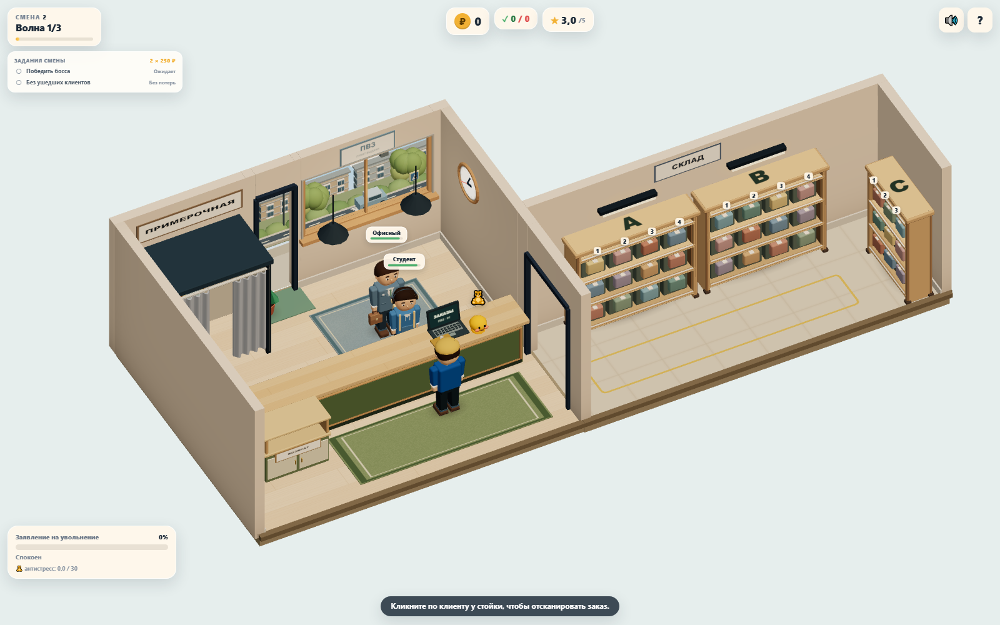
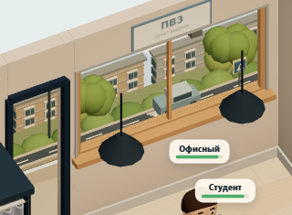
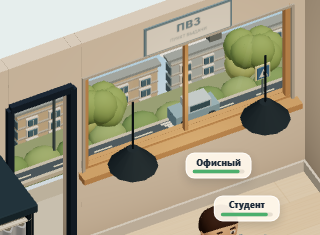
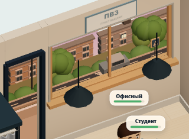

# Улица за окном — issue #74

База — PR #73 / dd350b2. [До](before.json) и [после](after.json) сняты на одном Chromium 158 / SwiftShader, отдельно от других браузерных проверок. Seed 73129, 1280×900/DPR 1, прогрев 2 с, RAF за 5 с: `npm run perf -- --label street-final --check-budget`. After снят по рабочему diff от dd350b2. Набор клиентов и оформление прежние.

| Сцена | До: calls / triangles / textures / programs | После | До: avg / p95 / max, мс | После, мс |
|---|---|---|---|---|
| 2 клиента | 127 / 61 715 / 16 / 10 | 123 / 68 840 / 15 / 12 | 91,21 / 100,10 / 100,10 | 94,44 / 100,10 / 100,10 |
| 4 клиента + весь декор | 179 / 84 532 / 20 / 10 | 175 / 91 657 / 19 / 12 | 102,72 / 116,70 / 133,30 | 108,86 / 116,80 / 133,40 |

Снижение на 4 draw calls и одну текстуру; дополнительные треугольники — фасады/листва и фаски рамы. Две дополнительные программы — варианты материалов с локальным clipping. Avg в этом замере выше примерно на 3,5%/6%, p95/max практически прежние. Это программный рендеринг: абсолютные времена не описывают FPS телефона, отсутствие просадки на физическом мобильном GPU не подтверждено.

Новый e2e отдельно включает вечерние окна и машину одновременно: **4 клиента, 177 calls, 92 205 triangles**. Это дороже обычного 5-секундного замера, который может пропустить редкий проезд. Бюджеты ≤150 calls для 2 клиентов, ≤180 для 4, ≤150k triangles соблюдены. Shadow map отключена, refresh = 0. Никаких SSAO/bloom/postprocess/render targets или новых источников света.

После прогрева утра/вечера три полных цикла фаз дают одинаковые счётчики **139 geometries / 19 textures / 12 programs** до/после. Цвета изменяются плавно, геометрия не пересоздаётся. Цветовые объекты переиспользуются, скопированные временные геометрии освобождаются после merge.

Проверки: `npm run build` PASS, `npm test` **92/92**, `npm run test:e2e` **72/72**. Production preview 1600×1000 и 390×844: console.error/pageerror — 0. [Снимок входа/выхода](../../screenshots/74-street/smoke.json): NPC появился в (-0,9; 4,68), дошёл в очередь, вышел через прежнюю дверь до EXIT_POINT и скрылся. Новых декоративных пешеходов нет; улица не участвует в picking.

## Кадры и воспроизведение

`npm run build` затем `node tests/visual/window-street.mjs` поднимает production preview на 4188, фиксирует seed/клиентов и положение машины, проходит три фазы через существующий `world.setDayPhase`, снимает общие/детальные кадры и mobile. В e2e: `npx playwright test tests/e2e/window-street.spec.ts`.

| Утро | День | Вечер |
|---|---|---|
|  |  |  |
|  |  |  |

[Мобильный вечерний кадр](../../screenshots/74-street/mobile-evening.png).

## Ограничения и ревью

Это сжатая перспектива для текущей неподвижной ортографической камеры, не доступный для прогулок район. Небо — градиентная плоскость, остальные объекты — геометрия. При смене направления камеры надо заново проверить пропорции и clipping фасада. Некоторые этажи естественно перекрываются зеленью/подоконником с высокого ракурса. Редкая машина одна, окна/фонарь светятся цветом без реального освещения окружения.

По сравнению с референсом сохранены прежние окно и размер проёма, интерьер и маршруты: внешняя композиция адаптирована к ним. Проверить из основной камеры глубину, свободную верхнюю полосу неба, ограничение улицы рамой и вечерние окна. В игровую логику, навигацию, UI и магазин изменений нет. Откат — revert одного коммита PR, включая localClippingEnabled в main.ts.
