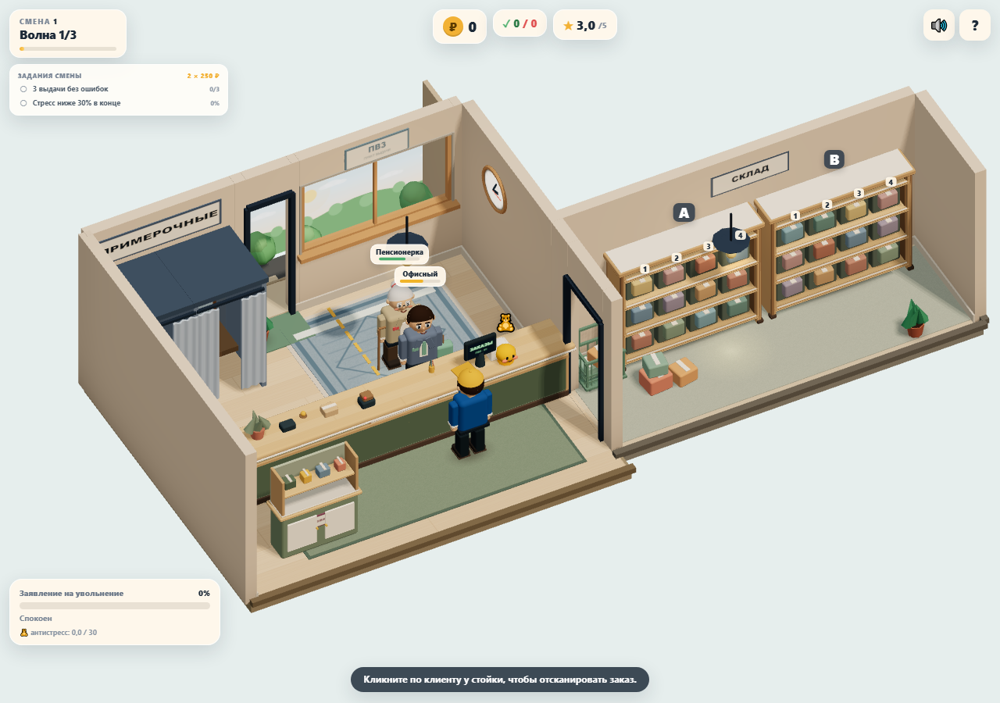
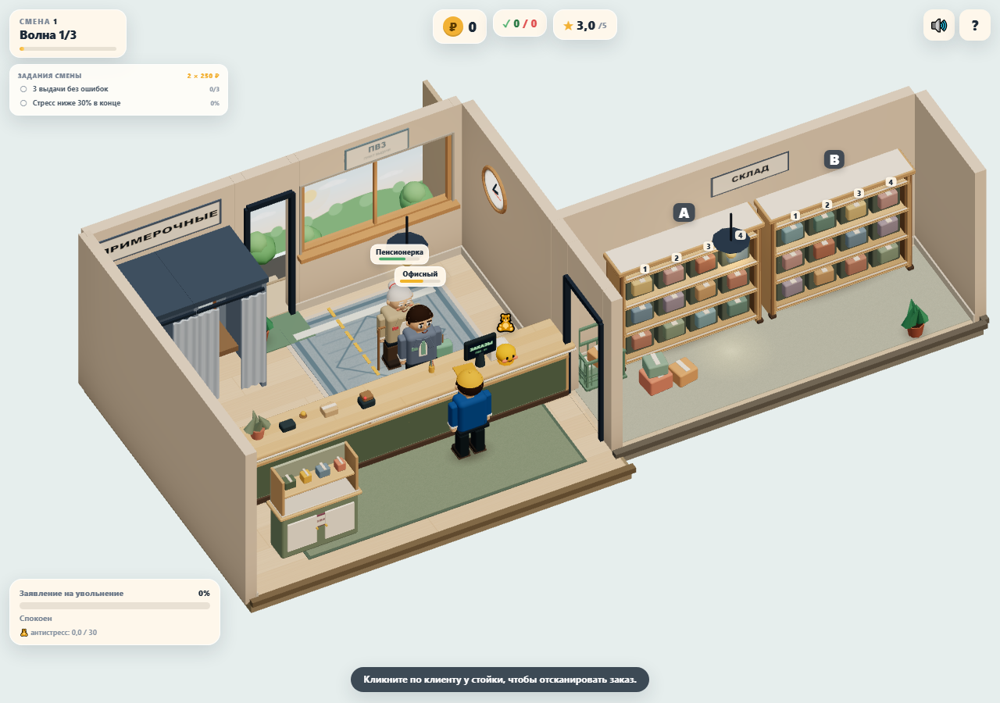
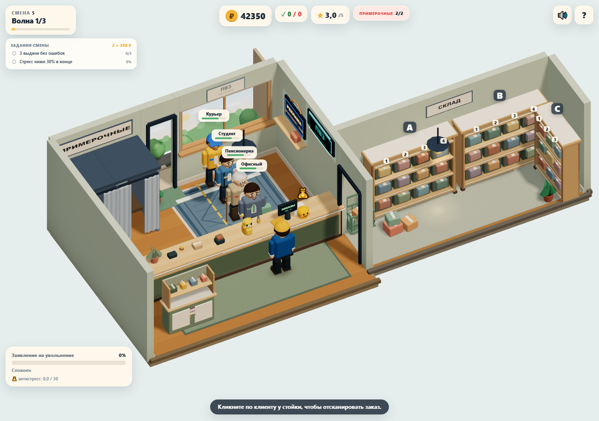
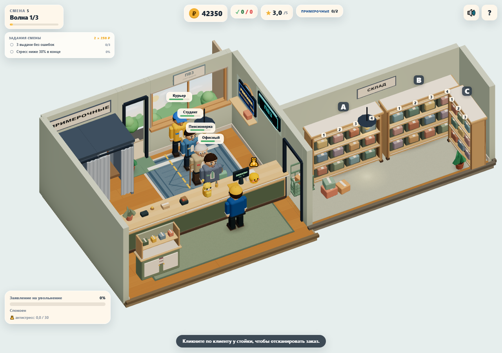

# PR #5: производительность до и после оптимизации

## Воспроизведение

```bash
npm ci
npx playwright install chromium
npm run perf -- --label after --check-budget
```

Скрипт сам поднимает Vite на свободном порту 4176, открывает headless Chromium и сохраняет JSON и два PNG в `test-results/perf/after/`. Никакой другой сервер не нужен. Замеры нужно запускать последовательно, без других браузерных тестов одновременно.

Для исходного варианта можно использовать отдельный worktree на коммите `9dcb944`: там уже есть тот же perf-скрипт, но графика ещё не оптимизирована. Команды сравнения в нём:

```bash
npm run perf -- --label before
npm run perf -- --label no-shadows --variant no-shadows
npm run perf -- --label no-shadows-lambert --variant no-shadows-lambert
```

`--check-budget` проверяет ≤150 draw calls для двух клиентов, ≤180 для полной комнаты и refresh (если он существует), ≤150k треугольников. Превышение завершает команду с ошибкой. Baseline запускается без этого флага, поскольку он превышал бюджет.

## Условия

- Chromium 158.0.8127.18; ANGLE / Vulkan / **SwiftShader (программный рендерер)**, Windows. Это сравнение одного окружения, а не доказательство мобильного FPS.
- Один и тот же viewport 1280×900, DPR 1, камера игры, seed 73129; новый browser context для каждой сцены.
- Два клиента: `office`, `elderly`, смена 1. Полная комната: `office`, `elderly`, `student`, `courier`, смена 5, все семь предметов оформления.
- Фикстура использует существующие `window.game`/`spawnNext`/`update`: заданные архетипы, одинаковые 300 шагов по 0.05 с, затем обслуживание приостановлено через `helpOpen`, чтобы терпение/уход/новые волны не меняли сцену. World-анимации, рендер и DOM-лейблы продолжают работать. Это тест отрисовки, не полного игрового update.
- Прогрев 2 секунды; затем RAF-интервалы за минимум 5 секунд, до ближайшего следующего кадра. Сохраняются количество кадров, фактическая длительность, avg/p95/max интервалов, максимальные draw calls/triangles, resident textures/programs.
- Refresh измеряется отдельно: обычный и один принудительно обновлённый рендер с синхронным `readPixels(1×1)` перед/после. Время включает синхронизацию и чтение, это не чистый GPU timer. Разность двух одиночных измерений чувствительна к шуму.
- Скриншоты сделаны из тех же фикстур после установки одинакового world-time и остановки RAF. Игровые файлы ради замера не изменяются.

Исходная графика: `ec8e922`, perf-скрипт: `9dcb944`; оптимизированная графика: `1913a83`.

## Результаты

Все времена в миллисекундах. Каждый ряд — отдельное пятисекундное окно, а не усреднение нескольких запусков.

| Сцена | Вариант | avg | p95 | max | Draw calls | Triangles | Textures | Programs |
|---|---|---:|---:|---:|---:|---:|---:|---:|
| 2 клиента | До | 171.1 | 183.4 | 199.9 | 129 | 78 908 | 20 | 14 |
| 2 клиента | После | 123.6 | 133.4 | 150.0 | 124 | 78 908 | 16 | 10 |
| 4 + декор | До | 206.0 | 233.3 | 299.9 | 181 | 114 044 | 23 | 14 |
| 4 + декор | После | 140.7 | 150.1 | 166.7 | 176 | 114 044 | 19 | 10 |

В этом запуске средний интервал кадра уменьшился примерно на 28% / 32%. Абсолютные значения относятся к SwiftShader; на настоящем мобильном GPU результаты могут отличаться. Финальный запуск `--check-budget` прошёл.

### Отдельный refresh shadow map

| Сцена | Cached render + readback | Refresh render + readback | Разность | Draw calls refresh | Triangles refresh |
|---|---:|---:|---:|---:|---:|
| 2 клиента, до | 179.9 | 232.8 | +52.9 | 181 | 121 472 |
| 4 + декор, до | 207.1 | 242.4 | +35.3 | 242 | 168 084 |
| Обе сцены, после | — | отсутствует | 0 | — | — |

### Выбор материалов

На исходной графике последовательно проверены runtime-варианты:

| Вариант | avg, 2 клиента | avg, 4 + декор |
|---|---:|---:|
| Без shadow map, Standard сохранён | 176.4 | 205.3 |
| Без shadow map, три материала заменены на Lambert | 158.3 | 180.4 |

Lambert дал ещё около 10–12% выигрыша среднего интервала относительно варианта без теней со Standard. Удаление одной shadow map без других изменений не дало убедительного среднего выигрыша на SwiftShader в этом окне. Но оно убрало дорогой refresh и позволило полностью исключить соответствующие шейдеры/ресурсы из финальной сборки.

Runtime A/B сохраняет часть уже созданных shadow-ресурсов/программ исходной страницы, поэтому их texture/program counts не сравниваются с чистой загрузкой финального приложения. Сырые данные: [до](pr5/before/metrics.json), [без теней](pr5/no-shadows.json), [без теней + Lambert](pr5/no-shadows-lambert.json), [после](pr5/after/metrics.json).

## Изменения и визуальная проверка

Полностью удалены VSM, shadow map, blur, cast/receive-настройки и инвалидирование карты при покупках. Сохранены запечённый vertex AO, мягкие contact shadows над ковриками, текстуры дерева/ткани, свет, экспозиция и складки. Полы и столешница переведены на Lambert. Постоянные contact shadows объединены по материалам; тень стеллажа C и опционального кота остаются с их объектами, чтобы правильно скрываться. Клиенты не входят в статический batch.

Кадры просмотрены: направленные отбрасываемые тени исчезли, но объём мебели, затемнение стыков и контакт с полом сохранены. Камера, интерфейс, размещение предметов и правила игры не изменены.

Два клиента, до:



Два клиента, после:



Четыре клиента и всё оформление, до:



Четыре клиента и всё оформление, после:



## Проверки и пределы

`npm run build` прошёл; `npm test` — 41/41; `npm run test:e2e` — 1/1 (25.5 секунды вместе с запуском сервера); perf с `--check-budget` прошёл. Ошибок `console.error`/`pageerror` нет. Бюджет проверен для описанных фиксированных сцен, не для всех комбинаций архетипов/боссов. Проверка на физическом мобильном устройстве остаётся отдельным шагом.
