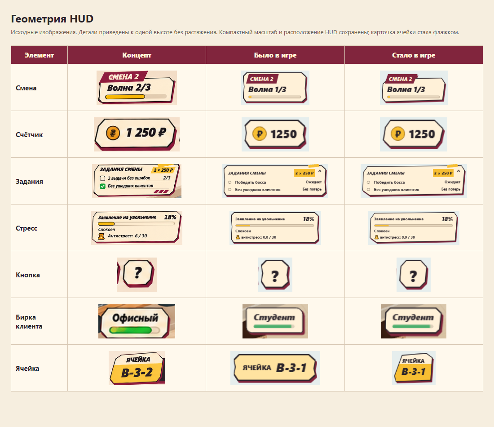
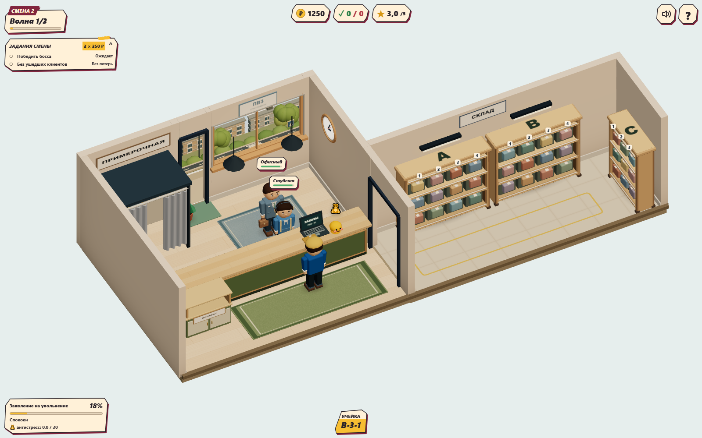
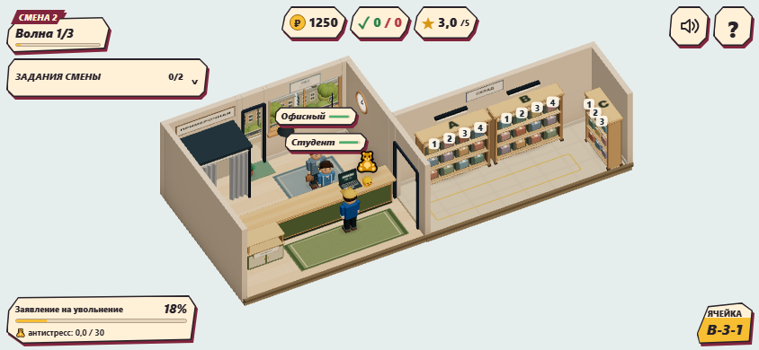
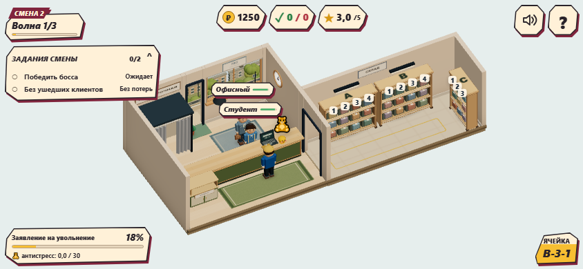

# Игровой HUD — issue #76

Реализован одобренный владельцем концепт, с уменьшенными элементами и приоритетом горизонтального телефона. В игре появились компактные бумажные панели с ломаным контуром, бордовой подложкой, кремовой поверхностью и жёлтыми акцентами. Смена/волна, деньги, выдачи/потери, репутация, занятость примерочной, задания, стресс, buff/босс-статусы и карточка заказа используют единый CSS-слой. Векторный значок звука больше не зависит от шрифта emoji; toggle имеет aria-label/aria-pressed.

## Границы

- Game/ServiceSystem, заказы, навигация, камера, геометрия, материалы и ассеты сцены не менялись. Диалоги, итоговый экран и магазин в этот PR не входят.
- Старые HUD-правила и responsive-дубли перенесены из общего style.css в `ui/hud.css` с заменой оформления, без слоя перекрывающих старый HUD стилей. HUD по-прежнему обновляется существующим HudView.
- Задания теперь native details/summary: на ПК открыты по умолчанию, в компактном режиме закрыты. Положение выбирает matchMedia при смене формата; пользовательский тап/клавиатура работают нативно. Счётчик показывает завершённые задания.
- CSS класс `cell` у карточки заказа скрывает только повторяющую его текстовую плашку. Номер/список ячеек виден; search/carry/return, обучение и остальные подсказки сохранены. Game продолжает формировать прежние данные.
- В Client добавлены только две записи CSS-переменной индекса очереди. На телефоне меняется положение DOM-бирки, а персонаж идёт и стоит по прежним правилам. Боссы и меню не получают вертикальную поправку бирки.
- Кнопки помощи/звука — 44×44 CSS px. Safe-area учитываются по всем четырём краям; портретный режим оставлен как fallback. Новых bitmap-ассетов и backdrop blur для HUD нет, подложка — drop-shadow без размытия.

## Проверки

`npm run build` и `npm test` — PASS, 92 unit.

Новый `gameplay-hud.spec.ts` проверяет четыре размера: **1600×1000, 844×390, 667×375, 568×320**. В кадре четыре клиента, занятая примерочная, critical stress, buff и статусы финального босса. Проверены границы и взаимные перекрытия панелей/бирок, размер кнопок, тап и Space для заданий, звук/помощь, скрытие навигационной плашки и сохранность специальных подсказок, поворот и возврат к landscape. Пятый тест проходит настоящий touch client → удержание сканера → ячейка → выдача без прямого completeScan().

Полный `npm run test:e2e` — **77/77 PASS** (5,3 минуты), включая все пять новых HUD-сценариев, пять смен, боссов и прежний игровой цикл. console.error/pageerror в e2e и production capture отсутствуют.

`npm run perf -- --label gameplay-hud --check-budget` — PASS для первого прохода HUD, отдельно от e2e. Это сохранённый замер до уточнения контуров; при текущей CSS-правке WebGL-ресурсы не менялись. [Raw metrics](../../perf/76-hud/metrics.json) сняты на рабочем diff от fa6ddaf; seed 73129, 1280×900, 2 с прогрева и 5 с RAF, Chromium 158 / SwiftShader:

| Сцена | Calls | Triangles | Textures | Programs | avg / p95 / max, мс |
|---|---:|---:|---:|---:|---|
| 2 клиента | 123 | 68 840 | 15 | 12 | 83,06 / 83,40 / 83,40 |
| 4 клиента + декор | 175 | 91 657 | 19 | 12 | 94,44 / 100,10 / 133,30 |

3D-счётчики совпадают с базовым [замером улицы #74](../../perf/74-street/after.json). Бюджеты соблюдены, shadow refresh=0. E2e улицы дополнительно подтверждает вечерний пик с машиной — 177 calls / 92 205 triangles. Абсолютные времена SwiftShader не являются FPS физического телефона; ускорение от замены blur-панелей отдельно на мобильном GPU не измерялось.

Production preview: `npm run build`, затем `node tests/visual/gameplay-hud.mjs`. Сервер 4188, фиксированный seed 73129, существующая камера, обычный активный заказ. Захват ниже — реальные кадры Chromium с эмуляцией touch, не повторная генерация концепта. Физическое мобильное устройство не использовалось.

## Уточнение геометрии по концепту — 14 ноября 2026

По замечанию владельца формы сверены с исходной генерацией отдельно от размеров/расположения HUD. Прежний общий многоугольник имел вогнутости посередине боков и одинаковый рисунок углов у всех панелей; бирки клиентов оставались скруглёнными. В концепте это прямые длинные скосы и несколько разных силуэтов.

- У счётчиков и кнопок убраны боковые вогнутости, заданы отдельные угловые координаты. У смены/заданий/стресса — бумажный силуэт с наклонными границами и асимметричным нижним срезом. Закрытая мобильная строка заданий имеет собственный компактный контур.
- Ярлык смены выступает над бумажной поверхностью. Бирки клиентов получили острые грани вместо radius; внешний layout box и CSS-поправка очереди прежние.
- Карточка обычной ячейки повторяет флажок концепта: подпись сверху, код на жёлтом поле снизу. Она стала уже и немного выше; положение и размеры шрифта прежние. Списки ячеек могут переноситься. Carry/search/return сохраняют широкую горизонтальную компоновку.
- Внутренний контур задан отдельно от внешнего с компенсацией inset на диагоналях. Бордовая подложка по-прежнему строится без размытия.
- В этом уточнении production-код менялся только в hud.css. Никаких новых обработчиков, эффектов, изменений механики/камеры/3D. Скриншоты заново сняты с production preview, console.error/pageerror — 0.

[Исходный концепт](geometry-reference.png) сохранён для ревью как документация; игра его не загружает. [HTML-сравнение](geometry-comparison.html) и изображение ниже используют исходные пиксели концепта, предыдущей сборки и текущего production preview, без перерисовки. Кадры приведены к одной высоте без растяжения; игровой HUD адаптирован к меньшему размеру и landscape. Воспроизведение: после `node tests/visual/gameplay-hud.mjs` запустить `node tests/visual/hud-shape-comparison.mjs`.

После уточнения повторены `npm run build`, `npm test` (92/92) и полный `npm run test:e2e` (77/77) — PASS. Вновь прошли четыре viewport HUD, touch-обслуживание, пять смен и боссы. Production preview на 1600×1000, 844×390, 667×375 и 568×320 — без console.error/pageerror. E2e также подтвердил прежний вечерний пик 177 calls / 92 205 triangles.

## Скриншоты

[667×375](compact.png) · [568×320](small.png).

## Ревью и откат

Проверить масштаб панелей, сохранность номеров/списков ячеек и важных подсказок, полную очередь и тапы звука/помощи на landscape. Раскрытый список заданий временно занимает больше места; по умолчанию на телефоне он свёрнут. Новые более длинные названия/новые элементы HUD нужно перепроверять на 568×320. Откат — откат PR целиком (CSS, markup и презентационные изменения); миграций сохранений нет.
