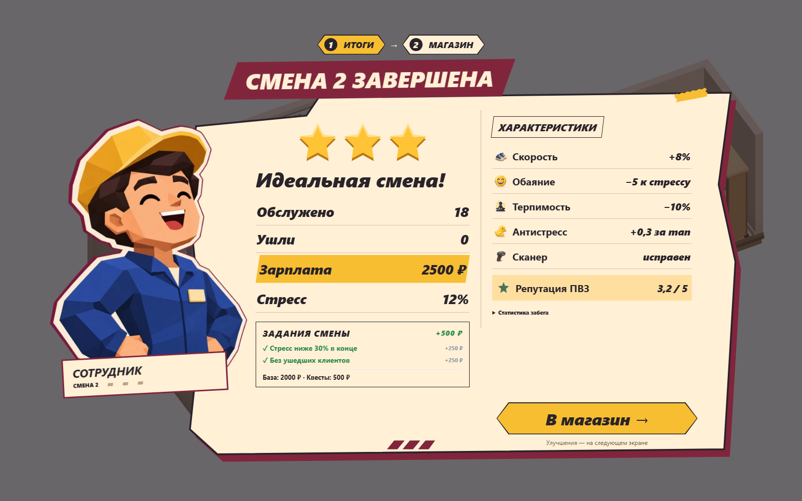
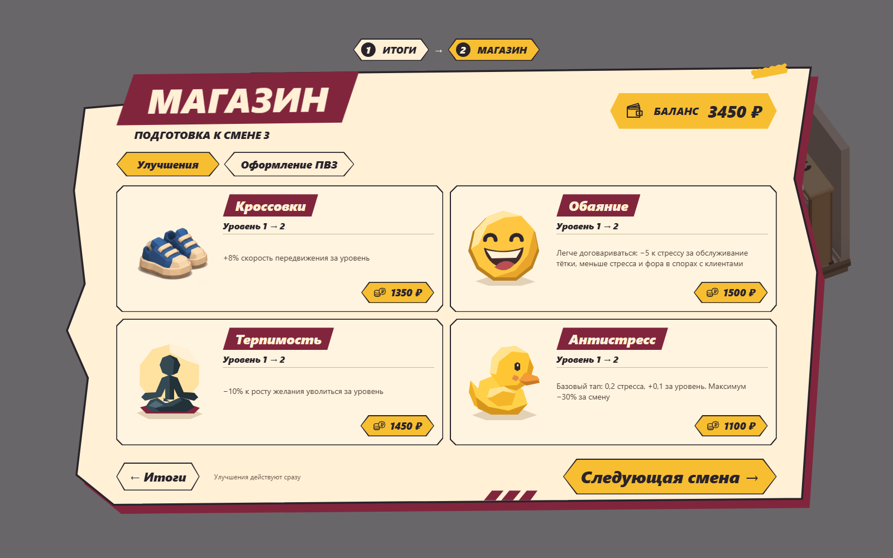
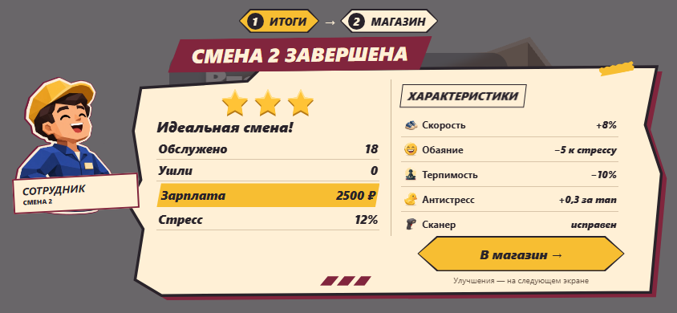
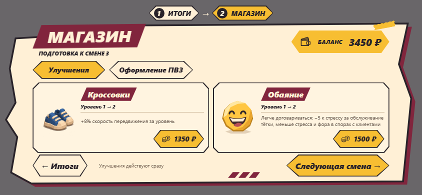

# Итоги → магазин — issue #78

Реализация двух одобренных концептов. База — ветка sol/76-gameplay-hud (PR #77), задача оформлена отдельным stacked PR.

## Изменения и границы

Первый экран показывает реальные итоги, зарплату, задания, характеристики и статистику забега рядом с портретом сотрудника. Второй — прежний магазин с балансом, отделами «Улучшения» / «Оформление ПВЗ», всеми товарами/условиями и кнопкой следующей смены. «← Итоги» возвращает к данным первого экрана, включая уже купленные улучшения. Зарплата начисляется в существующем Game.endShift один раз, переходы только презентационные.

Game, фазы/сессии/ownership заказа, экономика, баланс, 3D, камера и маршруты не менялись. ModalView хранит локальный выбор results/shop, а Game по-прежнему находится в phase=results до nextShift. ShopView использует прежние определения цен/максимумов и методы buyUpgrade/buyDecor. Финальный экран сохраняет «В меню». Одноразовое обучение итогам остаётся доступно на обоих этапах.

Полигональная бумага — SVG с явно заданным внешним контуром, обводкой vector-effect и смещённой бордовой подложкой. Кнопки/карточки рисуются CSS, без тяжёлых эффектов. Защита 350 мс после открытия магазина предотвращает случайный переход дальше двойным тапом; это не игровой таймер. Переходы переводят фокус на заголовок, Tab/Escape/стрелки работают, покупка возвращает фокус на обновлённую карточку/отдел.

[Иллюстрации и использованные промпты](../../../src/assets/intermission/README.md): прозрачный сотрудник WebP 48 828 байт, один atlas 12 товаров WebP 177 146 байт. Портрет загружается при первом показе, карточки создаются прежним ShopView при итогах. Общий вес около 226 КБ, без дополнительных canvas/WebGL-контекстов или перегенерации 3D-превью. Во время обычной смены новые картинки не видны.

## Доработка по визуальному ревью

Повторно сопоставлены оба исходных концепта и браузерные кадры. Плашка «МАГАЗИН» получила выраженные диагональные торцы (32 px на ПК) и небольшой общий наклон вместо прежних почти вертикальных краёв. Заголовки товаров и скошенные кнопки следуют той же геометрии. Нижний край бумаги выровнен, а внутренние отступы учитывают выступы SVG: баланс, карточки и переходы не выходят за силуэт. На ПК четыре улучшения заполняют две строки, на коротком телефоне каталог прокручивается отдельно от переходов.

Звёзды теперь отдельные SVG-фигуры 80×80 на ПК и 36–42 px на телефоне, с сохранением настоящей оценки и доступной подписью. Крупная кнопка «В магазин» расположена под характеристиками. Шрифты основных итогов и уровней товаров увеличены; вместо точек видны текущий и следующий уровни без изменения максимума/цены.

Иконки обуви и сканера сохранены. По запросу владельца добавлены медитирующий силуэт для терпимости, улыбка для обаяния и жёлтая уточка для антистресса. Эти SVG нарисованы в коде, используются также в характеристиках; кошелёк/монеты дополняют баланс и цены. Новых bitmap-иллюстраций и 3D-ресурсов нет.

## Проверки

Build и 92 unit — PASS. Полный `npm run test:e2e` — **84/84 PASS** (6,0 минут), включая новые 7 сценариев, прежний игровой цикл, обучение, непрерывные пять смен и боссов. После окончательного выравнивания карточки сотрудника повторены build, 7/7 intermission e2e и production-smoke. E2e улицы подтвердил прежний пик 177 calls / 92 205 triangles и плато 139 geometries / 19 textures / 12 programs. Между сменами не создаются новые 3D-превью или WebGL-контексты.

Семь новых тестов intermission.spec.ts: покупки/возврат на 1600×1000, 844×390, 568×320 и 390×844; сохранение денег/decor и характеристик; отсутствие повторной зарплаты; double tap, held Enter, Escape, клавиатурные отделы; провал/замена сканера; результаты 5-й смены → прежнее меню. Существующие тесты обслуживания/обучения/пяти смен сохранены и используют кнопку перехода к магазину.

После визуальной правки те же viewport дополнительно проверяются через `SVGPathElement.isPointInFill`: углы видимых карточек, баланса, вкладок, переходов, звёзд и строк характеристик должны попадать внутрь бумажной поверхности. Проверяется видимая часть каталога с учётом его прокрутки; декоративные портрет/заголовок намеренно выступают за бумагу, как в концепте.

Production preview: `npm run build` и `node tests/visual/intermission.mjs`, порт 4189. Фикстура заканчивает вторую смену через настоящий endShift; значения и задания вычисляет текущая игра. Числа отличаются от вымышленных значений макетов. Снимки — реальные Chromium/touch emulation, console.error/pageerror — 0. Физический телефон не использовался.

Для повторяемого сравнения установлен seed=78; перед снимком убирается только transient debug-тост фикстуры и указатель отводится с кнопок, чтобы не сравнивать hover с обычным состоянием. Проверяется, что наклонный пропуск сотрудника целиком виден внутри области прокрутки. Игровые расчёты не подменяются. В галерее ниже заменены все кадры после полировки.

## Кадры

[Оформление ПК](desktop-decor.png) · [Оформление landscape](landscape-decor.png) · [Итоги 568×320](small-results.png) · [Магазин 568×320](small-shop.png) · [Portrait](portrait-results.png).

## Ограничения и ревью

На коротком экране содержимое итогов/каталога прокручивается, переходы закреплены отдельно. Дополнительная статистика скрыта в details, а portrait-композиция упрощена. У сотрудника пока одна иллюстрированная поза, включая неидеальную смену; название/звёзды/данные провала настоящие. Не добавлены новые товары, персонажи, реплики или эффекты. После merge #77 Lead меняет base на main; Sol merge не выполняет. Откат — откат PR целиком, миграций сохранений нет.
